<p align="center">
  <picture>
    <source media="(prefers-color-scheme: dark)" srcset="package/docs/images/readme-banner-dark.png">
    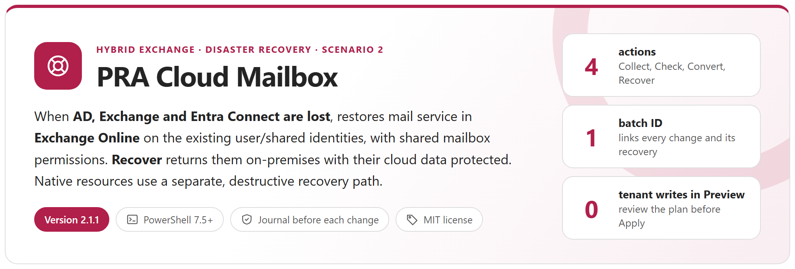
  </picture>
</p>

<p align="center">
  <a href="#quick-start"><b>Quick start</b></a> &nbsp;&middot;&nbsp;
  <a href="#protect-the-snapshot"><b>Protect the snapshot</b></a> &nbsp;&middot;&nbsp;
  <a href="#how-it-works"><b>How it works</b></a> &nbsp;&middot;&nbsp;
  <a href="#the-console"><b>The console</b></a> &nbsp;&middot;&nbsp;
  <a href="#convert-and-recover"><b>Convert and Recover</b></a> &nbsp;&middot;&nbsp;
  <a href="#reports"><b>Reports</b></a> &nbsp;&middot;&nbsp;
  <a href="package/docs/PraCloudMailbox-UserGuide.md"><b>User guide</b></a> &nbsp;&middot;&nbsp;
  <a href="package/docs/PraCloudMailbox-Guide.md"><b>Administrator guide</b></a>
</p>

> [!IMPORTANT]
> Files downloaded from the Internet may be blocked by Windows and fail to run. Before using this project, unblock every file in the downloaded folder:
>
> ```powershell
> Get-ChildItem "C:\Chemin\Du\Dossier" -Recurse -File -Force | Unblock-File
> ```
>
> Replace the example path with the folder where you downloaded or extracted this project.
>
> The `Install-Module` commands in this documentation use `-Force`, so they also update or reinstall a module that is already installed. If an older version still conflicts, close every PowerShell window, open a new one (as administrator for `-Scope AllUsers`), run `Uninstall-Module <ModuleName> -AllVersions -Force`, then run the `Install-Module` command again.

## Why

In a hybrid organisation, a mailbox hosted on-premises is only a *mail user* for Exchange Online. When **Active Directory, Exchange and Entra Connect** are lost at the same time — ransomware, loss of the site — the users can still sign in to Microsoft 365 and Teams still works, but nobody has a mailbox any more, and nothing can be written in AD to fix it. *PRA* stands for *Plan de Reprise d'Activité*, the disaster recovery plan; this is its **scenario 2** (scenario 1, Exchange servers lost with AD alive, is [PRA Remote Mailbox](https://github.com/Nico77600/PraRemoteMailbox)). The two tools can be installed on the same computer and loaded in the same PowerShell session.

Done by hand, giving each user a cloud mailbox means changing the source of authority of every identity, licensing it in the right order, recreating the shared mailboxes with their permissions — which can no longer be read on-premises — and, months later, undoing all of it **without deleting the mails received in the cloud**. This tool collects what it needs before the disaster, then does the conversion and the rollback in the order proven against a real tenant, verified at each step and journaled.

**Author:** Nicolas Fabert · **Version:** 2.0.0 ([changelog](CHANGELOG.md)).

<picture>
  <source media="(prefers-color-scheme: dark)" srcset="package/docs/images/readme-principles-dark.png">
  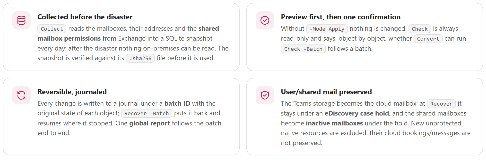
</picture>

## How it works

<picture>
  <source media="(prefers-color-scheme: dark)" srcset="package/docs/images/readme-how-it-works-dark.png">
  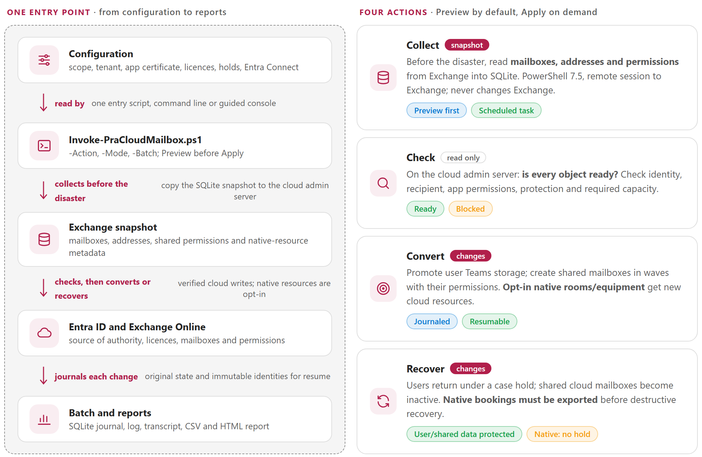
</picture>

- **Collected before.** `Collect` runs every day (PowerShell 7.5, from any domain-joined server that reaches an Exchange server) and stores the mailboxes, their GUIDs and X500 addresses, the **permissions of the shared mailboxes** (FullAccess with AutoMapping, SendAs, SendOnBehalf, groups expanded) and the **groups you name** with all their members, in one SQLite file, with a `.sha256` file that later runs verify.
- **Same identity, Teams storage promoted.** `Convert` (PowerShell 7.5, certificate of an app registration or an administrator who signs in) moves the source of authority of each identity to the cloud and gives it an Exchange plan: the **Teams storage of the user becomes their mailbox**, with their chats. Shared mailboxes are converted in waves, one temporary licence unit each (`Licensing.Shared.Parallel`, 100 by default, never using the `Licensing.Shared.KeepFree` units), given back after each wave.
- **Which objects, at run time.** Everything, or one mailbox (`-Identity`), a list (`-CsvPath`), an OU (`-SearchBase`) or a group (`-Group`, read from the snapshot first, then from Microsoft Entra ID), narrowed by `-Scope` and `-MaxObjects`. A member that is not a mailbox is skipped, and the run says why.
- **Preview by default, one batch ID.** Without `-Mode Apply` nothing is changed. Apply asks one confirmation, journals the original state of every object, and prints the batch ID with the exact next command, also after a failure.
- **Follow the batch.** `Check -Batch <ID> -Expect Provisioned|Deprovisioned|Retained [-Once]` reads the objects of a batch and tells whether they are in the state they should be in. One **global report** follows the batch from end to end.
- **Back without losing a mail.** `Recover -Batch <ID>` gives the identities back to AD in waves (one scheduler pause and one synchronisation per wave, not per object); the users' cloud data stays under an **eDiscovery case hold** (several policies in the same case once 1,000 mailboxes is reached), the cloud shared mailboxes become **inactive mailboxes**, and every licence is put back exactly as it was.

## The console

Open it with `pwsh -STA -File .\Invoke-PraCloudMailbox.ps1 -Gui` (PowerShell 7.5 or later, Fluent theme, light or dark). Five pages guide the operator, who always **sees a preview before a change** and confirms by typing the action word:

<table>
  <tr>
    <td width="50%" valign="top"><a href="package/docs/images/console-setup-light.png"><picture><source media="(prefers-color-scheme: dark)" srcset="package/docs/images/console-setup-dark.png">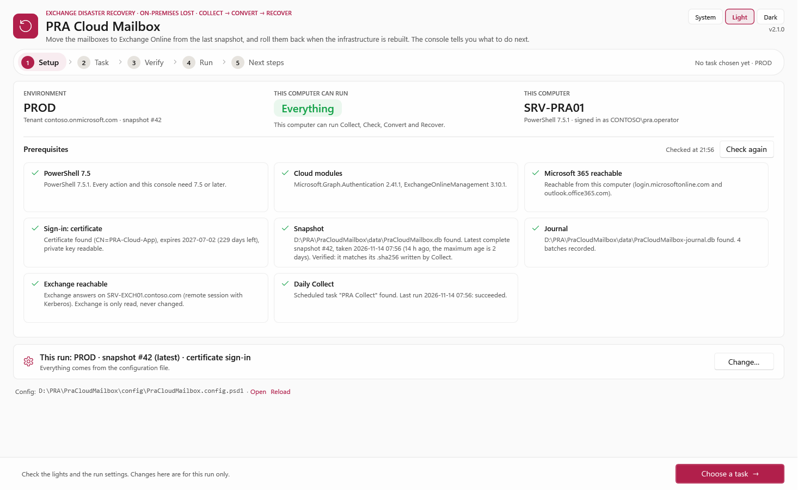</picture></a><br><sub><b>Setup</b> &middot; the lights: modules, Microsoft 365, sign-in, snapshot verified, journal</sub></td>
    <td width="50%" valign="top"><a href="package/docs/images/console-task-convert-group-light.png"><picture><source media="(prefers-color-scheme: dark)" srcset="package/docs/images/console-task-convert-group-dark.png">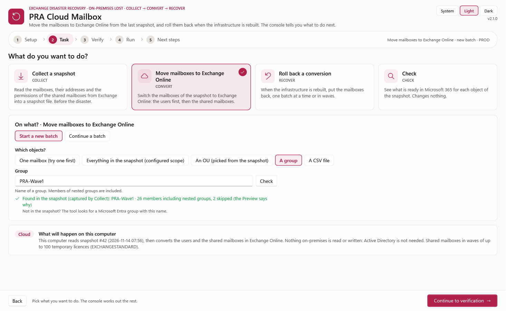</picture></a><br><sub><b>Task</b> &middot; four actions, then which objects: one mailbox, everything, an OU, a group, a CSV file</sub></td>
  </tr>
  <tr>
    <td width="50%" valign="top"><a href="package/docs/images/console-verify-preview-light.png"><picture><source media="(prefers-color-scheme: dark)" srcset="package/docs/images/console-verify-preview-dark.png">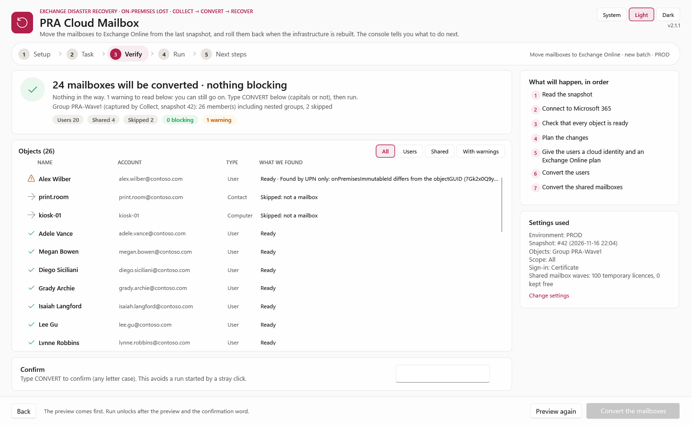</picture></a><br><sub><b>Verify</b> &middot; the mandatory preview, then the typed confirmation</sub></td>
    <td width="50%" valign="top"><a href="package/docs/images/console-next-light.png"><picture><source media="(prefers-color-scheme: dark)" srcset="package/docs/images/console-next-dark.png">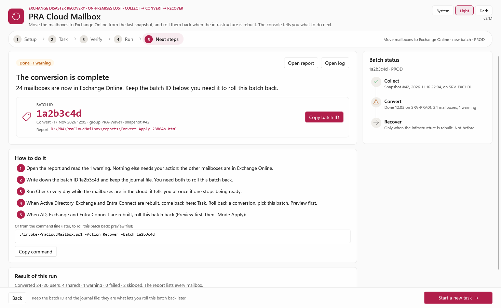</picture></a><br><sub><b>Next steps</b> &middot; the batch ID, the reports, the exact command</sub></td>
  </tr>
</table>

The settings changed in the console apply **to that run only**; the configuration file is never written. An interactive sign-in is available besides the certificate. The [user guide](package/docs/PraCloudMailbox-UserGuide.md#8-picture-dictionary) shows every page.

## Convert and Recover

<picture>
  <source media="(prefers-color-scheme: dark)" srcset="package/docs/images/readme-flows-dark.png">
  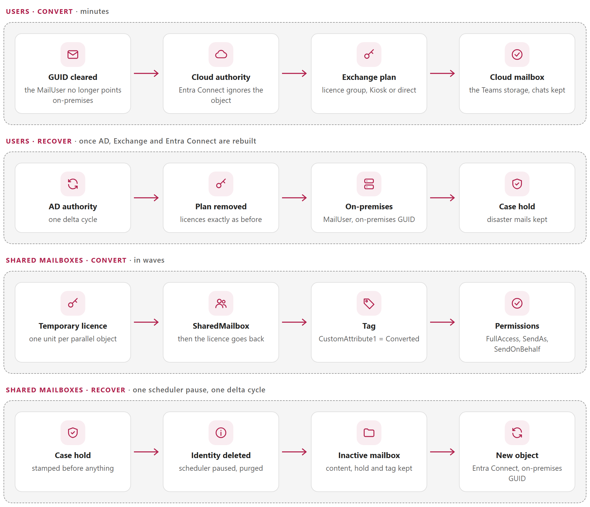
</picture>

| Object | Convert | Recover |
|---|---|---|
| User | Cloud authority, Exchange plan, Teams storage promoted on the same identity | AD authority and original licences restored; cloud data under a case hold |
| Shared mailbox | Temporary licence per parallel object, SharedMailbox type, collected permissions | Held cloud mailbox becomes inactive; Entra Connect recreates the on-premises identity |
| Native room/equipment (opt-in) | New cloud-only resource, required RoomLists, booking settings; no contents or general ACLs imported | Owned resource deleted without hold; routing contact to the restored on-premises mailbox |

The states of user/shared mailboxes through the cycle:

<picture>
  <source media="(prefers-color-scheme: dark)" srcset="package/docs/images/readme-states-dark.png">
  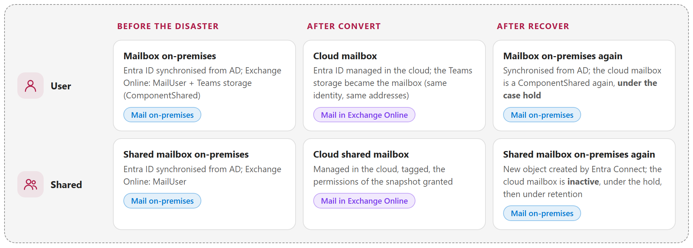
</picture>

> [!CAUTION]
> The on-premises mailbox contents are **not migrated**. User/shared cloud data is protected during Recover. New native resources follow a separate **destructive** lifecycle: no hold, no inactive copy, and cloud-created bookings/messages are **not preserved or merged**. Export/reconcile them before Recover.

### Native rooms and equipment

<picture>
  <source media="(prefers-color-scheme: dark)" srcset="package/docs/images/readme-resources-dark.png">
  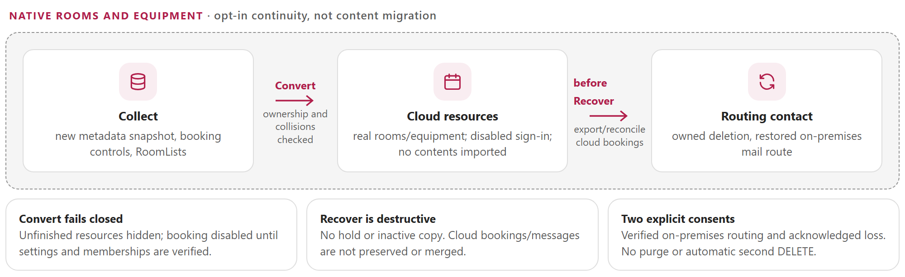
</picture>

New in 2.0.0, and off by default. For rooms/equipment excluded from Entra synchronisation, enable `Scope.ResourceMode = 'CloudResource'` and `Scope.ConvertRooms = $true`, then run a **new Collect**. Convert creates actual RoomMailbox/EquipmentMailbox resources with disabled sign-in and verified booking/delivery controls. Standard resources up to 50 GB require no mailbox licence; unfinished resources remain hidden with booking disabled.

Recover requires **both** verified on-premises routing (`Resources.OnPremisesReady`) and explicit loss acknowledgement (`Resources.AllowUnprotectedDeletion`); both ship as `$false`. Ownership, collisions, unexpected licences or holds block the operation. No purge, proxy removal or automatic second deletion; old protected journals keep their original contract, and RoomLists are retained.

Cloud actions require a **fresh, unconnected PowerShell process** so SDK retries cannot silently repeat an unprotected deletion. Setup, recovery and transport details: [administrator guide §6.2](package/docs/PraCloudMailbox-Guide.md#62-unsynchronised-native-resource-lifecycle). Test the whole cycle in your tenant before production.

## Shared mailbox permissions

<picture>
  <source media="(prefers-color-scheme: dark)" srcset="package/docs/images/readme-permissions-dark.png">
  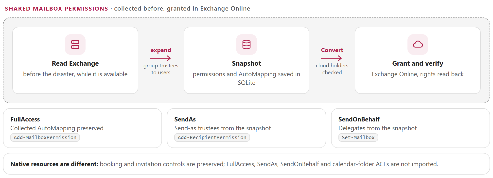
</picture>

Unlike scenario 1, Active Directory is also unavailable during the disaster: permissions must be **collected beforehand** from Exchange. The snapshot keeps FullAccess with AutoMapping, SendAs and SendOnBehalf, with group trustees expanded to users. Convert grants and reads back the collected permissions in Exchange Online; see the [administrator guide, chapter 9](package/docs/PraCloudMailbox-Guide.md#9-convert). General mailbox and calendar-folder ACLs are **not imported for native resources**.

## Reports

<table>
  <tr>
    <td width="50%" valign="top"><a href="package/docs/images/cli-convert-light.png"><picture><source media="(prefers-color-scheme: dark)" srcset="package/docs/images/cli-convert-dark.png">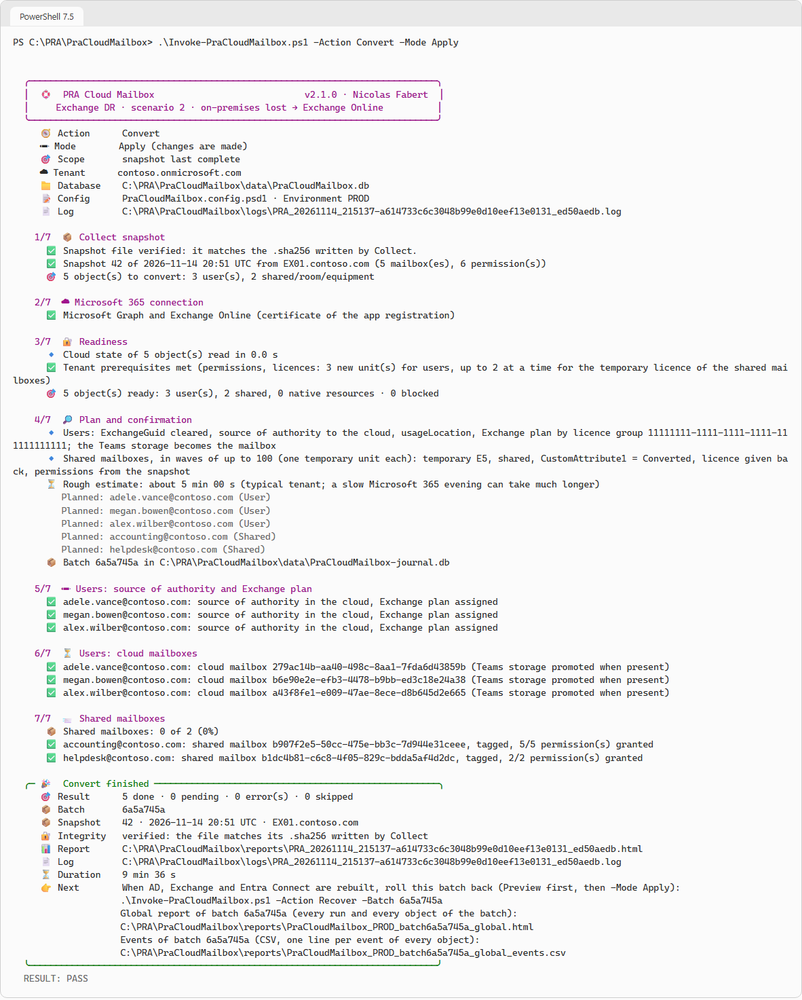</picture></a><br><sub><b>Convert</b> &middot; readiness, plan, users then shared mailboxes; the summary card has the batch ID and the next command</sub></td>
    <td width="50%" valign="top"><a href="package/docs/images/cli-follow-light.png"><picture><source media="(prefers-color-scheme: dark)" srcset="package/docs/images/cli-follow-dark.png">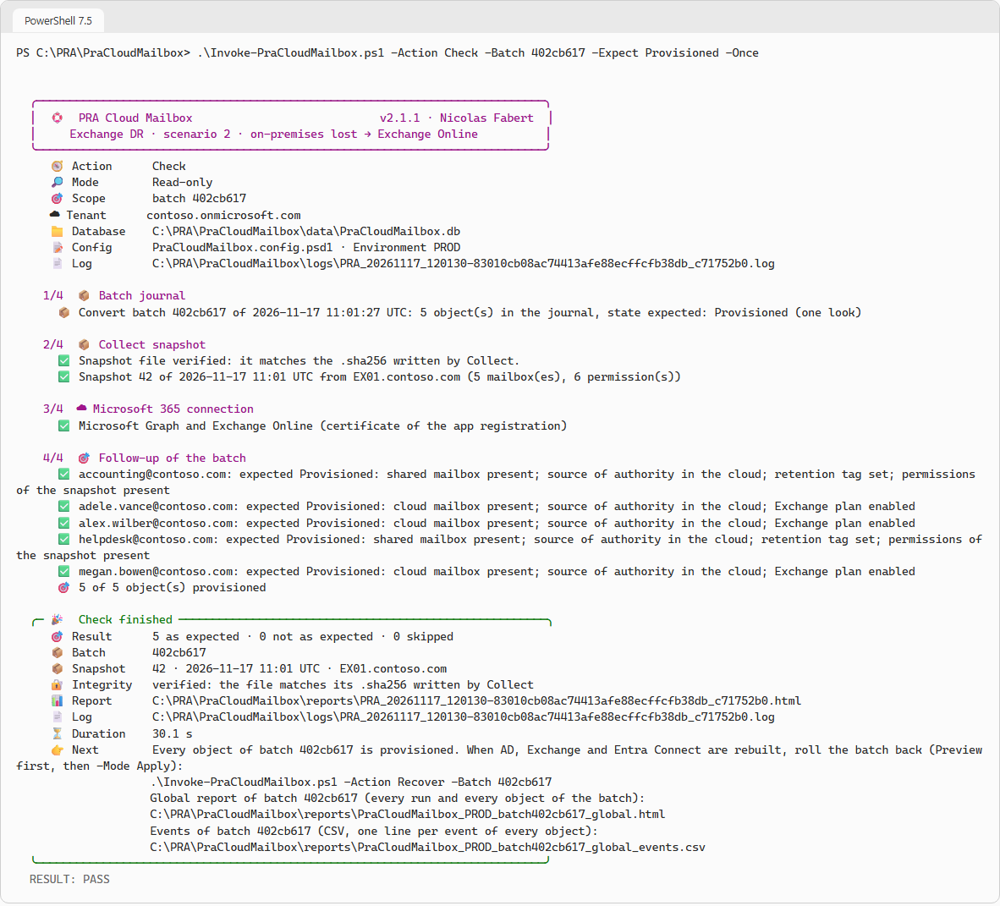</picture></a><br><sub><b>Follow a batch</b> &middot; read-only: is every object in the state the batch should give?</sub></td>
  </tr>
  <tr>
    <td width="50%" valign="top"><a href="package/docs/images/cli-recover-light.png"><picture><source media="(prefers-color-scheme: dark)" srcset="package/docs/images/cli-recover-dark.png">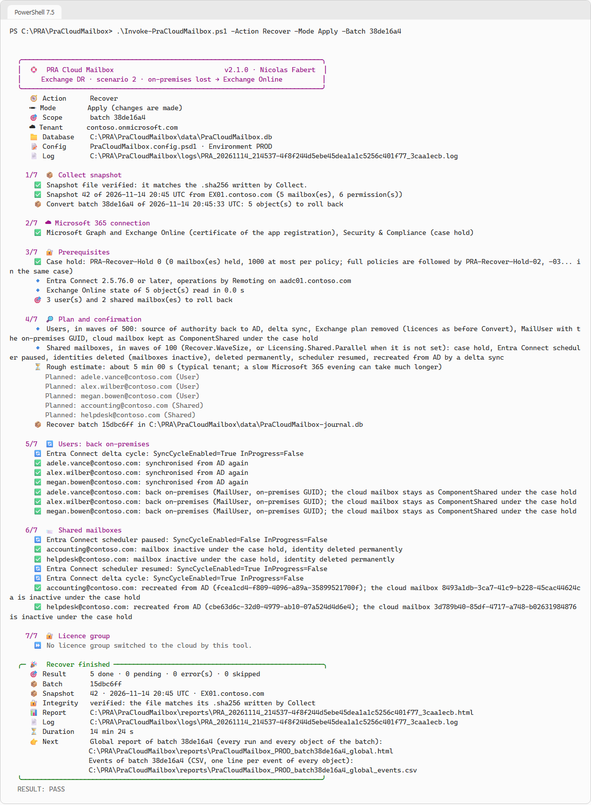</picture></a><br><sub><b>Recover</b> &middot; users back on-premises under the case hold, shared mailboxes inactive and recreated by Entra Connect</sub></td>
    <td width="50%" valign="top"><a href="package/docs/images/report-global-light.png"><picture><source media="(prefers-color-scheme: dark)" srcset="package/docs/images/report-global-dark.png">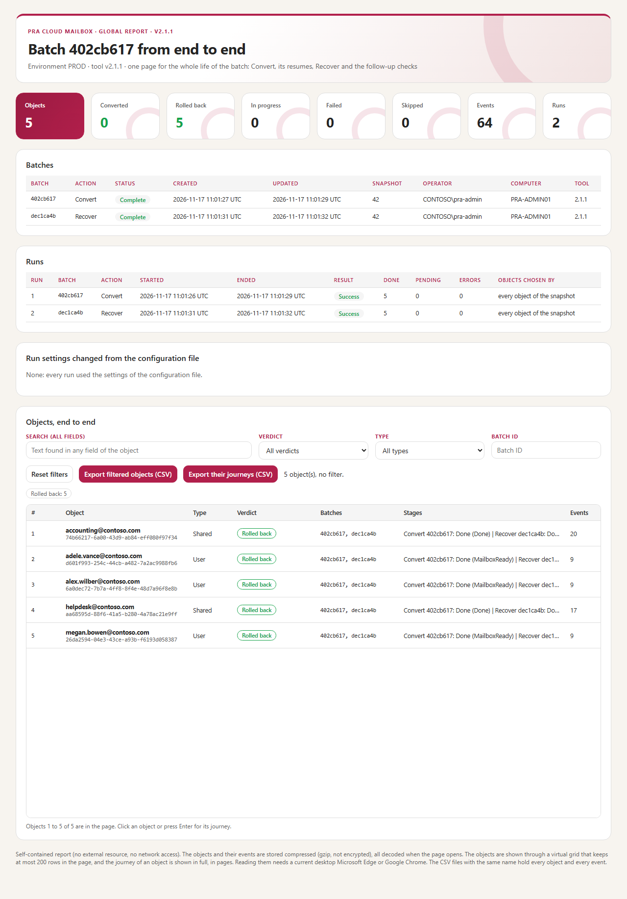</picture></a><br><sub><b>Global report</b> &middot; one page for the whole batch: every run, every object end to end</sub></td>
  </tr>
</table>

Every run also writes a log, a PowerShell transcript, a CSV and an HTML report; Convert and Recover write the journal of the batch. Exit codes: 0 = done, 1 = failed (or an object is not ready), 2 = done, next step required.

## Requirements

| Item | Requirement |
|---|---|
| Scenario | Hybrid Exchange organisation synchronised by **Entra Connect**. After the disaster: AD restored from a backup (same objectGUID), Exchange, and Entra Connect **2.5.76.0** or later |
| Collect | A domain-joined computer with **PowerShell 7.5+** that reaches an Exchange server (`Exchange.Server`, remote Exchange PowerShell with Kerberos), an account that reads recipients and permissions. Nothing to install (SQLite is bundled) |
| Cloud actions | A cloud admin server that does not depend on the on-premises AD, **PowerShell 7.5+**, `Microsoft.Graph.Authentication` 2.41.1+ and `ExchangeOnlineManagement` 3.10.1+ |
| Sign-in | An app registration with a certificate (Graph application permissions; `Exchange.ManageAsApp` with Exchange Administrator; eDiscovery Manager in Microsoft Purview), **or** an administrator who signs in interactively. The minimum permissions are in the [administrator guide, chapter 4.5](package/docs/PraCloudMailbox-Guide.md#45-minimum-permissions) |
| Licences and holds | A licence group with an Exchange Online plan (or the Kiosk plan of the Teams licence, or direct licences), free units for the shared mailboxes (one per mailbox of a wave), an eDiscovery case hold policy, a retention policy for the inactive shared mailboxes |
| Console | Windows 10/11 or Windows Server 2016+, PowerShell 7.5+ (Fluent theme). Windows Terminal for emoji and colours in the command line |

## Quick start

Do these steps in order. Each one is explained, with pictures, in the [user guide](package/docs/PraCloudMailbox-UserGuide.md).

1. **Download the release, not the source.** On the [releases page](https://github.com/Nico77600/PraCloudMailbox/releases) take `PraCloudMailbox-2.0.0.zip` and its `.sha256` file from the **Assets** list. The "Source code" archives are not the tool.
2. **Verify the download.** Compare the hash of the zip with the one in the `.sha256` file, then check the signature of the verifier:

   ```powershell
   (Get-FileHash .\PraCloudMailbox-2.0.0.zip -Algorithm SHA256).Hash
   Get-Content .\PraCloudMailbox-2.0.0.zip.sha256
   Get-AuthenticodeSignature .\module\Test-PackageIntegrity.ps1 | Format-List Status, SignerCertificate    # in the extracted folder: Status must be Valid
   ```

3. **Prepare PowerShell 7.5.** Extract the zip to `C:\PRA\PraCloudMailbox`, unblock the files (the box at the top of this page), then install the two modules in an administrator PowerShell 7:

   ```powershell
   Install-Module Microsoft.Graph.Authentication -MinimumVersion 2.41.1 -Scope AllUsers -Force
   Install-Module ExchangeOnlineManagement -MinimumVersion 3.10.1 -Scope AllUsers -Force
   ```

4. **Fill in the configuration.** `notepad .\config\PraCloudMailbox.config.psd1`: `Exchange.Server`, the tenant, the app registration (or an interactive sign-in), the licences, the case hold policy, Entra Connect. Copy the same file to every computer.
5. **Schedule the daily Collect, with `pwsh.exe`.** It writes the snapshot from Exchange, every day, before the disaster. In an administrator PowerShell 7 on the Collect computer, one command checks the account (a domain user that Exchange accepts) and registers the task. Add `-Credential` or `-At 03:30` if you want:

   ```powershell
   .\Invoke-PraCloudMailbox.ps1 -Action Schedule                  # Preview: checks, registers nothing
   .\Invoke-PraCloudMailbox.ps1 -Action Schedule -Mode Apply      # asks for the account and its password, then registers the task
   ```

   If a group policy creates your tasks, create the task yourself with `Register-ScheduledTask` (see [Scheduling](package/docs/PraCloudMailbox-Guide.md#scheduling) in the administrator guide).
6. **Protect the snapshot** (next section), then copy it, with its `.sha256` file, to the cloud admin server.
7. **First Check.** On the cloud admin server: `pwsh -File .\Invoke-PraCloudMailbox.ps1 -Action Check`. It reads Microsoft 365 and changes nothing. Fix every red line until every object is ready.
8. **Open the console** to see the lights and to rehearse with one mailbox: `pwsh -STA -File .\Invoke-PraCloudMailbox.ps1 -Gui`.

## Protect the snapshot

> [!CAUTION]
> **After the disaster, the snapshot is the only copy of your directory data.** Active Directory, Exchange and Entra Connect are lost. If the snapshot is lost or changed, the tool has nothing to work from.
>
> - **Back it up every day and externalise the backup**: off-site, out of reach of the domain that can be compromised (offline, immutable, or separate credentials), in several generations.
> - **Protect access to the file and to its backups.** They hold names, addresses, GUIDs and permissions: a restricted access list, no share open to *Domain Users*.
> - **Copy the `.sha256` file with the snapshot.** Check, Convert and Recover verify the file against it. If it says the file **changed**, restore it from the external backup. `-AcceptUnverifiedSnapshot` is only for when you know why. A missing `.sha256` file only gives a warning.
> - **Back up the journal too, during the operations.** `data\PraCloudMailbox-journal.db` is written by Convert and Recover themselves, so the hash does not cover it. It is the only input of the rollback.

## Upgrading from 1.x

- Recreate the scheduled task of Collect with `pwsh.exe` (not `powershell.exe`): the tool runs in PowerShell 7.5 or later only.
- Set `Exchange.Server` in the configuration and remove `Exchange.ConnectionMode`.
- Your snapshot and journal files are read as before. A snapshot written before 2.0.0 has no `.sha256` file, so the first runs only warn: run a Collect to get one.
- The runtime now lives in the `package` folder of the repository (the release zip holds its content).

## Documentation

| Guide | Content |
|---|---|
| **[User guide](package/docs/PraCloudMailbox-UserGuide.md)** | For the people who run the tool, in plain English: the two scenarios, before you start, the one-time setup, **protect the snapshot**, **move** (one mailbox first, then a group, an OU, a list, everything, in waves), **go back** (a whole batch or a wave, resume), **check and read the report**, what to do when something goes wrong, a picture dictionary of every console page, a glossary. Every task is shown in the console and on the command line. |
| **[Administrator guide](package/docs/PraCloudMailbox-Guide.md)** | Everything else: the scenario and the states of a mailbox, the app registration, the **minimum permissions** of each action, the case hold and the retention policy, the configuration in detail, the package integrity, each action step by step, the Check codes, the reports, the architecture, the databases, the tests and troubleshooting. |

Both guides also exist as a single HTML file with a light and a dark theme (`package/docs/PraCloudMailbox-UserGuide.html`, `package/docs/PraCloudMailbox-Guide.html`): download them and open them locally, or use the copies in the release zip. `tools\Build-Documentation.ps1`, `tools\New-DocumentationImages.ps1` and `tools\New-ReadmeImages.ps1` rebuild the guides and the pictures.

## Security

The package is authenticated: every PowerShell file and the manifest carry the owner's timestamped Authenticode signature, and every stable file must match the signed SHA256 inventory. The tool refuses to start from a package that fails this check; there is no bypass. Editable configuration is outside the check. Release attestations, when present, prove ZIP provenance, not the safety of an operation. Report sensitive findings **privately** as described in [SECURITY.md](SECURITY.md); contribution and publication rules are in [AGENTS.md](AGENTS.md).

## Tests

```powershell
# Pester 5+ and PSScriptAnalyzer; no Exchange, no tenant needed
pwsh -NoProfile -File .\tests\Invoke-TestGate.ps1               # PowerShell 7.5: everything, Collect, Convert and Recover end to end
```

The end-to-end tests run the real Convert and Recover code against an in-memory tenant that reproduces the behaviour of Exchange Online and Entra ID that the tool relies on (Teams storage promoted, a hold that blocks the switch back, inactive mailbox when a held identity is deleted, deleted object restored by Entra Connect unless purged...), with faults to inject: order of the steps, resume, refusals, waves, stops and resumes, partial failures and the rollback of every state; the console is tested with a synthetic engine and with a real run in a child PowerShell, and the documentation tests keep the guides honest against the code. The tool was also validated on Exchange Server SE servers with Entra Connect and a Microsoft 365 E5 tenant: licence groups (cloud and synchronised), Kiosk and direct licences, shared mailboxes, waves, Entra Connect remoting (administrator guide, appendix B).

## License

[MIT](LICENSE). Third-party components: [THIRD-PARTY-NOTICES.md](package/THIRD-PARTY-NOTICES.md) (System.Data.SQLite, public domain).

## Disclaimer

This Script is a Personal project.
It's provided "AS-IS". It's not an official Microsoft product so no support can be expected from Microsoft.

As any scripts you must read carefully the documentation and test it first in a Test environment before any run in Production.

The tool changes production objects in Entra ID and Exchange Online: run the preview, review the plan, keep the journal and test the whole cycle in a lab before using it in a real disaster.
