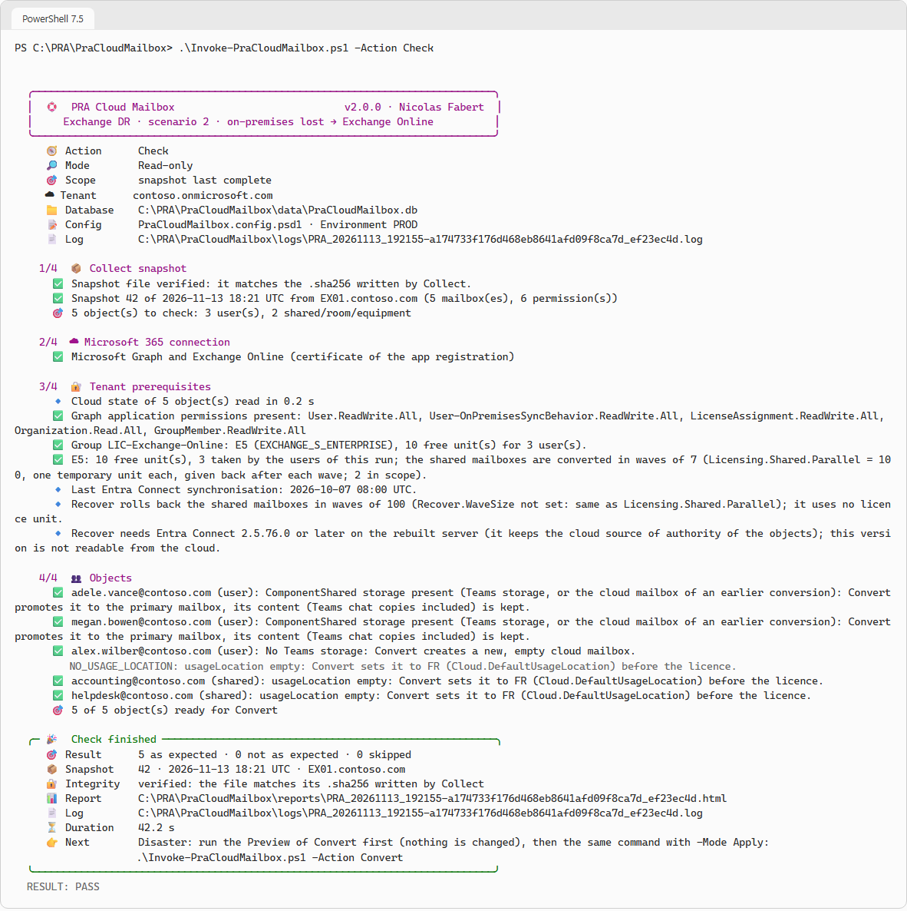
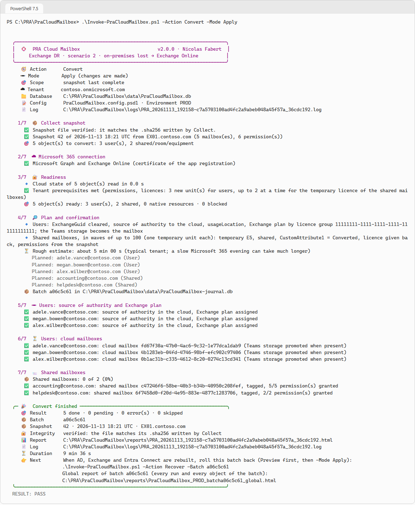
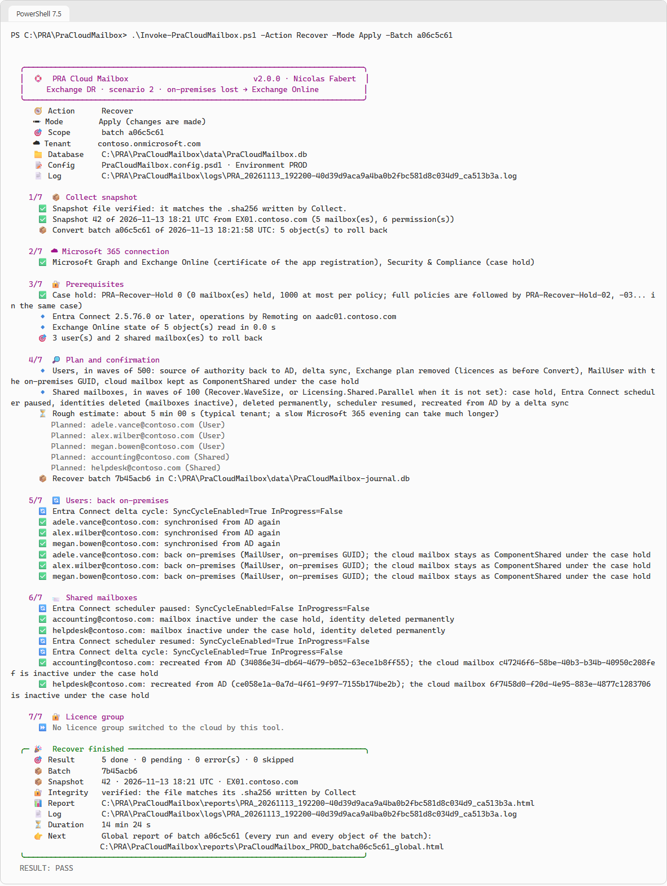
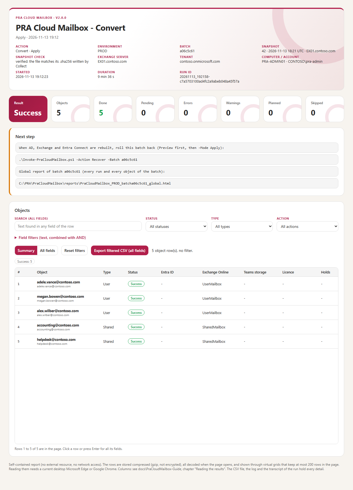
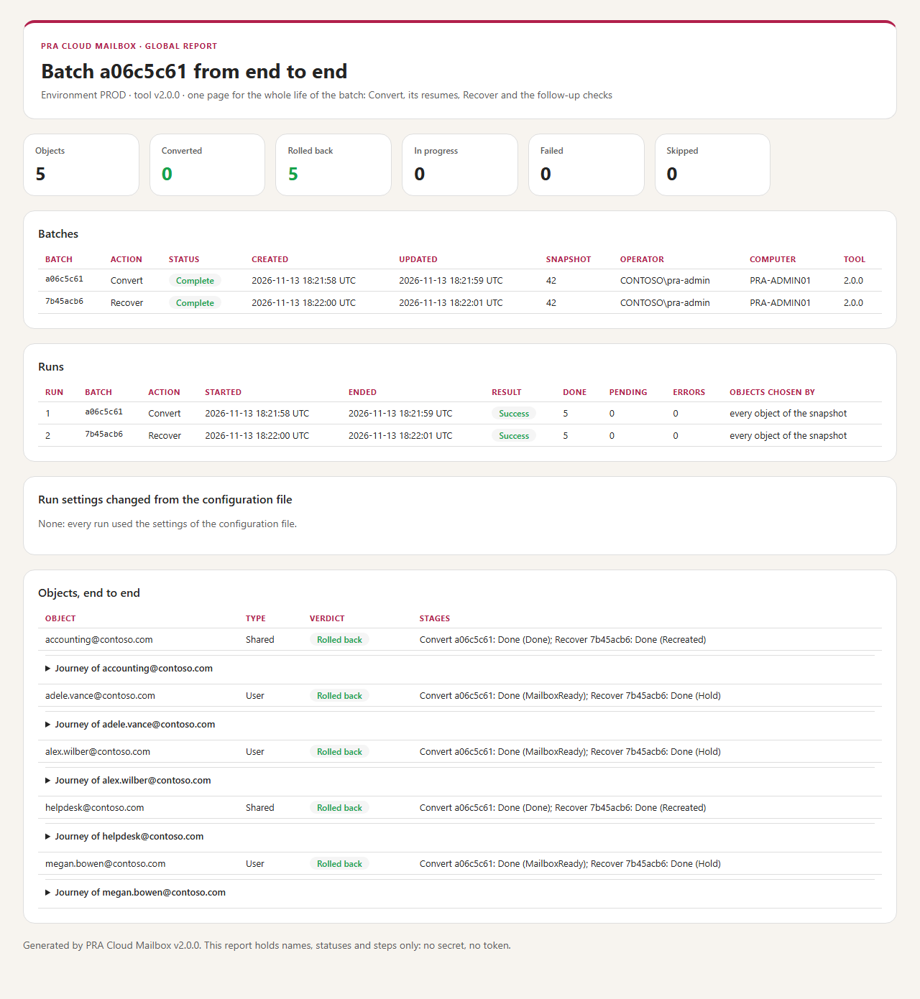

---
title: PRA Cloud Mailbox
subtitle: Administrator guide
version: 2.0.0
author: Nicolas Fabert
updated: 2026-11-12
---

# PRA Cloud Mailbox — Administrator guide

> Exchange disaster recovery, **scenario 2**: Active Directory, Exchange and Entra Connect are lost at the same time. Users and shared mailboxes get a mailbox in **Exchange Online on their existing identities** — the Teams storage of each user becomes his mailbox, so Teams keeps working and nothing is lost — and **everything is rolled back** when the on-premises infrastructure is rebuilt, without losing the mails received in the cloud.

> [!IMPORTANT]
> Files downloaded from the Internet may be blocked by Windows and fail to run. Before using this project, unblock every file in the downloaded folder:
>
> ```powershell
> Get-ChildItem "C:\Chemin\Du\Dossier" -Recurse -File -Force | Unblock-File
> ```
>
> Replace the example path with the folder where you downloaded or extracted this project.

> [!NOTE]
> This is the **administrator guide**: the scenario, the procedure and the states of a mailbox, the prerequisites and the **minimum permissions** derived from the code, the configuration, every action step by step, the reports, the package integrity, the architecture, the databases, the tests and how to evolve the tool. For the everyday path of the operator, with a picture for every step, read the [user guide](PraCloudMailbox-UserGuide.md). It is the file `PraCloudMailbox-UserGuide.html` in the same `docs` folder.

> [!CAUTION]
> **Protect the snapshot.** After the disaster the snapshot file is the **only copy** of the directory data: the mailboxes, their GUIDs and addresses, the permissions of the shared mailboxes. Back it up, **externalise** the backup (off-site, out of reach of the domain that can be compromised: offline, immutable or with separate credentials, several generations), restrict its access list, copy its `.sha256` file with it, and back up the journal during the operations. The rules are in [chapter 7](#7-collect) and in [appendix C](#appendix-c---security-and-data).

```cards
database | Collected before the disaster | `Collect` reads the mailboxes, their addresses and the **shared mailbox permissions** from Exchange into a SQLite snapshot, every day: after the disaster nothing on-premises can be read. The snapshot is verified against its `.sha256` file before it is used.
check | Preview first, then one confirmation | Without `-Mode Apply` nothing is changed. `Check` is always read-only and says, object by object, whether `Convert` can run. `Check -Batch` follows a batch.
refresh | Reversible, journaled | Every change is written to a journal under a **batch ID** with the original state of each object; `Recover -Batch` puts it back and resumes where it stopped. One **global report** follows the batch end to end.
shield | User/shared mail preserved | The Teams storage becomes the cloud mailbox; at `Recover` it stays under an **eDiscovery case hold**, and the shared mailboxes become **inactive mailboxes** under the hold. New unprotected native resources are excluded: their cloud bookings/messages are not preserved.
```

## Quick start

```steps
Verify | Download the release zip and its `.sha256` file, compare the hash, check the signature of `module\Test-PackageIntegrity.ps1` (chapter 5).
Install | Copy the folder on the cloud admin server (and on any other server that runs Collect), unblock the files, install the two PowerShell modules (chapter 5).
Configure | Fill in `config\PraCloudMailbox.config.psd1`: Exchange server, scope, tenant, app registration, licences, case hold policy, Entra Connect (chapter 6).
Collect every day | `-Action Schedule -Mode Apply` registers a daily task that runs `pwsh.exe -NoProfile -NonInteractive -File "<full path>\Invoke-PraCloudMailbox.ps1" -Action Collect -Mode Apply -Force`; the snapshot is backed up off-site and copied to the cloud admin server (chapter 7).
Check | `pwsh -File .\Invoke-PraCloudMailbox.ps1 -Action Check` on the cloud admin server: every object must be ready (chapter 8).
Disaster | `-Action Convert`, then `-Mode Apply`: note the batch ID (chapter 9).
Infrastructure rebuilt | `-Action Recover -Batch <ID>`, then `-Mode Apply` (chapter 10).
Or the console | `pwsh -STA -File .\Invoke-PraCloudMailbox.ps1 -Gui`: the same actions, a preview before every change and a typed confirmation (chapter 13.1).
```

> [!CAUTION]
> Convert and Recover change production objects in Entra ID and Exchange Online. Run the preview, read the plan, test the whole cycle with your own tenant settings, and keep the journal (`data\PraCloudMailbox-journal.db`) with the logs: it is the record of what was changed.

# Part I · Understand

<!-- icon: target -->
## 1. Purpose

In a hybrid organisation, a mailbox hosted on-premises is only a *mail user* for Exchange Online. **Scenario 1** — the Exchange servers are lost but Active Directory and Entra Connect work — is covered by [PRA Remote Mailbox](https://github.com/Nico77600/PraRemoteMailbox): it rewrites the Exchange attributes in AD and lets Entra Connect provision new cloud mailboxes.

**Scenario 2** is worse: Active Directory, Exchange **and** Entra Connect are lost (ransomware, loss of the site). The users can still sign in to Microsoft 365 — their Entra ID objects and password hashes are in the cloud — and Teams keeps working, but their mailboxes are unreachable and nothing can be written in AD any more. *PRA* stands for *Plan de Reprise d'Activité*, the disaster recovery plan.

PRA Cloud Mailbox gives every user and shared mailbox in scope a mailbox in Exchange Online **on the same identity** (same objectId, same SMTP and X500 addresses), entirely from the cloud, and rolls everything back once AD, Exchange and Entra Connect are rebuilt. No data is migrated: the cloud mailboxes start with what the cloud already holds — for a user, his Teams storage.

Why a snapshot: after the disaster nothing on-premises can be read. The list of the objects, their GUIDs, their X500 addresses and the permissions of the shared mailboxes (FullAccess with AutoMapping, SendAs, SendOnBehalf) must therefore be collected **before**, regularly, and stored in a file that is copied to the cloud admin server.

<!-- icon: flow -->
## 2. How it works

```flow
database | Collect | Exchange server, every day: SQLite snapshot
arrow | copy |
check | Check | cloud admin server: is every object ready?
arrow | disaster |
cloud | Convert | users and shared mailboxes to Exchange Online
arrow | rebuilt |
refresh | Recover | back to AD and the on-premises mailboxes
```

| Action | When | Where | Edition | Writes |
|---|---|---|---|---|
| `Collect` | before the disaster, every day | any domain-joined server that reaches `Exchange.Server` with Kerberos | PowerShell 7.5 | the SQLite snapshot and its `.sha256` file only (never Exchange), `Schedule.TaskName` (the name of the daily task of `-Action Schedule`, default `PraCloudMailbox Collect`) and `Schedule.At` (its time on 24 hours, default `02:00`) |
| `Check` | any time, and before Convert | cloud admin server | PowerShell 7.5+ | nothing |
| `Convert` | disaster | cloud admin server | PowerShell 7.5+ | Entra ID (source of authority, usageLocation, licences), Exchange Online (shared mailboxes, permissions, tag), the journal |
| `Recover` | infrastructure rebuilt | cloud admin server | PowerShell 7.5+ | Entra ID (source of authority back to AD, licences, shared identities deleted), case hold, Entra Connect cycles, the journal |

- **One script, one configuration file**, the same on both sides. The objects of a run are the configured scope, or one source chosen at run time (`-Identity`, `-CsvPath`, `-SearchBase` or `-Group`, chapter 9.1), narrowed by `-Scope UsersOnly | SharedOnly` and `-MaxObjects`.
- **Preview by default.** Without `-Mode Apply` nothing is changed. With `-Mode Apply`, Convert and Recover show the plan and ask **one** confirmation (`-Force` for unattended runs).
- **One batch ID** links Convert and Recover: Convert prints it with the exact next command; `-Action Recover -Batch <ID>` rolls that batch back. Running the same command again resumes what is not finished.
- **Every run** prints a banner, numbered steps and a summary card, and writes a log, a transcript and a CSV + HTML report. Exit codes: `0` done, `1` failed (or an object is not ready), `2` done, next step required.

<!-- icon: checklist -->
## 3. The validated procedure

Validated step by step against a test environment (appendix B). Convert and Recover implement exactly this order; every step checks the current state first, so a step already done is not repeated.

### 3.1 Users

| Step | Action | Result |
|---|---|---|
| Convert 1 | `Set-MailUser -ExchangeGuid` empty | The MailUser no longer points to the on-premises mailbox |
| Convert 2 | Source of authority to the cloud (`onPremisesSyncBehavior.isCloudManaged = true`) | Entra Connect ignores the object (20 to 30 s) |
| Convert 3 | usageLocation set from the cloud when needed | The value synchronised from AD can be refused for a licence right after the transfer |
| Convert 4 | Exchange plan: licence group (cloud, or synchronised group switched to the cloud), Kiosk plan of the Teams licence, or direct licence | The **Teams storage (ComponentShared) becomes the primary mailbox** in 45 s to 2 min. Same objectId, SMTP and X500 addresses; the Teams chats and their compliance copies are kept |
| Recover 1 | Case hold lifted if present, source of authority back to AD, one delta cycle | Still a cloud mailbox (the plan is still there): no address gap |
| Recover 2 | Exchange plan removed (licences put back exactly as before Convert) | MailUser with the on-premises ExchangeGuid in 2 to 70 s; the cloud mailbox goes back to ComponentShared **with its content** |
| Recover 3 | eDiscovery case hold on the user, checked in `InPlaceHolds` | The mails received during the disaster stay protected and searchable (about 90 s) |
| End | Licence group back to AD, once no converted user of any batch is left | |

A hold on the cloud mailbox (eDiscovery, Litigation or retention) **blocks Recover 2**: Exchange refuses to give the mailbox back to the on-premises object. The tool lifts its own case hold for the switch and puts it back right after; any other hold stops the user with a message (remove it first). For the same reason a user never carries the retention tag.

### 3.2 Shared mailboxes

| Step | Action | Result |
|---|---|---|
| Convert 1 | `Set-MailUser -ExchangeGuid` empty, source of authority to the cloud | |
| Convert 2 | usageLocation set from the cloud | |
| Convert 3 | Temporary licence (Exchange plan only) | Mailbox in 25 to 70 s |
| Convert 4 | `Set-Mailbox -Type Shared`, **wait until it is a SharedMailbox**, tag (`CustomAttribute1 = Converted`), the licence put back as before, then the permissions of the snapshot | Removing the licence before the conversion is effective disables the mailbox at once. One unit per shared mailbox converted at the same time (`Licensing.Shared.Parallel`), given back after each wave |
| Recover 1 | eDiscovery case hold, checked in `InPlaceHolds` | About 90 s |
| Recover 2 | Entra Connect scheduler paused, Entra ID identity deleted | **The mailbox becomes inactive** in 16 to 48 s, with its content, the hold and the tag |
| Recover 3 | Identity deleted permanently (Entra ID recycle bin) | Otherwise the next synchronisation **restores** the deleted object (same immutableId) |
| Recover 4 | Scheduler resumed (always, even after an error), one delta cycle | Entra Connect creates a **new object** (same immutableId, new objectId): MailUser with the on-premises GUID, mail flows on-premises |
| Later | The retention policy (adaptive scope `IsInactiveMailbox` + tag) picks up the inactive mailbox; the case hold entry can then be removed | Chapter 11 |

### 3.3 States of a mailbox

| | Before the disaster | After Convert | After Recover |
|---|---|---|---|
| **User** — Active Directory | mailbox on-premises | lost | rebuilt (same objectGUID), mailbox on-premises |
| **User** — Entra ID | synchronised from AD | **cloud-managed** | synchronised from AD again |
| **User** — Exchange Online | MailUser (on-premises GUID) + Teams storage (ComponentShared) | **UserMailbox** = the former Teams storage | MailUser (on-premises GUID) + ComponentShared **with the disaster mails, under the case hold** |
| **User** — mail delivered to | on-premises | Exchange Online | on-premises |
| **Shared** — Active Directory | shared mailbox on-premises | lost | rebuilt, shared mailbox on-premises |
| **Shared** — Entra ID | synchronised from AD | **cloud-managed** | **new object** created by Entra Connect (same immutableId) |
| **Shared** — Exchange Online | MailUser (on-premises GUID) | **SharedMailbox**, tagged, permissions granted | new MailUser (on-premises GUID); the cloud mailbox is **inactive** under the case hold, then under retention |
| **Shared** — mail delivered to | on-premises | Exchange Online | on-premises |

The mails received in the cloud during the disaster are **never deleted**: those of the users stay in their ComponentShared storage under the case hold, those of the shared mailboxes in their inactive mailboxes. They are found with eDiscovery (chapter 11). Copying them back into the on-premises mailboxes is not part of the tool.

### 3.4 What the tool never does

- It never writes to Exchange on-premises or to Active Directory (Collect only reads; everything else happens in the cloud).
- It never deletes a user mailbox, and never runs `Set-User -PermanentlyClearPreviousMailboxInfo` (it empties the mails of the cloud mailbox 3 to 6 hours later).
- It never deletes a shared mailbox identity before the case hold is stamped on the mailbox (`InPlaceHolds`): otherwise the mailbox would be soft-deleted, not inactive, and purged after 30 days.
- It never lifts a hold from an object that is already back on-premises.
- It never handles a room or equipment mailbox unless `Scope.ConvertRooms` is set (`KIND_NOT_SUPPORTED` otherwise). The default `SynchronizedShared` path retains the released shared-mailbox behaviour; `CloudResource` is a separate opt-in lifecycle for native resources excluded from synchronisation (chapter 6.2). Neither path automatically merges cloud reservations into the native calendar.

# Part II · Set up

<!-- icon: checklist -->
## 4. Prerequisites

### 4.1 Collect

| Item | Requirement |
|---|---|
| Computer | Any domain-joined Windows server that reaches the Exchange server named in `Exchange.Server` (remote Exchange PowerShell, `http://<server>/PowerShell/`, Kerberos): typically the cloud admin server |
| PowerShell | **PowerShell 7.5** or later, 64-bit (`pwsh.exe`). The Exchange cmdlets come from the remote session, so every object Collect reads is a deserialized copy |
| Account | A domain **user** account, member of the Exchange role group *View-Only Organization Management* (rights in [chapter 4.5](#45-minimum-permissions)). A computer account cannot be used: run as SYSTEM, Collect is refused by Exchange remote PowerShell. The AutoMapping list (`msExchDelegateListLink`) and the members of the target groups are read in AD with the same account |
| Software | Nothing to install: the SQLite engine is in `lib\sqlite` |

### 4.2 Cloud actions (cloud admin server)

| Item | Requirement |
|---|---|
| Computer | Any Windows computer that reaches Microsoft 365 — it must **not depend on the on-premises AD** (it is lost). It is a machine of the company, not a machine hosted in the cloud |
| PowerShell | **PowerShell 7.5** or later (`pwsh.exe`), started **without** `-NonInteractive` when the sign-in is interactive |
| Modules | `Microsoft.Graph.Authentication` 2.41.1 or later and `ExchangeOnlineManagement` 3.10.1 or later (checked before any change, in Preview too; the message gives the `Install-Module` commands, one module per command). If other `Microsoft.Graph.*` modules are loaded, they must all be in one version |
| Sign-in | `Cloud.SignIn = 'Certificate'` (an app registration; the certificate with its private key in `Cert:\CurrentUser\My` or `Cert:\LocalMachine\My`) or `'Interactive'` (an administrator signs in; chapter 4.3) |
| Licences | Group mode: a licence group whose licence includes an Exchange Online plan, and enough free units for the users. Kiosk mode: the Exchange Kiosk plan inside the licence the users already have (e.g. Teams Enterprise). Direct mode: free units of `Licensing.Users.SkuPartNumber`. Shared mailboxes: free units of `Licensing.Shared.SkuPartNumber` (any SKU with an Exchange Online plan): one per shared mailbox of a wave, up to `Licensing.Shared.Parallel` (100 by default), never using the `Licensing.Shared.KeepFree` units; one unit is enough, then they go one after another |
| Holds | An eDiscovery case with a case hold policy (`Retention.HoldPolicy`, chapter 4.4), and a retention policy for the inactive shared mailboxes |
| Entra Connect | Recover only: Entra Connect **2.5.76.0** or later on the rebuilt server (it keeps the cloud source of authority of the objects), reachable as described in chapter 6.1 |
| Snapshot and journal | The snapshot file **and its `.sha256` file** copied from the Collect computer; the journal is created by the first Convert |

> [!IMPORTANT]
> Recover needs the on-premises objects with **their original objectGUID** (AD restored from a backup, not recreated): the immutableId links each Entra ID object to its AD account.

### 4.3 App registration and interactive sign-in

**Certificate sign-in (the default).** Create an app registration for the tool (Entra admin center › *App registrations* › *New registration*, single tenant), upload the public part of its certificate, then:

| Where | What |
|---|---|
| Microsoft Graph, application permissions | `User.ReadWrite.All`, `User-OnPremisesSyncBehavior.ReadWrite.All`, `LicenseAssignment.ReadWrite.All`, `Organization.Read.All`. Group mode: `GroupMember.ReadWrite.All`, and `Group-OnPremisesSyncBehavior.ReadWrite.All` when the licence group is synchronised from AD. To use `-Group` with a Microsoft Entra group, one group-read permission is also needed (`GroupMember.Read.All`, when the app has no `GroupMember.ReadWrite.All`) |
| Office 365 Exchange Online, application permission | `Exchange.ManageAsApp` |
| Admin consent | *Grant admin consent* for all of them |
| Entra ID role | **Exchange Administrator** assigned to the application |
| Microsoft Purview | The service principal in the **eDiscovery Manager** role group (case hold of Recover) |

Check reads the Graph permissions from the token and names the missing ones (`APP_PERMISSION`). The Purview role group is set once by an administrator, in Security & Compliance PowerShell (the *ObjectId* is the one of the **Enterprise application**, not of the app registration):

```powershell
Connect-IPPSSession -UserPrincipalName admin@contoso.com
New-ServicePrincipal -AppId <application-client-id> -ObjectId <enterprise-application-object-id> -DisplayName 'PRA Cloud Mailbox'
Add-RoleGroupMember -Identity eDiscoveryManager -Member <enterprise-application-object-id>
```

**Interactive sign-in.** Set `Cloud.SignIn = 'Interactive'` (any letter case) and `Cloud.TenantId`; `Cloud.UserPrincipalName` is the administrator proposed at the sign-in. The tool then connects to Microsoft Graph with **delegated permissions** (`Connect-MgGraph -Scopes`, the same names as the application permissions above), to Exchange Online and, for the case hold, to Security & Compliance, all with the administrator's account and the Windows account broker (WAM). An administrator of the tenant consents once. The PowerShell process must have a window where someone can answer: it must **not** be started with `-NonInteractive` (the tool says so in plain words), so it cannot run in a scheduled task. `Cloud.AppId` and `Cloud.CertificateThumbprint` are not used.

### 4.4 Case hold and retention

Created once, before the disaster, by a compliance administrator:

```powershell
Connect-IPPSSession -UserPrincipalName admin@contoso.com

# eDiscovery case hold used by Recover (users and shared mailboxes): Retention.HoldPolicy = 'PRA-Recover-Hold'
New-ComplianceCase -Name 'PRA Recover'
New-CaseHoldPolicy -Name 'PRA-Recover-Hold' -Case 'PRA Recover' -Enabled $true
New-CaseHoldRule -Name 'PRA-Recover-Hold-Rule' -Policy 'PRA-Recover-Hold'      # no query: everything is held

# Retention of the inactive shared mailboxes (tag written by Convert: Retention.TagAttribute / TagValue)
New-AdaptiveScope -Name 'PRA-Converted-Inactive' -LocationType User -RawQuery '(IsInactiveMailbox -eq "True") -and (CustomAttribute1 -eq "Converted")'
New-RetentionCompliancePolicy -Name 'PRA-Converted-Retention' -AdaptiveScopeLocation 'PRA-Converted-Inactive' -Applications 'User:Exchange' -Enabled $true
New-RetentionComplianceRule -Name 'PRA-Converted-Retention-Rule' -Policy 'PRA-Converted-Retention' -RetentionDuration Unlimited -RetentionComplianceAction Keep
```

- The case hold protects at once (about 90 s per object); the adaptive scope needs **up to 5 days** to pick up a new inactive mailbox. The case hold covers the meantime.
- An eDiscovery case hold holds **at most 1,000 mailboxes** (Microsoft Purview limit, `Retention.HoldPolicyLimit`). Recover handles this itself: once `Retention.HoldPolicy` is full, it creates `<HoldPolicy>-02`, `<HoldPolicy>-03`... in the **same case** (with a rule that holds everything) and keeps using them — nothing to configure by hand, one configuration file is enough for the whole volume. A sibling policy being deleted is left out, its number is not used again.
- The adaptive scope never catches a mailbox that is already deleted without a hold: this is why Recover puts the case hold **before** deleting a shared identity.
- Retention policies applied to **every** mailbox of the organisation would also hold the users' cloud mailboxes and block their Recover: Check warns about them (`ORG_HOLD`).

### 4.5 Minimum permissions

The tables below come from the code (`RequiredGraphRoles`, `Get-PcmDelegatedScope`, `Get-PcmRoleNeed`, the cmdlets that each action calls). Give each account **no more** than the row of the actions it runs. A cell marked **to confirm** could not be proved from the code and must be checked once in your tenant before the real day.

**Certificate sign-in (application permissions)**

| Action | Microsoft Graph (application) | Exchange Online | Security & Compliance | Other |
|---|---|---|---|---|
| **Collect** | none | none | none | Exchange **on-premises**: remote PowerShell with Kerberos and a role that allows the Collect cmdlets (table below); read access to AD (ADSI) |
| **Check** | The four base permissions are **read from the token** and must be there (`User.ReadWrite.All`, `User-OnPremisesSyncBehavior.ReadWrite.All`, `LicenseAssignment.ReadWrite.All`, `Organization.Read.All`); with `Licensing.Users.Mode = 'Group'` also `GroupMember.ReadWrite.All`. Reads only: users, subscribed SKUs, organisation, the licence group and its source of authority | `Exchange.ManageAsApp` + **Exchange Administrator**: `Get-Recipient`, `Get-MailUser`, `Get-Mailbox`, `Get-MailboxLocation`, `Get-User`, `Get-OrganizationConfig`, `Get-MailboxPermission`, `Get-RecipientPermission` | `Check -Batch -Expect Retained` only: `Get-CaseHoldPolicy` (eDiscovery Manager) | none |
| **Convert** | The four base permissions; Group mode: `GroupMember.ReadWrite.All`, and `Group-OnPremisesSyncBehavior.ReadWrite.All` if the licence group is synchronised from AD. Writes: `usageLocation`, the source of authority of users and of the licence group, licence assignment, licence group membership | `Exchange.ManageAsApp` + **Exchange Administrator**: `Set-MailUser`, `Set-Mailbox`, `Add-MailboxPermission`, `Add-RecipientPermission` and the reads above | none (native resources of the opt-in lifecycle need no compliance connection) | none |
| **Recover** | The same as Convert, plus the deletion of the shared identities (`User.ReadWrite.All`) | The same as Convert | **eDiscovery Manager** role group: `Get-CaseHoldPolicy`, `Set-CaseHoldPolicy`, `New-CaseHoldPolicy`, `New-CaseHoldRule` | Entra Connect: `Get-ADSyncScheduler`, `Set-ADSyncScheduler`, `Start-ADSyncSyncCycle` in `Remoting` mode (WinRM, account in `ADSyncAdmins`), or what your `Script` does; nothing in `Manual` mode |
| **Native rooms/equipment** (opt-in) | `User.ReadWrite.All` only | The cmdlets of chapter 6.2 (`New-Mailbox`, `Set-CalendarProcessing`, `New-MailContact`, `New-DistributionGroup` ...) exposed to the app by Exchange RBAC | none | none |

Permanent deletion of a deleted shared identity (`directory/deletedItems`) is made with `User.ReadWrite.All`; whether another permission is required in your tenant is **to confirm**.

**Interactive sign-in (delegated permissions and Microsoft Entra roles)**

The delegated scopes requested at the sign-in are the same names as the table above, according to the licensing mode and the resources of the configuration: `User.ReadWrite.All`, `User-OnPremisesSyncBehavior.ReadWrite.All`, `LicenseAssignment.ReadWrite.All`, `Organization.Read.All`; in `Group` mode `GroupMember.ReadWrite.All` and `Group-OnPremisesSyncBehavior.ReadWrite.All`; `GroupMember.Read.All` when no `GroupMember.ReadWrite.All` is requested (to read the groups of `-Group`). An administrator of the tenant consents once. The delegated permission is limited by the roles of the account that signs in:

| Action | Entra roles (any one of the roles of each line) | Source |
|---|---|---|
| **Check** | Global Reader, Global Administrator, Exchange Administrator or User Administrator: read users, licences and Exchange Online recipients | `Get-PcmRoleNeed`; Check compares them with what **Convert** needs when the sign-in is interactive |
| **Convert**, **Recover** | Hybrid Identity Administrator or Global Administrator: move the source of authority of users and groups. User Administrator or Global Administrator: usage location, licences, deletion of identities. Exchange Administrator or Global Administrator: mailboxes and mailbox permissions in Exchange Online. Groups Administrator, User Administrator or Global Administrator: membership of the licence group | `Get-PcmRoleNeed` |
| **Recover** (case hold), `Check -Batch -Expect Retained` | Member of the **eDiscovery Manager** role group in Microsoft Purview (not readable from Microsoft Graph) | the Check says it must be checked by hand |

The mapping of the interactive roles to the actions is **to confirm in your tenant**: the code reads the roles of the account and warns when none of a line is held, but only a rehearsal proves that nothing else is refused.

**Collect (Exchange on-premises and Active Directory)**

The Collect account uses the cmdlets that the code imports from the remote session: `Get-Mailbox`, `Get-MailboxStatistics`, `Get-MailboxPermission`, `Get-ADPermission`, `Get-Recipient`, `Get-User`, `Get-Group`, `Get-MailContact`, `Get-DistributionGroup`, `Get-DistributionGroupMember`, `Get-DynamicDistributionGroup`, `Get-ExchangeServer`, `Set-ADServerSettings`, `Get-CalendarProcessing`, `Get-MailboxCalendarConfiguration`. The Exchange role group *View-Only Organization Management* gives all of them, `Get-ADPermission` included (nothing else is needed). The account must be a domain **user** account: Exchange remote PowerShell does not accept a computer account, so a Collect that runs as SYSTEM (or as the computer) stops at step 1 with "couldn't be found". A new member of the role group can be refused for a few minutes ("isn't assigned to any management roles") until the membership reaches the domain controllers that Exchange reads. Collect needs **neither the Exchange management tools nor the Remote Server Administration Tools (RSAT)**: the cmdlets come from the remote session and Active Directory is read with ADSI. The account is a **standard domain user**: it needs no mailbox and no local administrator rights for Collect itself. Only **registering the task** needs an elevated window (administrator rights on the computer that runs it). The account must not be SYSTEM, the computer account or a (group) managed service account such as a gMSA: Exchange refuses them, and `-Action Schedule` refuses them first, with the reason ([Scheduling](#scheduling)). On a domain controller, the account of a scheduled task also needs the right **Log on as a batch job**, and `-Action Schedule` checks it (on a member server the task is registered the same way). The account also reads AD objects with ADSI (`msExchDelegateListLink`, group members, the class of an object): authenticated users can do it by default. Collect never writes to Exchange or to AD.

**File system**

| Where | Right | Who |
|---|---|---|
| `data\` (snapshot, its `.sha256`, `backup\`) | write on the Collect computer; read on the cloud admin server | the Collect account; the operator |
| `data\PraCloudMailbox-journal.db` | read and write on the cloud admin server | the operator of Convert and Recover |
| `logs\`, `reports\` | write | every account that runs the tool |
| `logs\gui\` | write: the console writes its run files, the generated run settings and its wave lists there | the operator of the console |
| `config\PraCloudMailbox.config.psd1` | read; write only to the administrator who edits it | |
| the package folder | read (execute) only | everyone: the integrity check refuses a package that changed |
| the snapshot and its backups | a **restricted** access list, never **Domain Users** | the administrators of the tool and the backup account |

<!-- icon: download -->
## 5. Installation

1. Download `PraCloudMailbox-<version>.zip` and its `.sha256` file from the release page. Compare the hash of the zip with the one in the `.sha256` file (the file holds `<hash>  <file name>`; the letters can be capital or small):

```powershell
(Get-FileHash .\PraCloudMailbox-2.0.0.zip -Algorithm SHA256).Hash
Get-Content .\PraCloudMailbox-2.0.0.zip.sha256
```

2. Extract it, copy the folder to `C:\PRA\PraCloudMailbox` on the cloud admin server and on any other server that runs Collect, and unblock the files.
3. Check the signature of the verifier (see *Package integrity* below). Do not run a package that fails.
4. On the cloud admin server, install the modules (an administrator PowerShell 7):

```powershell
Install-Module Microsoft.Graph.Authentication -MinimumVersion 2.41.1 -Scope AllUsers -Force
Install-Module ExchangeOnlineManagement -MinimumVersion 3.10.1 -Scope AllUsers -Force
```

`-Force` also updates or reinstalls a module that is already installed. If an older version still conflicts, close every PowerShell window, open a new one as administrator, run `Uninstall-Module <ModuleName> -AllVersions -Force`, then the `Install-Module` command again.

5. Import the certificate of the app registration (with its private key) in `Cert:\LocalMachine\My` or in `Cert:\CurrentUser\My` of the account that runs the tool (not needed for an interactive sign-in).
6. Fill in the configuration (chapter 6) and copy it to the other side: **the same file** is used by Collect and by the cloud actions.

| Folder | Content |
|---|---|
| `Invoke-PraCloudMailbox.ps1` | the tool (the only script to run) |
| `PraCloudMailbox.psd1`, `PraCloudMailbox.psm1` | the module manifest (the single source of the tool version) and the root module |
| `PackageIntegrity.psd1` | the signed SHA256 inventory of every stable file |
| `module\` | `PRA.Common` (console, log, configuration, reports), `PRA.Store` (SQLite), `PRA.Collect` (Exchange, remote session), `PRA.Cloud` (Graph, Exchange Online, holds, Entra Connect), `PRA.Gui` and its parts (the console), `Test-PackageIntegrity.ps1` (the verifier) |
| `lib\sqlite\` | System.Data.SQLite for PowerShell 7 (`netstandard2.0`), x64 |
| `config\` | the configuration, `Targets.sample.csv`, `EntraConnect.sample.ps1` (Entra Connect `Script` mode) |
| `templates\` | the HTML report template |
| `docs\` | the two guides (Markdown and HTML) and their pictures |
| `data\`, `logs\`, `reports\` | created at run time: snapshots and journal, logs and transcripts, CSV and HTML reports |

### Package integrity

The tool runs only from a package signed by its owner. `module\Test-PackageIntegrity.ps1` and `PackageIntegrity.psd1` must carry a valid, **timestamped** Authenticode signature of the owner (thumbprint `0F28E442889F17B5F4D251E8F96E7CC6E2C9C6D6`); every PowerShell file of the inventory must be signed by the same owner; every stable file (modules, XAML, template, sample files, SQLite library, README, licence, change log, guides, images) must match the SHA256 of the signed manifest. The entry script and each module run the check first. It stops the tool, before any import, window or operation, on:

| Message | Cause |
|---|---|
| `Package integrity: expected trusted, timestamped owner signature` | a PowerShell file or the manifest is unsigned, signed by someone else, or not timestamped |
| `Package integrity: SHA256 mismatch` | a stable file was changed |
| `Package integrity: missing inventory path` | a file of the inventory is missing |
| `Package integrity: unexpected stable file` | a file that is not in the inventory was added |
| `Package integrity: reparse point` or `reparse-point ancestor` | a link where a plain file or folder must be |
| `Package integrity: invalid, duplicate or unapproved inventory path/hash` | the manifest itself is not valid |

There is no unsigned mode, switch or environment bypass. **Not covered, by design**: `config\PraCloudMailbox.config.psd1`, `config\EntraConnect.cred.xml`, the CSV lists kept in `config\`, and the generated folders `data\`, `logs\` and `reports\`. A signature detects a change; it does not stop the file system from being written. Output folders (`Store.Path`, `Store.BackupFolder`, `Store.JournalPath`, `Logging.Folder`, `Report.Folder`) must be outside the package or the canonical `data`, `logs` and `reports` folder (a sub-folder of its own canonical folder is accepted); any other folder inside the package is refused before a file is written.

<!-- icon: settings -->
## 6. Configuration

`config\PraCloudMailbox.config.psd1` is a PowerShell data file. An unknown setting is refused (spelling mistakes are detected); relative paths are relative to the tool folder. Every value that an operator types is **case-insensitive** (modes, scopes, names); GUIDs are compared as hex.

| Section | Settings |
|---|---|
| `Environment` | Label used in the backup file names; a batch only continues in its own environment |
| `Exchange` | `Server` (host name of an Exchange server, **required by Collect**), `DomainController` (the same DC for every read of a run). `ConnectionMode` of 1.x is gone: `Local` is refused with a migration message, `Remote` is ignored |
| `Scope` | `Mode` (`Auto`, `OU`, `Group`, `Csv`), `SearchBase`, `GroupDN`, `CsvPath` (column `Identity`: UPN, SMTP, sAMAccountName, DN or GUID), `IncludeUsers`, `IncludeShared`, `IncludeRoom`, `IncludeEquipment`, `ExcludeSamAccountNames`, `ConvertRooms` (default `$false`), `ResourceMode` (`SynchronizedShared`, default, or `CloudResource` for unsynchronised native resources) |
| `Collect` | `SharedPermissions`, `ExpandGroupTrustees` (groups used as trustees: members stored and granted one by one), `ExcludeTrustees` (wildcards), `MailboxStatistics`, `Contacts`, `ContactsSearchBase`, `DistributionGroups`, `DistributionGroupsSearchBase`, `DynamicDistributionGroups`, `TargetGroups` (groups kept **with all their members**, nested groups, computers and contacts included, so that `-Group` works after the disaster; `Scope.GroupDN` is always kept too; a group that is not found is a warning) |
| `Store` | `Path` (snapshots), `KeepSnapshots`, `BackupFolder` (a consistent copy and its `.sha256` after each Collect), `MaxSnapshotAgeDays` (Check warns beyond), `JournalPath` (journal of Convert and Recover, cloud side) |
| `Cloud` | `SignIn` (`Certificate` or `Interactive`), `UserPrincipalName` (the administrator proposed at an interactive sign-in), `TenantId`, `Organization`, `AppId`, `CertificateThumbprint`, `DefaultUsageLocation` (two letters, for the objects without usageLocation) |
| `Exo` | `MinModuleVersion` (default `3.10.1`, the run stops before any change when the module is older; it cannot go under the built-in minimum) |
| `Polling` | `IntervalSeconds`, `MailboxTimeoutMinutes`, `SyncTimeoutMinutes`, `HoldTimeoutMinutes` (`Check -Batch` waits with the same values: `MailboxTimeoutMinutes` for `Provisioned`, `SyncTimeoutMinutes` for `Deprovisioned`, `HoldTimeoutMinutes` for `Retained`), `CallTimeoutMinutes` (1 to 60, default 5: the time the tool waits for **one** answer of Microsoft 365; see the paragraph **When Microsoft 365 does not answer** below) |
| `Licensing` | `Users.Mode` (`Group`, `Kiosk`, `Direct`), `Users.GroupId` (object ID of the licence group), `Users.SkuPartNumber` (Direct), `Shared.SkuPartNumber` (temporary licence), `Shared.Parallel` (shared mailboxes converted together, 1 to 1000, default 100), `Shared.KeepFree` (units of the shared mailbox licence that Convert never uses, default 0; the users who draw from the same licence leave them free too) |
| `Recover` | `WaveSize` (shared mailboxes rolled back together, 1 to 1000; 0 or absent = the value of `Licensing.Shared.Parallel`; Recover uses no licence unit) |
| `Retention` | `TagAttribute`, `TagValue` (written on the shared mailboxes), `HoldPolicy` (case hold policy of Recover), `HoldPolicyLimit` (mailboxes per policy before a sibling is created, 1 to 1000, default 1000) |
| `Resources` | `LicensingGroupId` (old protected native journals only; unused for new resources), `OnPremisesRoutingDomain` (destination domain of the rebuilt native resources), `OnPremisesReady` (explicit operator assertion, default `$false`), `AllowUnprotectedDeletion` (explicit cloud-bookings/messages loss acknowledgement, default `$false`), `Parallel` (native resource waves, 1 to 1000, default 100) |
| `EntraConnect` | `Mode` (`Remoting`, `Script`, `Manual`), `Server`, `ScriptPath`, `MinVersion` (chapter 6.1) |
| `Logging`, `Report` | Folders; `Report.Enabled` |

System mailboxes (HealthMailbox, SystemMailbox, DiscoverySearchMailbox...) and system or administration trustees (NT AUTHORITY, SIDs, Exchange and domain admin groups) are always excluded.

**When Microsoft 365 does not answer.** During a service incident a call can stay pending for ever. The cloud actions (Check, Convert, Recover) therefore wait for **one** answer of Microsoft 365 at most `Polling.CallTimeoutMinutes` (default 5): every read and every change of Microsoft Graph, Exchange Online and Security & Compliance, and every sign-in (an interactive sign-in window gets at least 15 minutes, because a person answers it). The limit does not cut the waits that are meant to be long (`MailboxTimeoutMinutes`, `SyncTimeoutMinutes`, `HoldTimeoutMinutes`: each of their polls is a call of its own). When a call does not answer in time, the run stops like it does for any other error: the message says that Microsoft 365 did not answer within N minutes during which step, with the link https://status.cloud.microsoft; the summary ends with `RESULT: FAIL`, exit code 1, and the next steps give the command to run again (the command with `-Batch` for a Convert or Recover batch). Nothing is written to the journal that did not happen: an object whose change did not answer keeps the last step that was confirmed, and the next run reads the state of the object again before it does anything (a change that Microsoft 365 had applied anyway is seen, not repeated). In a scheduled task, test the exit code. How it works: the Exchange Online and Graph sessions belong to the PowerShell of the run, so no call is moved to another one; a watchdog only watches a deadline and, when it is reached, stops the run the way Ctrl+C does (the cleanups run: Entra Connect scheduler resumed, journal closed, report and summary written). If a call does not react to the stop, the watchdog ends the process after 30 seconds, with the same message and the next steps on the console and in the log (the summary and the report are then not written; after a Recover, check that the Entra Connect scheduler is running). Not covered: the Entra Connect server (remoting or script) and the remote session of Collect to Exchange on-premises.

**Run-only settings.** The console never writes the configuration file. It writes the settings that the operator changed to a generated copy (`logs\gui\run-<id>\effective.config.psd1`), passes it as `-ConfigPath` and gives the original file as `-BaseConfigPath`. The settings that differ are listed in the banner, the log, the summary and the report, and the next steps show the original file.

**Choosing `Licensing.Users.Mode`**

| Mode | What Convert does | When |
|---|---|---|
| `Group` | adds the user to `GroupId`. A group synchronised from AD is switched to cloud management first, once; it goes back to AD with the last user of the journal | a licence group already exists (the usual case) |
| `Kiosk` | enables the Exchange Kiosk plan inside the licence the user already has (no extra unit; 2 GB mailbox, no Outlook desktop) | users with Teams Enterprise or another licence that carries `EXCHANGE_S_DESKLESS` |
| `Direct` | assigns `SkuPartNumber` to the user, or enables its Exchange plan when the user already holds the SKU with Exchange disabled (typical hybrid user: no new unit) | no licence group |

In every mode Recover puts the licences back **exactly** as they were (direct assignments and disabled plans are recorded by Convert).

### 6.1 Entra Connect

Recover needs, on the rebuilt Entra Connect server: delta cycles, and the scheduler paused while shared identities are deleted (a cycle at the wrong moment restores a deleted object).

| `EntraConnect.Mode` | How | Requirements |
|---|---|---|
| `Remoting` | `Invoke-Command -ComputerName <Server>` with the current account, ADSync cmdlets | WinRM to the server, account in `ADSyncAdmins` |
| `Script` | `<ScriptPath> -Operation Pause \| Resume \| Delta` | any access path (another account, a jump host, Azure Run Command...). Output: one line of state, logged. `exit 0` = done, any other exit code or an exception = failed |
| `Manual` | the tool asks the operator, who confirms | interactive console (not with `-Force`) |

`config\EntraConnect.sample.ps1` implements the `Script` contract with PowerShell remoting and a credential saved with `Export-Clixml`: copy it and adapt the server name.

### 6.2 Unsynchronised native resource lifecycle

This lifecycle is new in 2.0.0 and is **off by default**: the synchronised shared-mailbox path is unchanged.

| Phase | Native Exchange | Exchange Online |
|---|---|---|
| Collect | Room/Equipment, excluded from Entra sync; identities, addresses, descriptive/location properties, room lists and portable booking/work-hours settings read | No resource recipient required |
| Convert | Native object untouched, infrastructure unavailable during the disaster | Missing true cloud RoomLists created first, then RoomMailbox/EquipmentMailbox with independent GUID, disabled sign-in, captured properties, visibility and booking restrictions, then selected room-list memberships; no general mailbox rights |
| Recover | Rebuilt native resource and hybrid routing verified by the operator; cloud bookings/messages exported/reconciled separately | New journals: explicitly acknowledged unprotected deletion, exact deleted/soft-deleted proof and foreign collision checks, then an Exchange-validated routing MailContact attempt; NO hold/NO inactive copy. Old protected journals retain case-hold/inactive verification |

Set `Scope.ResourceMode = 'CloudResource'`, `Scope.ConvertRooms = $true` and include the required resource types. Collect must run again before the disaster: schema-1 databases, snapshots collected in legacy mode and resource JSON schema 1 lack the complete resource metadata. Resource JSON schema 2 stores Office, StreetAddress, City, StateOrProvince, PostalCode, CountryOrRegion, Phone and Notes in `Directory`, and room-list identity/membership metadata in `RoomLists`, alongside capacity/custom properties and booking/work-hours settings. Empty descriptive values are recorded explicitly, not guessed. Collect fails explicitly if descriptive properties, room-list membership, mandatory booking controls, calendar configuration or booking trustees cannot be read/resolved.

SMTP identities replace AD DNs in booking lists. Native PCA resources **do not collect or replay FullAccess, SendAs or SendOnBehalf**, even if earlier snapshot permission rows exist. `HiddenFromAddressListsEnabled` and the supported BookInPolicy/RequestInPolicy/RequestOutOfPolicy restrictions and booking delegates are preserved. This is directory visibility and booking control, not a general permission migration: per-user address-book segmentation and calendar-folder viewing ACLs are not recreated. Existing calendar items and other mailbox contents are not imported.

`Delivery` also preserves invitation delivery restrictions: RequireSenderAuthenticationEnabled, AcceptMessagesOnlyFromSendersOrMembers, RejectMessagesFromSendersOrMembers, ModerationEnabled, ModeratedBy, BypassModerationFromSendersOrMembers and SendModerationNotifications. Recipient/group references are stored as SMTP addresses, resolved before creation and read back after restoration. This avoids accidentally opening a room whose booking restrictions were enforced at message-delivery level; it does not grant mailbox access. Moderation requires explicit resolvable moderators.

Room-list identities/memberships are captured for rooms even when `Collect.DistributionGroups = $false`. Each referenced `RoomLists` entry includes metadata schema 1, source GUID/name, display name, alias, original SMTP/X500 addresses and LegacyExchangeDN, visibility, delivery controls and membership join/depart restrictions. Run a new Collect if earlier snapshots lack these creation properties. Only lists referenced by the **selected native rooms** are in the Convert plan: it does not recreate every group, empty/unreferenced list or unselected room from AD.

**Convert order: lists, rooms, membership.** Missing groups are created as real cloud-only **RoomLists** with `New-DistributionGroup -RoomList`; lists shared by multiple rooms are deduplicated and incompatible snapshot definitions/aliases/addresses are refused before changes. List intent and an unpredictable technical Name/token are recorded before creation. The returned Exchange GUID is pinned immediately, before further reads, the ownership marker (CustomAttribute15) or configuration. Exchange-only RoomLists need no Entra group: `ExternalDirectoryObjectId` is pinned only when Exchange exposes it, but once pinned it must remain present and unchanged. No matching Graph group is guessed or adopted. The user-visible display name, alias, addresses, visibility, delivery and membership controls are restored and read back before dependent rooms start. The original source Name remains in the snapshot; the temporary technical Name is retained as an ownership proof. Lists are created without room members; only successfully provisioned selected rooms are added later and membership is read back.

A compatible existing cloud-only RoomList with the same primary SMTP, alias and visibility may be **reused**, with its Exchange GUID and any exposed directory ID journaled. Its configuration and other members are not overwritten. The tool never converts an ordinary group, modifies a synchronised list, replaces a journal-owned list or adopts a conflicting address/alias. Creation/configuration failures block dependent rooms and leave an explicit partial/resumable batch. Resume uses the same token/name and immutable IDs, avoiding duplicate groups even after an interruption between the Exchange operation and the journal update. If creation was attempted but its exact object cannot be verified, no second create is issued. Equipment is never added to room lists.

**Restrictive initialization before descriptive writes.** New resource mailboxes can start with broad AutoAccept defaults. Immediately after journaling their returned IDs, Convert sets `AutomateProcessing = None`, disables all three all-book/all-request flags, clears booking/request/delegate arrays, disables forwarding/external processing and hides the unfinished mailbox. Configuration is staged under that restriction. Source visibility is restored and verified only after all required metadata/work-hours/delivery readbacks, final identity/sign-in/protection checks, collision inventory and room-list membership succeed. Source booking policy activation/readback is the last cloud write/proof, so no later mandatory metadata failure leaves booking open. Failures attempt verified booking-disable/hidden cleanup and remain Partial, with any cleanup failure explicitly reported for immediate operator review. Already Done resources are excluded from resume; no unowned object is adopted or disabled. This changes no user/shared or legacy protected resource final configuration and grants no new privileges.

Descriptive `Set-User` failures are blockers, not a reason to skip Notes or substitute Graph writes. The strict duplicate Graph identity consistency guard also remains mandatory: default and advanced query indexes can propagate differently, but an inconsistent result must be investigated/retried, never accepted as proof of absence.

Native mailbox creation similarly pins the returned directory ID and independent ExchangeGuid before further reads or sign-in changes. Older interrupted intents without IDs can resume only through their exact journaled technical name/token, compatible type, empty or matching marker and verified cloud-only source identity; the recovered IDs are persisted before mutations. Disabled sign-in is verified by bounded polling using `Polling.MailboxTimeoutMinutes` and `Polling.IntervalSeconds`. Only an explicitly boolean `accountEnabled = true` may wait for propagation; missing/malformed account data, changed identity, synchronisation or an unexpected source anchor fail immediately. Null cloud-only sync/anchor fields are valid, not evidence of an absent directory identity.

`New-DistributionGroup`, `Set-DistributionGroup`, room-list membership cmdlets and `Set-User` must be exposed to the app with appropriate Exchange RBAC (including naming-policy and group-manager bypass parameters). Check and Convert preview remain read-only: a missing non-conflicting list is a planned creation rather than a manual prerequisite; unsupported commands, conflicting groups and unresolved controls remain blocking.

The location fields above are native Exchange `Get-User` properties. Cloud-only Places building/floor hierarchies are not inferred from arbitrary custom attributes. Resource `ResourceCustom` and CustomAttribute1-15 retain their existing treatment; the ownership marker reserves one custom attribute.

**New native journals persist `protectionMode = 'None'`.** Microsoft states that standard resource mailboxes [up to 50 GB require no licence](https://learn.microsoft.com/en-us/office365/servicedescriptions/exchange-online-service-description/exchange-online-limits#mailbox-storage-limits). No licence is assigned, no licensing group is joined, and usageLocation is not set for licensing. Native-only Check/Preview/Convert/Recover skip subscribed-SKU/group/capacity prerequisites and do not connect to Security & Compliance. Mixed scopes retain all user/shared prerequisites. The app still needs `User.ReadWrite.All` for disabled sign-in, cloud/deleted identity inspection and owned account deletion, plus the Exchange resource/directory/RoomList RBAC. Unreadable organisation holds fail closed; active organisation holds block new unprotected provisioning. Larger mailboxes, archives and other licensed features are outside this lifecycle.

**Backward compatibility is journal-based, not configuration-based.** A native journal lacking `protectionMode` is treated as `CaseHold`; explicit `CaseHold` is also preserved on Convert/Recover resume. Such journals continue using their recorded cloud-only enterprise-plan licence group, licensing usageLocation and case hold; capacity remains one unit per active protected resource, not a recycled shared pool. They require Compliance and exact held inactive-copy verification. No journal is automatically downgraded and no licence/hold is removed. Microsoft requires appropriate licensing for that old inactive-mailbox procedure; see [Create and manage inactive mailboxes](https://learn.microsoft.com/en-us/purview/create-and-manage-inactive-mailboxes).

Readiness checks both directory identities and Exchange recipients/addresses, including aliases, proxies and legacy X500. Existing cloud resources are refused, not adopted. Each owned creation and its IDs are journaled so that resume cannot mistake an unrelated mailbox for the temporary resource. Recover follows the journaled lifecycle, not a later configuration-mode change; legacy resource batches keep their original behaviour.

For Recover, configure `Resources.OnPremisesRoutingDomain` and verify each resource accepts mail at `alias@<domain>` through your restored connector. Only then set `Resources.OnPremisesReady = $true`. A domain that loops to the original cloud address is invalid. The flag does not perform an on-premises reachability or reservation reconciliation test.

**Unprotected Recover requires `Resources.AllowUnprotectedDeletion = $true`**, a Boolean acknowledgement of loss after export/reconciliation; the shipped and merged configuration default is `$false`. This is independent of `OnPremisesReady`. Preview and the single Apply confirmation warn of **NO hold, NO inactive copy and cloud-created bookings/messages NOT retained or merged**. `-Force` bypasses only the interactive question, never the deletion guard. The guard and ownership/disabled cloud-only identity checks run before mutation. Assigned licences, active mailbox holds (including delay/compliance-tag holds) or organisation-wide holds are refused, never revoked or cleared.

Deletion intent is journaled before deleting only the exact owned cloud ID. Recover waits for that ID in deletedItems and the exact independent cloud GUID in a non-inactive soft-deleted mailbox, then checks all addresses/aliases, including soft-deleted Exchange recipients, before contact creation. For this unprotected Recover check only, a freshly reverified journal-owned tombstone is excluded when both ExternalDirectoryObjectId and ExchangeGuid match the recorded cloud IDs, RecipientTypeDetails matches the recorded source resource type, and an actual nonempty valid WhenSoftDeleted is exposed. Durable deletion progress must be Verified; missing/legacy protected modes never qualify. A name prefix alone proves nothing. Retained proxies on this exact tombstone alone do not prove a service uniqueness conflict or require waiting for normal retention to expire.

The deleted identity and tombstone proxies remain untouched; no permanent-delete/purge shortcut is used. Foreign active/soft-deleted recipients, mismatched ID/GUID pairs and competing Graph source anchors still block. Missing proof or foreign claims produce `ResourceDeletionPending` / `ResourceAddressReleasePending` and a Pending row; changed proof fails closed. Passing these checks authorises only a contact attempt: actual New-MailContact/Set-MailContact uniqueness errors remain explicit Errors in a Partial batch, never Done. Contact creation intent is saved first and a returned contact GUID is pinned immediately before reads/configuration; a failed configuration resumes that same journal-owned contact. Resolve safely and resume the same Recover batch. A missing active identity alone is not deletion proof, and changed journal ownership/protection mode is refused. If normal retention removes the deleted proof before completion, stop for manual reconciliation rather than guessing ownership.

The durable deletion stages are `Intent` (before the request), `Issuing` (persisted immediately before sending), `Issued` (the DELETE returned) and `Verified` (exact deleted identity/soft-deleted mailbox proven). Unprotected DELETE requests are never automatically retried after network/gateway ambiguity. Only a definite rejection can return to `Intent`. A legacy attempted flag without progress is treated as ambiguous, not authorisation to delete again. If the immutable identity is still or again active after `Issuing`, `Issued` or `Verified`, Recover refuses another DELETE and routing; wait for deletion evidence or investigate a restore. The active ID is rechecked after address inventory before creating/configuring the contact. Packaged configurations always reset both native-resource consents to `$false`.

Old protected native journals still apply and verify the specific tool hold while enterprise licensing is active, then verify the exact inactive mailbox before contact creation. Both paths retain journal-owned routing contacts for crash-safe resume and never use source-of-authority transfer or Entra Connect.

Cloud room lists are **retained on Recover**, including those created by Convert, to avoid deleting groups/members used by other rooms or batches. Routing MailContacts are not inserted into RoomLists (they are not room mailboxes). Review cloud room discovery and any later cleanup/reuse separately with the owner; list provenance remains in the Convert journal under `tenant_change.kind = 'NativeRoomList'`. A retained list is not evidence that the rebuilt native rooms are discoverable through Room Finder.

New resource creation does **not** restore native mailbox contents or historic reservations. New unprotected Recover offers **no inactive archive and no preservation of cloud bookings/messages**; export/reconcile them separately before deletion. Only old protected journals retain their held inactive copy, still without automatic calendar merge. Native booking settings remain authoritative on-premises.

# Part III · Use

<!-- icon: database -->
## 7. Collect

```powershell
# PowerShell 7.5 on a domain-joined server
pwsh -File .\Invoke-PraCloudMailbox.ps1 -Action Collect                            # preview: what would be collected
pwsh -File .\Invoke-PraCloudMailbox.ps1 -Action Collect -Mode Apply -Force         # writes a snapshot and its .sha256 file
pwsh -File .\Invoke-PraCloudMailbox.ps1 -Action Collect -Identity compta@contoso.com   # one object (preview)
```

Steps: Exchange on-premises connection, mailboxes in scope, shared mailbox permissions, contacts and distribution groups, target groups, saving the snapshot. Collect reads Exchange through a **remote session** (`New-PSSession -ConfigurationName Microsoft.Exchange -ConnectionUri http://<Exchange.Server>/PowerShell/ -Authentication Kerberos`, then `Import-PSSession` of the cmdlets it uses): every object is a deserialized copy, and the code reads sizes, multi-valued properties, AD identifiers and enums accordingly. A snapshot is written with the status *Running* and marked *Complete* at the end: an interrupted Collect never replaces the last good snapshot. A snapshot of one object (`-Identity -Mode Apply`) asks for a confirmation, because it becomes the last snapshot.

**Target groups.** Groups named in `Collect.TargetGroups` (a name, a sAMAccountName, a distinguished name or an SMTP address) and the group of `Scope.GroupDN` are stored with **every member**: nested groups are followed (a cycle is safe), and users, computers, contacts and groups are all kept with their class (tables `target_group` and `target_member`). After the disaster this is what lets `-Group` select a wave when AD is gone, and tells **why** a member is skipped. A configured group that is not found is a warning; the rest of the Collect goes on. With `Scope.Mode = 'Group'`, the members that are not mailboxes are reported as excluded, with their reason.

### Scheduling

One command registers the daily task. Open **PowerShell 7 as administrator** on the computer that runs Collect, in the folder of the tool. Preview first, then apply:

```powershell
.\Invoke-PraCloudMailbox.ps1 -Action Schedule -Credential (Get-Credential)      # Preview: checks the account and Exchange, registers nothing
.\Invoke-PraCloudMailbox.ps1 -Action Schedule -Mode Apply                       # asks for the account and its password, checks them, registers the task
.\Invoke-PraCloudMailbox.ps1 -Action Schedule -Mode Apply -At 03:30 -Credential $credential -Force   # no question at all (a script)
```

The task is named `PraCloudMailbox Collect` (`Collect.Schedule.TaskName`), in the root folder of the Task Scheduler, and runs every day at `02:00` (`Collect.Schedule.At`; `-At` takes precedence). Names, times and values are not case sensitive. The five steps of the run:

| Step | What it does | When it fails |
|---|---|---|
| 1 Configuration | `Exchange.Server` is set; the window is elevated (a Preview only warns, an Apply stops) | Set `Exchange.Server`; open PowerShell with *Run as administrator* |
| 2 Account | The account (`-Credential`, or the question of the Apply) is a **domain user** found in Active Directory. Refused, with the reason: SYSTEM, LOCAL SERVICE, NETWORK SERVICE and every service identity (SIDs `S-1-5-18`, `S-1-5-19`, `S-1-5-20`, `S-1-5-80-…`), local accounts, **computer** accounts, **managed service accounts** and **gMSA**: Exchange remote PowerShell refuses all of them | Use a standard domain user account |
| 3 Exchange access | Opens the remote session `New-PSSession -ConfigurationName Microsoft.Exchange -ConnectionUri http://<Exchange.Server>/PowerShell/ -Authentication Kerberos -Credential`, reads one recipient with `Get-Recipient -ResultSize 1`, closes the session: the proof that the account is in the role group *View-Only Organization Management* | "isn't assigned to any management roles": add the account to the role group, wait a few minutes for the replication. "couldn't be found": Exchange does not know it as a user (a computer account, SYSTEM) |
| 4 Batch logon right | **Domain controller only** (`Win32_ComputerSystem.DomainRole` 4 or 5): best effort, reads `SeBatchLogonRight` and `SeDenyBatchLogonRight` (`secedit /export /areas USER_RIGHTS`) to a temporary file in `logs\`, deleted at once, and looks for the account and its groups. A right that cannot be read is a warning | Give *Log on as a batch job* in the *Default Domain Controllers Policy*, then `gpupdate /force` |
| 5 Scheduled task | Registers the task, replaces a task of the same name, reads it back | Read the message: elevation, password, account |

A Preview without `-Credential` does not test the account or Exchange (the lines say *Not tested*: information, not a failure). With `-Credential` it runs steps 2 to 4 for real and registers nothing. If a task of this name exists, the Preview shows its account, its time and its command and says it will be replaced. An Apply asks one confirmation (none with `-Force`), then registers.

What the task is: **`pwsh.exe`** (the PowerShell that runs the command; never `powershell.exe`) with `-NoProfile -NonInteractive -File "<package folder>\Invoke-PraCloudMailbox.ps1" -Action Collect -Mode Apply -Force` (plus `-ConfigPath` when the configuration file is not the default one), the package folder as working folder, one daily trigger, the account with its password stored by Windows (logon type *Password*, so that it gets a Kerberos ticket) and standard rights (run level *Limited*), started as soon as possible when the computer was off, one run at a time (a second start is ignored), stopped after 4 hours. Without `-Credential` an Apply needs a window to ask in: with `-NonInteractive` it stops and tells you to give `-Credential`.

The password is read from the credential for one call. It is never written to the console, the log, the transcript, the report or the result object, and a message that could repeat it is cleaned first. The summary card shows the task, the account, the time, the command, the proof from Exchange and the batch right; the next steps are `Start-ScheduledTask -TaskName 'PraCloudMailbox Collect'` to run it once now, then `-Action Check` and the light **Daily Collect** of the console. The verdict is `RESULT: PASS` (exit code 0), `RESULT: FAIL` (1) or `RESULT: CANCELLED` (1: nothing was given or you answered no). In the console, the button **Schedule the daily Collect** of the Collect page runs the same action.

**By hand.** If your tasks are managed by a group policy or by your own tools, create the task yourself with the same account and command:

```powershell
$action = New-ScheduledTaskAction -Execute 'pwsh.exe' -Argument '-NoProfile -NonInteractive -File "C:\PRA\PraCloudMailbox\Invoke-PraCloudMailbox.ps1" -Action Collect -Mode Apply -Force' -WorkingDirectory 'C:\PRA\PraCloudMailbox'
$trigger = New-ScheduledTaskTrigger -Daily -At 2am
$trigger.StartBoundary = (Get-Date -Hour 2 -Minute 0 -Second 0).ToString('s')   # local time, without Z: the task stays at 02:00 when the clock changes
Register-ScheduledTask -TaskName 'PRA Collect' -Action $action -Trigger $trigger -User 'CONTOSO\svc-pra-collect' -Password '<password>'
```

In PowerShell 7 New-ScheduledTaskTrigger writes the start in UTC, so without the second line the task would move by one hour at each change of the clock; the line sets the local time. The package integrity check refuses a package that changed, so the task needs no `-ExecutionPolicy Bypass`; do not add one to clear an error. A missing `-Action` ends at once with exit code 1 and the usage, so a task never waits for an answer. The console recognises the task (the light **Daily Collect**) by the script name in its arguments. Check warns when the last snapshot is older than `Store.MaxSnapshotAgeDays`.

### Protect the snapshot

> [!CAUTION]
> **The snapshot is the only copy of the directory data after the disaster.** The rules below are mandatory.

| Rule | How |
|---|---|
| **Back it up** | Every Collect writes a consistent copy in `Store.BackupFolder` (`data\backup` by default). Back up that folder and `data\PraCloudMailbox.db`, every day |
| **Externalise the backup** | Off-site, **out of reach of the compromised domain**: offline, immutable (WORM) or on storage with separate credentials, in **several generations**. A backup that the domain can reach is lost with the domain |
| **Restrict access** | The snapshot holds names, addresses, GUIDs and permissions of the whole organisation. A restricted access list on the folder, the backups and the cloud admin server: the administrators of the tool and the backup account. No share open to *Domain Users* |
| **Copy the `.sha256` with the file** | Format `<hex>  <file name>`, beside the live file and beside each backup copy |
| **Respect the verification** | Before Check, Convert and Recover read a snapshot, the tool compares its SHA-256 with the `.sha256` beside it (the letters of the hash can be capital or small) |
| **Back up the journal too** | `data\PraCloudMailbox-journal.db` is written by Convert and Recover themselves, so no hash covers it; it is the record of every change and the only input of the rollback. Copy it off-site **during** the operations |

What the verification does:

| State | Meaning | What the tool does |
|---|---|---|
| **Verified** | the hash of the file is the one of the `.sha256` | goes on: *Snapshot file verified: it matches the .sha256 written by Collect.* |
| **Not verifiable** | no `.sha256` beside the file (an old snapshot, or a copy made without it) | a **warning** only: the tool cannot prove the file is the one written by Collect |
| **Changed** | the hash differs, or the `.sha256` holds no hash | **stops, nothing changed**: restore the snapshot from the external backup |

With `-AcceptUnverifiedSnapshot` (Check, Convert, Recover) the run goes on although the snapshot changed. Use it only when you know why the file changed and accept it as it is. The run says so in the banner, the log, the summary and the report, and the next steps keep the switch. The console shows the light **Snapshot** as Verified, Not verifiable or Changed (red).

<!-- icon: check -->
## 8. Check

```powershell
# PowerShell 7 on the cloud admin server
pwsh -File .\Invoke-PraCloudMailbox.ps1 -Action Check
pwsh -File .\Invoke-PraCloudMailbox.ps1 -Action Check -Scope SharedOnly
pwsh -File .\Invoke-PraCloudMailbox.ps1 -Action Check -Identity compta@contoso.com
pwsh -File .\Invoke-PraCloudMailbox.ps1 -Action Check -Snapshot 12
pwsh -File .\Invoke-PraCloudMailbox.ps1 -Action Check -Group PRA-Wave1 -ResolveOnly
pwsh -File .\Invoke-PraCloudMailbox.ps1 -Action Check -Batch 1a2b3c4d -Expect Provisioned -Once
```



Steps: snapshot, Microsoft 365 connection, tenant prerequisites, objects. An object with an **Error** is not ready (exit code 1) and Convert would refuse it; warnings do not change the exit code. Run it after each change of the configuration, of the licences or of the scope, and regularly (for example weekly) to catch drift. With an interactive sign-in, Check also reads the Microsoft Entra roles of the account and warns (`ADMIN_ROLE`) when none of the roles that Convert needs is held.

`-Group <name> -ResolveOnly` only says which group is meant and how many members it has, and stops: it changes nothing, writes no report, and exits 0 when the group is found, 1 when it is not found or several groups match.

| Code | Level | Meaning |
|---|---|---|
| `APP_PERMISSION` | Error | A Graph application permission is missing |
| `LICENCE_GROUP` | Error | Licence group missing or without an Exchange plan |
| `LICENCE_CAPACITY` | Error / Ok | Free units for the objects that will take a **new** unit (a user who already holds the SKU, Kiosk mode and shared mailboxes already converted take none) |
| `LICENCE_GROUP_SOA` | Info | Licence group synchronised from AD: switched to the cloud at Convert, back to AD with the last user |
| `SHARED_LICENCE` | Error / Ok | Temporary licence of the shared mailboxes: SKU, Exchange plan, one free unit |
| `ENTRA_NOT_FOUND` | Error | No Entra ID object (neither by onPremisesImmutableId nor by UPN) |
| `ENTRA_MATCHED_BY_UPN` | Warn | Found by UPN only: check the source anchor |
| `ENTRA_NOT_SYNCED` | Error | Cloud-only object |
| `ALREADY_CLOUD_MANAGED` | Warn | Source of authority already in the cloud: a Convert already started |
| `PROVISIONING_ERROR` | Warn | Unresolved provisioning errors in Entra ID |
| `EXO_NOT_FOUND` | Error | No Exchange Online recipient |
| `EXO_MAILUSER` | Ok | MailUser with the on-premises ExchangeGuid |
| `GUID_CLEARED` / `GUID_MISMATCH` | Warn | ExchangeGuid empty (a Convert started) or different from the snapshot |
| `ALREADY_CLOUD_MAILBOX` | Error | Already a cloud mailbox |
| `KIND_NOT_SUPPORTED` | Error | Room or equipment mailbox, `Scope.ConvertRooms` is `$false` (the default) |
| `ROOM_CONVERT_ENABLED` | Info | Legacy synchronised Room/Equipment, `Scope.ConvertRooms` is `$true`: converted like a shared mailbox |
| `RESOURCE_COLLECT_REQUIRED` | Error | Native resource metadata/settings are absent, earlier or incomplete: run a new Collect before the disaster |
| `RESOURCE_CONFIGURATION_REQUIRED` | Error | Native-resource Check/Convert preview cannot verify cmdlet support, room lists, booking/delivery recipients or resource custom schema; no settings are omitted |
| `RESOURCE_PROTECTION_UNKNOWN` | Error | Native readiness mode is missing, unknown or non-scalar; no lifecycle is assumed and nothing is changed |
| `TEAMS_STORAGE` / `NO_TEAMS_STORAGE` | Info | The ComponentShared storage will be promoted, or a new empty mailbox created |
| `COMPONENT_SHARED` | Info | Shared mailbox with a ComponentShared storage: the temporary licence promotes it, with its content |
| `EXCHANGE_PLAN_PRESENT` | Error | An Exchange Online mailbox plan is already enabled (by plan ID; Foundation does not count): clearing the ExchangeGuid would not create the mailbox while the plan stays. Remove the plan before the disaster or exclude the object |
| `ORG_HOLD` | Warn | Retention policies applied to every mailbox: they would also hold the users' cloud mailboxes and block their Recover |
| `NO_USAGE_LOCATION` | Info / Error | usageLocation empty: set from `Cloud.DefaultUsageLocation` at Convert, or an error when that setting is empty |
| `KIOSK_AVAILABLE` / `NO_KIOSK_PLAN` | Ok / Error | Kiosk mode: the Exchange Kiosk plan is in the user's licences, or not |
| `HOLD_PRESENT` | Warn (user) / Info (shared) | Hold on the object (it would block the Recover of a user) |
| `TAG_ALREADY_SET`, `USER_TAGGED` | Warn | Retention tag already set; a user must not carry it |
| `TRUSTEES_OK` / `TRUSTEE_UNKNOWN` | Ok / Warn | Shared mailbox permissions: every trustee (or group member) is known in Exchange Online, or not |
| `ADMIN_ROLE` | Info / Warn / Ok | Interactive sign-in: the Microsoft Entra roles of the account against what Convert needs; Purview and Exchange roles are not readable from Graph and are listed to check by hand |
| `LICENCE_SKU` | Error | `Licensing.Users.SkuPartNumber` is not a licence of the tenant |
| `EXO_UNEXPECTED_TYPE` | Error | An Exchange Online recipient type that the scenario does not know |
| `RESOURCE_COLLISION`, `RESOURCE_ABSENCE_UNVERIFIED` | Error | A native resource that already exists in the cloud, or whose absence could not be proved |
| `RESOURCE_UNPROTECTED` | Warn | Native resource Recover has no hold and no inactive copy |

### 8.1 Follow a batch

`Check -Batch <id>` follows the objects of a batch **without changing anything**. `-Expect` says the state they should be in (any letter case); the default is `Provisioned` after a Convert batch and `Deprovisioned` after a Recover batch.

| `-Expect` | What is verified (read only) |
|---|---|
| `Provisioned` | A user: a cloud mailbox (`UserMailbox`), the source of authority in the cloud, the Exchange plan enabled. A shared mailbox: `SharedMailbox`, tagged, the permissions of the snapshot present. A native resource: the mailbox that the journal owns |
| `Deprovisioned` | A `MailUser` with the on-premises ExchangeGuid, synchronised from AD again, the source of authority back in AD. A native resource: its cloud identity is gone |
| `Retained` | The cloud data is protected as the journal says: a case hold of the tool on the cloud mailbox of a user, an inactive mailbox for a shared mailbox, nothing for a native resource without protection. It connects to Security & Compliance when users are in the batch |

Without `-Once` the check waits, with the `Polling` settings (`MailboxTimeoutMinutes`, `SyncTimeoutMinutes`, `HoldTimeoutMinutes`), until every object is in the expected state or the time is over; with `-Once` it looks one time. Objects not in the expected state end the run with exit code 1 and a plain next step (the command to look again, and the command to resume the Convert or the Recover). Every run on a batch updates its **global report** (chapter 12). The `-Identity`, `-CsvPath`, `-SearchBase`, `-Group`, `-Scope` and `-MaxObjects` options narrow the objects that are followed.

<!-- icon: cloud -->
## 9. Convert

```powershell
pwsh -File .\Invoke-PraCloudMailbox.ps1 -Action Convert                                   # preview: the plan, nothing is changed
pwsh -File .\Invoke-PraCloudMailbox.ps1 -Action Convert -Mode Apply                       # one confirmation, then the batch
pwsh -File .\Invoke-PraCloudMailbox.ps1 -Action Convert -Mode Apply -Scope UsersOnly -Force
pwsh -File .\Invoke-PraCloudMailbox.ps1 -Action Convert -Mode Apply -Batch 5b21030d       # resume a batch
pwsh -File .\Invoke-PraCloudMailbox.ps1 -Action Convert -Mode Apply -CsvPath .\data\wave1.csv   # a wave
pwsh -File .\Invoke-PraCloudMailbox.ps1 -Action Convert -Mode Apply -Group PRA-Wave1 -MaxObjects 200
```



Steps: snapshot, Microsoft 365 connection, readiness (the rules of Check), plan and confirmation, users (source of authority and Exchange plan), users (cloud mailboxes), shared mailboxes. Every write to Entra ID, Exchange Online, the case hold or Entra Connect goes through `ShouldProcess` (the script has `ConfirmImpact = 'High'`): `-WhatIf` shows a Preview, `-Confirm` asks before each change, `-Force` and `-Confirm:$false` ask nothing, and a Preview never writes.

- **Refused objects**: an object with a Check error is not converted; the others are. Licence capacity is checked first: not enough free units = nothing is changed.
- **Batch**: Apply creates a batch in the journal (chapter 14) with the original state of every object — source of authority, ExchangeGuid, usageLocation, recipient type, tag, holds, direct licences with their disabled plans. Its ID is printed at the end with the next command, and is the only input of Recover.
- **Users**: in waves of 500, phase by phase for the whole wave: ExchangeGuid cleared (one Exchange Online call each), source of authority to the cloud (Graph batches of 20), **one** wait for the wave until Exchange Online no longer sees them as synchronised, usageLocation (Graph batches), then the plan: membership of the licence group checked and added by Graph batches, or the Kiosk / direct plan user by user. Then the tool polls every `Polling.IntervalSeconds` all the users together (filters of 50) until each one is a UserMailbox (`MailboxTimeoutMinutes`). A user still waiting at the timeout is *Pending*: run the same command with `-Batch` later.
- **Licence group synchronised from AD** (Group mode): its source of authority goes to the cloud once, before the first user; the journal records it.
- **Shared mailboxes**: in waves of `Licensing.Shared.Parallel` (100 by default), one temporary unit of `Licensing.Shared.SkuPartNumber` each and **never more than the free units** at the start of the wave, minus `Licensing.Shared.KeepFree` (0 by default): a shared mailbox that failed keeps its temporary licence, and no object is started without a unit (never left half-converted). Each wave goes phase by phase: identity start as for the users, temporary licence (Exchange can refuse a licence assignment for a few seconds after a usageLocation change, so it is retried for 45 s), one wait for all the mailboxes, `Type Shared` asked again until it is effective, tag, licence put back as before, **one** pause of 60 s for the wave, type checked, then the permissions of the snapshot, granted and read back: FullAccess with AutoMapping as collected, SendAs, SendOnBehalf; group trustees as their members.
- **Resume** (`-Batch`): only the objects not *Done* are taken again; objects that already hold their licence do not count in the capacity check. `-Identity`, `-CsvPath`, `-SearchBase`, `-Group`, `-Scope` and `-MaxObjects` narrow the objects of the batch that are resumed; an object outside the batch is refused.
- **Already converted**: an object that an earlier batch converted is refused, and the message names that batch (*… is already converted by Convert batch …: nothing was changed.*), with the command to continue it.
- **Stop** (from the console, chapter 13.1): the wave in progress is finished (500 users or `Parallel` shared mailboxes), no new wave is started; the objects not started stay *Planned* and the batch *Partial*: resume it with `-Batch`.
- **Many objects**: the cloud state of every object is read in bulk before anything is changed (Entra ID users page by page, source of authority by Graph batches, Exchange Online by filters of 50 objects): about 20 minutes for 21,000 objects instead of 15 hours one by one.

> [!TIP]
> Converting in **waves** (for example the managers first) is supported: each Convert creates its own batch, and each batch is rolled back on its own. The licence group goes back to AD only with the last converted user of all the batches of the journal.

### 9.1 Which objects

Check, Convert and Recover take their objects from **one** source at a time (the run refuses a mix with *Choose one way to say which objects: …*); `-Scope` and `-MaxObjects` go with any of them.

| Source | Takes | Refuses, before any change |
|---|---|---|
| none | every object of the snapshot (or of the batch) | |
| `-Identity <value>` | one object: UPN, SMTP address, sAMAccountName, DN or GUID | an identity that is not in the snapshot or the batch |
| `-CsvPath <file>` (alias `-IdentityPath`) | the objects of a CSV file with an `Identity` column (comma or semicolon, the header in any letter case) or of a plain list, one identity per line (`#` starts a comment) | an object listed twice, an empty or invalid line (the message gives the line numbers), an object that is not in the snapshot or the batch |
| `-SearchBase <OU>` | the objects of an organizational unit of the snapshot, sub-units included, given as a distinguished name (`OU=Paris,DC=contoso,DC=com`) or as a canonical name (`contoso.com/Paris`) | an OU that holds no object |
| `-Group <value>` | the members of a group, nested groups included | several groups with the same name; no group at all; a group of which no member can be taken |

`-MaxObjects N` keeps the **first** N objects in the stable order of the snapshot (0, the default, means no limit) and says so in the header line; run the same selection again for the next wave. `-Scope` is `All`, `UsersOnly` or `SharedOnly`.

**How `-Group` is resolved.** First among the groups that Collect captured (`name`, `sAMAccountName`, distinguished name, primary SMTP address, display name or group GUID, any letter case): one match is used, several are refused with their list. When the snapshot has no such group — or is older than the capture and has no group table at all — the group is read in **Microsoft Entra ID** at the time of the run: a GUID is read directly; any other value is looked up by display name, mail or mail nickname (the answers are verified case-insensitively), several matches are refused, none is refused with *Group … is not in snapshot … nor in Microsoft Entra.* The members are the transitive members (nested groups included, paged) and are matched to the snapshot by the immutable ID, then the UPN, then the SMTP address. Reading groups needs one Graph permission among `GroupMember.Read.All`, `Group.Read.All`, `GroupMember.ReadWrite.All`, `Group.ReadWrite.All` or `Directory.Read.All`; without one, the run says so in plain words. The header line says where the group comes from, for example *Group … (captured by Collect, snapshot …): … member(s) including nested groups, … skipped*, or *Microsoft Entra group, read now* instead of the part in brackets.

**Skipped members.** A member that is not taken is not an error: the run says why, one line each on the console (`<name>: not taken, <reason>`, the first 25), then all of them in the log and in the report row **Skipped members**. The reasons come from the code:

| Reason | When |
|---|---|
| *a computer, not a mailbox*, *a contact, not a mailbox*, *a device, not a mailbox*, *an application, not a mailbox* | the class of the member |
| *not in …: no mailbox, or outside the scope of the Collect* | a user that is not in the snapshot |
| *excluded (a system mailbox, or listed in Scope.ExcludeSamAccountNames)* | system mailbox or excluded account |
| the kind left out by `-Scope` or by `Scope.Include*` | the options of the run |
| *not in this batch* | Recover (and a resumed Convert): the member is not an object of the batch |
| *already converted by Convert batch …* | Convert: an earlier batch has it |

For **Recover**, the source selects a wave **inside** the Convert batch: objects outside the batch are skipped with *not in this batch*, and if all are outside the run is refused. The next steps keep the source and the filters.

<!-- icon: refresh -->
## 10. Recover

```powershell
pwsh -File .\Invoke-PraCloudMailbox.ps1 -Action Recover -Batch 5b21030d                   # preview
pwsh -File .\Invoke-PraCloudMailbox.ps1 -Action Recover -Batch 5b21030d -Mode Apply
pwsh -File .\Invoke-PraCloudMailbox.ps1 -Action Recover -Batch 5b21030d -Mode Apply -Identity compta@contoso.com
pwsh -File .\Invoke-PraCloudMailbox.ps1 -Action Recover -Batch 5b21030d -Mode Apply -CsvPath .\data\wave1.csv
pwsh -File .\Invoke-PraCloudMailbox.ps1 -Action Recover -Batch 5b21030d -Mode Apply -Group PRA-Wave1
```



Run it once AD, Exchange and Entra Connect are rebuilt and synchronising. Steps: snapshot, Microsoft 365 and Security & Compliance connections, prerequisites (case hold policies, Entra Connect), plan and confirmation, users (back on-premises), shared mailboxes, licence group. Users (and shared mailboxes whose Convert stopped half-way) are rolled back in waves of 500, shared mailboxes in waves of `Recover.WaveSize` (`Licensing.Shared.Parallel` when it is not set); every phase of a wave runs for the whole wave at once, with a single wait instead of one per object. Each object goes the way its **current state** allows:

| State found | What Recover does |
|---|---|
| User with a cloud mailbox | Case hold lifted if present (any other hold stops the user: remove it first), source of authority back to AD (Graph batches), **one** delta cycle for the wave (skipped when already synchronised), Exchange plan removed (licences as before Convert), **one** wait for the wave until each one is a MailUser with the on-premises ExchangeGuid, case hold added to the wave and **one** wait for the stamps. The cloud mailbox stays as ComponentShared with its content, under the hold |
| Already back on-premises (synchronised MailUser, on-premises GUID) | Case hold added if missing and checked; **never lifted** |
| SharedMailbox | Case hold added to the wave and checked (otherwise nothing is deleted), scheduler paused **once for the wave**, identities deleted (Graph batches), inactive mailboxes checked, identities deleted permanently, scheduler resumed (always, even after an error), **one** delta cycle for the wave, new objects checked as MailUser with the on-premises GUID |
| Shared identity deleted by an earlier run | Recycle bin checked (purged if needed), delta cycle, recreated object checked |
| Shared mailbox whose Convert stopped half-way (MailUser or UserMailbox) | Rolled back like a user (temporary licence put back as before); never deleted |

- One scheduler pause and one delta cycle serve all the shared mailboxes of a wave.
- **Licence group**: given back to AD only when no converted user of any Convert batch of the journal is left.
- A Recover batch is linked to its Convert batch; running Recover again resumes it. Once complete, Recover refuses to run again on the same Convert batch (*Convert batch … was already rolled back by Recover batch …*).
- **A wave**: `-Identity`, `-CsvPath`, `-SearchBase` or `-Group` (chapter 9.1) select the objects of the batch to roll back; the others wait for the next run with the same `-Batch`. **Stop** (from the console, chapter 13.1): the wave in progress is finished, no new wave is started; the objects not started stay *Pending*, the scheduler is resumed as always.
- The case hold overflow (`Retention.HoldPolicyLimit`) opens a sibling policy in the same case for the extra mailboxes.

<!-- icon: shield -->
## 11. After the Recover

| What | When | How |
|---|---|---|
| Disaster mails of the users | any time | In their ComponentShared storage, under the case hold. Search them with eDiscovery on the user; Microsoft documents `IncludeUserAppContent` for the cloud storage of users whose mailbox is on-premises (to confirm in your tenant) |
| Inactive shared mailboxes | once the retention policy has stamped them (up to 5 days) | `Get-Mailbox -InactiveMailboxOnly` shows the retention policy in `InPlaceHolds`; then remove the entry of the deleted identity (its old objectId) from the case hold policy |
| Case hold entries of the users | never, as long as the disaster mails must be kept | Removing the case hold releases the ComponentShared storage to its normal life |
| Journal and logs | after every run | Keep `data\PraCloudMailbox-journal.db`, `logs\` and `reports\`: they record what was changed |

> [!WARNING]
> `Invoke-HoldRemovalAction` is refused while the case hold policy exists: remove the location from the policy instead (`Set-CaseHoldPolicy -RemoveExchangeLocation <old objectId>`), and only once another hold (the retention policy) is in `InPlaceHolds`, otherwise the inactive mailbox is purged.

<!-- icon: chart -->
## 12. Reading the results

Each run writes:

| File | Content |
|---|---|
| `logs\PRA_<date>_<run>.log` | every step with its time; last line `RESULT: PASS`, `RESULT: PENDING` (exit code 2), `RESULT: FAIL` or `RESULT: CANCELLED` |
| `logs\PRA_<date>_<run>.transcript.txt` | the PowerShell transcript of the run |
| `reports\PRA_<date>_<run>.csv` | one row per object |
| `reports\PRA_<date>_<run>.html` | the same, self-contained (no external resource): result, counters, next step, the settings of the run that differ from the file, the skipped members, a filterable table |
| `reports\PraCloudMailbox_<environment>_batch<id>_global.html` and `.csv` | the **global report** of a batch |



| Column | Content |
|---|---|
| `Identity`, `Kind`, `PrimarySmtpAddress`, `ObjectGuid`, `ExchangeGuid` | the object, from the snapshot |
| `Action` | what the run did or plans |
| `Entra`, `ExchangeOnline`, `TeamsStorage`, `Licence`, `Holds`, `Permissions` | the codes or states per area (Check codes: chapter 8) |
| `FinalStatus` | `Planned`, `AlreadyDone`, `Success`, `Error`, `Pending`, `Skipped` |
| `Detail`, `Warnings` | the explanation, and what to look at |

**The global report.** One page per Convert batch, written at the end of every Convert, Recover and `Check -Batch` run (its path is in the next steps, and the two files are replaced at each run). It follows the batch end to end: every Convert run, every resume, every follow-up and every Recover wave, with the source of each run (which group, which list), and, for each object, its journey. The report carries no script and no external resource.



Exit codes: `0` done, `1` failed (or an object is not ready for Check), `2` done, next step required (an object is *Pending*: run the same command again later). **Next steps are always printed**, also after a failure (exit code 1): what the run kept in the journal, whether anything was changed, and the exact command to run again, with the same options, in the form `.\Invoke-PraCloudMailbox.ps1 -Action …`, to run from the package folder (`-ConfigPath` is repeated only when it is not the default file). The error block of the summary lists the first five object errors, then *... and … more, see the report*, then the line that says where the run stopped. An operator who answers no to the confirmation ends the run with exit code 1, the title *… cancelled - nothing was written*, the verdict `RESULT: CANCELLED` and no error: nothing was written.

# Part IV · Maintain

<!-- icon: layers -->
## 13. Architecture

| File | Role |
|---|---|
| `Invoke-PraCloudMailbox.ps1` | entry script: parameters, edition check, the package integrity bootstrap, the run context, the four actions (`Invoke-PcmCollect`, `Invoke-PcmCheck`, `Invoke-PcmCheckBatch`, `Invoke-PcmConvert`, `Invoke-PcmRecover`) and their helpers (targets, licence need, assessment of the current state, journal) |
| `PraCloudMailbox.psd1`, `PraCloudMailbox.psm1` | the manifest (the single source of the tool version, read by `Get-PcmToolVersion`) and the root module that loads `PRA.Common` and `PRA.Store` |
| `module\PRA.Common.psm1` | console theme, banner, steps, summary card, log, configuration (`Import-PcmConfiguration`), audit (log + transcript), results and reports (`Complete-PcmRun`), the global report, the cloud module report |
| `module\PRA.Store.psm1` | SQLite (System.Data.SQLite in `lib\sqlite`): snapshot schema 3, journal schema 2; older stores remain readable; the `.sha256` helpers |
| `module\PRA.Collect.psm1` | Collect (remote Exchange session): scope, mailboxes, permissions, groups expanded, contacts and distribution groups, target groups |
| `module\PRA.Cloud.psm1` | cloud: connections (certificate or interactive), Graph with retries, tenant facts, readiness rules (`Get-PcmReadiness`, pure functions), the follow-up of a batch, source of authority, licences, permissions, case hold, Entra Connect operations |
| `module\PRA.Gui.psm1`, `PRA.Gui.*.ps1`, `PRA.Gui.xaml` | the console (`-Gui`): the five pages, the state read from the files, the runs in a child process (chapter 13.1) |
| `module\Test-PackageIntegrity.ps1`, `PackageIntegrity.psd1` | the integrity verifier and the signed inventory (chapter 5) |
| `templates\Report.template.html` | the HTML report: a data-driven template (`{{DATA_NOTICE}}`, `{{DATA}}`) |

The run state is one hashtable, the **context**, created by the entry script and passed to every function: `Action`, `Mode`, `RunId`, `Config`, `StepIndex` / `StepTotal`, `Rows` (one result row per object), `Issues` (run errors), `BatchId`, `SnapshotLabel`, `NextSteps`, `FallbackNext`, `Journal` (open journal connection), `LogFile`, `TranscriptPath`, `ExitCode`.

Conventions: `Set-StrictMode -Version Latest` everywhere; generic lists created with `::new()`; never `@(...)[0]` on a result that can be empty (use `Select-Object -First 1`); files in UTF-8 **with BOM** and CRLF (the signature and the hashes of the integrity manifest cover the exact bytes); one `Write-Host` per console line (the transcript writes each `-NoNewline` piece on its own line). The console uses console colours, not ANSI sequences, so that the transcript and the log stay clean; `PRA_ICONS = Emoji | Symbols | Ascii` forces an icon style and `PRA_ANSI = 1` writes the colours as ANSI sequences (screenshots of the guides). **Nothing an operator types is case-sensitive** (parameter values, identities, file paths, batch IDs, typed confirmations): machine identifiers are compared exactly only where folding could merge two distinct objects, and GUIDs as hex.

### 13.1 The console

`-Gui` opens `module\PRA.Gui.psm1` (layout in `PRA.Gui.xaml`) in PowerShell 7.5 or later, with the Fluent theme. The window never changes anything itself. It has five pages, **Setup**, **Task**, **Verify**, **Run** and **Next steps**; the Preview of the Verify page is mandatory, a change of task, source or settings voids it, and the typed word (`CONVERT`, `RECOVER`, `COLLECT`; any letter case; invisible characters refused) unlocks the run.

```steps
Read | The state comes from the files only: the configuration, the snapshot database and the journal (read-only), the lights of the detection (modules, certificate, Microsoft 365 reached with an HTTPS HEAD through the system proxy, Exchange reached with a remote session, scheduled task).
Run | Each action is `Invoke-PraCloudMailbox.ps1` in a child `pwsh.exe` (7.5+, every action, Collect included) with its **own visible console**, never with `-NonInteractive`, so that an interactive sign-in can open; Apply gets `-Force` because the window asked its own confirmation.
Settings | The settings changed for one run are written to `logs\gui\run-<id>\effective.config.psd1`, passed as `-ConfigPath`, with the original file as `-BaseConfigPath`. The file is never written.
Follow | `PRA.Common` writes one JSON line per console event to the file `PRA_EVENT_FILE`; a timer of the window reads the new complete lines every 400 ms.
Answer | A question of the run (Entra Connect `Manual`) is an `ask` event; the window writes `yes` or `no` to the answer file it names.
Stop | The window creates the file `PRA_STOP_FILE`; the run checks it before each object.
```

| Event | Data | Written by |
|---|---|---|
| `start` | title, action, mode, version, runId, logFile, details of the banner | `Write-PcmBanner` |
| `plan` | the steps of the run, known before it starts | `Write-PcmPlan` |
| `step` | index, total, title | `Write-PcmStep` |
| `target` | the group, list or OU that was resolved, with its counters | `Write-PcmTargetHeader` |
| `progress` | phase, done, total, percent, eta (rough time left, or empty) | `Write-PcmProgress` |
| `item` | status (`Ok`, `Warn`, `Fail`, `Info`, `Skip`, `Sub`), text, identity | `Write-PcmLog`, `Write-PcmItem` |
| `ask` | id, title, text, answer (path) | `Request-PcmOperator` |
| `summary` | title, status, values of the final card | `Write-PcmSummary` |
| `result` | status, exitCode, counters, seconds, batchId, nextSteps, logFile, csvReport, htmlReport, warnings, issues | `Complete-PcmRun` |

- **Which objects** (Task page): one mailbox, everything, an OU picked from the snapshot, a group (the **Check** button runs the engine with `-Group … -ResolveOnly`), or a CSV file. A rollback wave is a ticked grid, written to `logs\gui\wave-<batch>-<time>.csv` (`Identity` = object GUID) and passed with `-CsvPath`.
- **Schedule the daily Collect** (Collect page): a button that asks one question, then runs `-Action Schedule -Mode Apply -Force` in the child PowerShell like the other actions. The child asks for the account and its password in its own window; the console must have been started as administrator. When the run ends, the lights are read again (the light **Daily Collect**).
- **Tables**: `DataTable` views, so that 21,000 objects filter as you type and the boxes bind both ways.
- **Files**: `logs\gui\<id>.events.jsonl`, `.stop`, `.stdout.txt`, `.stderr.txt`; the wave lists are kept, the logs name them.
- **Theme**: the buttons System / Light / Dark.
- The window cannot be closed during a run. The engine runs exactly as by hand without the window: no `PRA_EVENT_FILE`, no event; `Request-PcmOperator` asks the console.

### 13.2 Coexistence with PRA Remote Mailbox

Every command of this tool has the noun prefix `Pcm`; PRA Remote Mailbox uses `Pra`. The two tools can be imported in the same PowerShell session without either replacing a command of the other. A test compares the functions that this tool defines and exports with the frozen list of the commands of PRA Remote Mailbox 3.1.3 (`tests\fixtures\PraRemoteMailbox-3.1.3-commands.json`); a live test imports both manifests when `PRA_REMOTE_MAILBOX_PACKAGE` names a package folder of PRA Remote Mailbox.

<!-- icon: database -->
## 14. The databases

Two SQLite files, never mixed up: each one records its kind and the tool refuses the other. The snapshot uses **schema 3** and the journal **schema 2**; snapshots of schema 1 and 2 and the journal of schema 1 remain readable without modification (they are upgraded only when a command that writes opens them), and a snapshot without the target-group tables sends `-Group` straight to Microsoft Entra ID. Old rows do not acquire invented values.

**Snapshots** (`Store.Path`, written by Collect): `snapshot` (one row per Collect: status, dates, server, scope, counters), `mailbox`, `permission`, `group_member` (members of the groups used as trustees), `contact`, `distribution_group`, `dl_member`, `collect_issue`, `target_group` (the groups kept by Collect: name, sAMAccountName, distinguished name, SMTP address, display name, member count) and `target_member` (every member, with its class, its UPN, SMTP address, DN, the group it came through and its depth). Every data row carries its `snapshot_id`; deleting a snapshot deletes its rows. The `.sha256` beside the file is the only integrity record of the snapshot.

**Journal** (`Store.JournalPath`, cloud side, written by Convert and Recover; a new copy of the snapshot file never touches it; **not covered by a hash**): `batch` (one row per Convert or Recover: action, snapshot, linked Convert batch, status, account, counters), `batch_item` (one row per object: Entra ID object, original state, last step, status, message), `batch_event` (every step with its time and outcome), `tenant_change` (licence group switched to the cloud, and when it was given back), `batch_run` (every run on a batch: who, when, which source and settings, how it ended: the input of the global report).

```powershell
Import-Module .\module\PRA.Store.psm1
$db = Open-PcmStore -Path .\data\PraCloudMailbox.db -Root . -ReadOnly
$snapshot = Get-PcmSnapshot $db
Read-PcmTable $db permission $snapshot.id | Format-Table access_right, trustee, trustee_upn, auto_mapping
Close-PcmStore $db

$journal = Open-PcmStore -Path .\data\PraCloudMailbox-journal.db -Root . -Kind Journal -ReadOnly
Get-PcmBatchItem $journal 5b21030d | Format-Table identity, kind, step, status, message
Close-PcmStore $journal
```

<!-- icon: beaker -->
## 15. Tests

```powershell
pwsh -NoProfile -File .\tests\Invoke-TestGate.ps1             # PowerShell 7.5: everything, Collect, Convert and Recover end to end
```

Pester 5 and PSScriptAnalyzer; offline, nothing reaches a server or a tenant. The gate runs every `*.Tests.ps1`, then the analyzer, and writes its evidence (Pester XML, analyzer CSV, summary) in `tests\evidence\gate`. The tests import a copy of the package whose signature check alone is substituted (`New-PcmTestPackage`), so the real code runs from an unsigned working tree.

- `PraCloudMailbox.Tests.ps1`: Collect against synthetic Exchange cmdlets, the store, the configuration, the readiness rules (pure functions), the licence helpers, the Entra Connect modes, the console and the reports, and hygiene rules on the code (StrictMode patterns, encodings).
- `PraCloudMailbox.Casing.Tests.ps1`: every operator-facing value in mixed letter case, and a static test of every case-sensitive comparison of the code against an allow-list.
- `PraCloudMailbox.Collect.Tests.ps1`: Collect through the remote session with deserialized-like objects, the target groups with nesting and a cycle.
- `PraCloudMailbox.FollowUp.Tests.ps1`: `Check -Batch`, the global report, run-only settings, interactive sign-in.
- `PraCloudMailbox.Snapshot.Tests.ps1`: the `.sha256` file and the verification (Verified, Not verifiable, Changed).
- `PackageIntegrity.Tests.ps1` and `PraCloudMailbox.Coexistence.Tests.ps1`: the verifier, the manifest and the coexistence with PRA Remote Mailbox. `PraLegacyFixtures.Tests.ps1`: old snapshots and journals stay readable.
- `PraCloudMailbox.Gui.Tests.ps1`: the data of the console (command lines, events read as they are written, tables, selection keys, waves, preview counts), the window built on a test configuration and a synthetic engine, a refused confirmation, run-only settings never written, the arguments of the child process. Questions and confirmations are answered by hooks.
- `PraCloudMailbox.EndToEnd.Tests.ps1`: the real Convert and Recover code against `FakeTenant.ps1`, an in-memory tenant that reproduces the behaviour of Exchange Online and Entra ID that the tool relies on — Teams storage promoted, mailbox disabled when the licence goes too early, a hold that blocks the switch back, inactive mailbox when a held identity is deleted, deleted object restored by Entra Connect unless purged, case hold "failed to be deployed" — with faults to inject: order of the steps, resume, refusals, waves, partial failures and the rollback of every state.
- `PraCloudMailbox.Documentation.Tests.ps1`: the README and the guides: every link and picture, light and dark twins, no real name, every quoted parameter, message and permission exists in the code, the guides are in the integrity inventory.

The repository tools (not in the package, PowerShell 7.5 and Microsoft Edge):

```powershell
.\tools\New-DocumentationImages.ps1    # the pictures of the guides, light and dark: the real tool against the in-memory tenant
.\tools\Build-Documentation.ps1        # the HTML guides (user guide, administrator guide)
.\tools\New-ReadmeImages.ps1           # the graphics of the README (light and dark)
.\tools\Update-PackageIntegrity.ps1    # the SHA256 inventory (a DRAFT until the owner signs)
.\tools\New-PraCloudPackage.ps1        # the release folder, its zip and its .sha256 file
```

<!-- icon: wrench -->
## 16. Evolving the tool

- **A new Check rule**: a finding in `Get-PcmReadiness` (code, level, area, message), a row in the table of chapter 8, a unit test. A rule that refuses an object must be an *Error*: Convert refuses exactly the objects with an error.
- **A new step in Convert or Recover**: assess the current state first (a resumed run must not repeat it), write it to the journal (`Write-PcmJournal`), add the behaviour to `FakeTenant.ps1` and an end-to-end scenario, then check it against a real tenant before a release.
- **A new option that selects objects**: add it to `Get-PcmCommandLine` (the builder of the next-step commands) so that the next steps keep it.
- **Rehearse first**: every behaviour of Exchange Online and Entra ID the tool relies on was measured against a real tenant (appendix B). A change of order or a new operation needs the same proof.
- **After any change of a packaged file**: rebuild the guides, run `tools\Update-PackageIntegrity.ps1`, then the owner signs.

# Appendices

<!-- icon: lifebuoy -->
## Appendix A - Troubleshooting

| Symptom | Cause and what to do |
|---|---|
| Convert refused: *Tenant prerequisites not met* | Run Check: missing Graph permission, licence group, free units, temporary licence. Nothing was changed |
| *The cloud part cannot run on this computer.* | A cloud module is missing or too old (or several versions of Microsoft Graph are loaded). Run the `Install-Module` command of the message (one module per command), in a new window |
| *Microsoft 365 did not answer within … during …* | Microsoft 365 did not answer in time (a service incident, the network). Look at https://status.cloud.microsoft and the service health of the tenant, then run the command given in the next steps. A change that did not answer may or may not have been applied: the next run reads the state back first. See `Polling.CallTimeoutMinutes` |
| *Certificate … not found in Cert:\CurrentUser\My nor Cert:\LocalMachine\My.* | The certificate of the app is not on this computer, or has no private key. Import it, or use `Cloud.SignIn = 'Interactive'` |
| *… needs a window where you can sign in, and this PowerShell was started with -NonInteractive* | An interactive sign-in cannot run in a scheduled task or a `-NonInteractive` process. Use the certificate, or open PowerShell 7 normally |
| *… was changed after its last Collect* | The snapshot does not match its `.sha256`. Restore it from the external backup. `-AcceptUnverifiedSnapshot` only when you know why |
| *… cannot prove it is the file written by Collect* | No `.sha256` beside the snapshot. A warning: copy the `.sha256` file with the snapshot next time |
| *Choose one way to say which objects* | Two of `-Identity`, `-CsvPath`, `-SearchBase`, `-Group` were given |
| *Group … is not in snapshot … nor in Microsoft Entra.* | Check the name; add the group to `Collect.TargetGroups` and collect again; or give the object ID |
| *This sign-in cannot read groups in Microsoft Entra ID* | None of the group-read permissions is granted: grant `GroupMember.Read.All`, or capture the group with Collect |
| A user stays *Pending* at Convert | Exchange Online is still provisioning: run `Convert -Mode Apply -Batch <ID>` again later. An `EXCHANGE_PLAN_PRESENT` object is refused for this reason |
| Licence assignment `400 Bad Request` right after the usageLocation | Exchange can refuse a licence for a few seconds after a usageLocation change; the tool retries for 45 s. If it persists, check `Cloud.DefaultUsageLocation` and the SKU |
| *other hold(s) on the cloud mailbox block the rollback* (Recover, user) | A hold other than the case hold of the tool (Litigation, retention policy, another eDiscovery hold) blocks the switch: remove it, run Recover again. `ORG_HOLD` in Check warns about organisation-wide policies |
| *Policy ... failed to be deployed* on the case hold | Reported by Purview while the change is recorded: the tool reads the policy back and goes on; the stamp in `InPlaceHolds` is checked anyway. A policy in *Error* can be redeployed with `Set-CaseHoldPolicy -RetryDistribution` |
| *the case hold is not stamped on the shared mailbox: identity NOT deleted* | The hold did not reach the mailbox within `HoldTimeoutMinutes`: run Recover again later. The identity is never deleted without the hold |
| *back on-premises; case hold not stamped yet* (user *Pending*) | The user is back; the hold is still being applied: run Recover again later to check it |
| A deleted shared object came back with its old objectId | A synchronisation ran before the permanent deletion (scheduler not paused): the tool pauses it; in `Manual` mode, pause it before confirming |
| Recreated shared object not found | Entra Connect did not create it yet (or the AD object is missing): run a delta cycle, then Recover again |
| An object stays *not recreated by Entra Connect yet* after several delta cycles | In the Synchronization Service Manager on the Entra Connect server, check that the metaverse object of the AD object is linked to the Entra connector (the Microsoft Entra ID connector space) |
| *Entra Connect is busy with another synchronization cycle* | The delta cycle could not start after three attempts, one minute apart. Wait for the running cycle to end, then run `Recover -Batch <ID>` again: what is done is never repeated |
| *Package integrity: …* | A file of the package is unsigned, changed, missing or unexpected (chapter 5). Download the package again; never bypass the check |
| `-Action Schedule` says that the account is a computer account, a gMSA, SYSTEM or a local account | Exchange remote PowerShell refuses them, so Collect cannot run as one of them. Use a standard domain user account in the role group *View-Only Organization Management* |
| `-Action Schedule` stops at the step *Exchange access* | The account is new in the role group (wait a few minutes for the replication), or Exchange does not know it as a user: the message says which |
| `-Action Schedule` stops: it needs an elevated window | Open PowerShell 7 with *Run as administrator* and run the same command again. A Preview goes on with a warning |
| *Cannot open the remote session to Exchange on …* | Collect cannot reach `Exchange.Server`: domain membership, the right to use Exchange remote PowerShell, the server name and Kerberos |
| The console: *Convert the mailboxes* or *Roll back the mailboxes* stays disabled | No preview of the selection of now, or the word is not typed: the selection changed or the preview planned nothing. Run *Preview* again |
| The console: *ended without a result* | The child PowerShell stopped before the end of the run (missing module, script blocked): read `logs\gui\<id>.stderr.txt` and `.stdout.txt`, then run the same command by hand |

<!-- icon: beaker -->
## Appendix B - Lab validation

The behaviour of Exchange Online and Entra ID that the tool relies on was measured by hand first, then with the tool, in a test environment of four Exchange Server SE servers in a DAG, Active Directory, Entra Connect 2.6.3.0 and a Microsoft 365 E5 tenant with Teams.

| Test | What it proved |
|---|---|
| Source of authority transfer; GUID cleared + licence = cloud mailbox; shared mailbox on a new object; mail flow; a hold blocks the user rollback | The order of Convert and Recover for users and shared mailboxes |
| Licence by group (cloud management of a synchronised group), Kiosk plan inside the Teams licence, gap-free rollback order | The three licensing modes |
| The cloud mailbox of a Teams user is its Teams storage; there is no supported way to delete it; clearing the history empties its mails; a hold blocks the rollback | Why a user is never deleted and carries no retention tag |
| Teams chats (client and compliance copies) | Kept through the whole cycle |
| A shared mailbox deleted with a hold already in place becomes inactive; the adaptive scope never catches a mailbox already deleted without a hold | Why Recover puts the case hold before it deletes a shared identity |
| Shared mailbox on the same synchronised object: temporary licence, then identity deleted under an eDiscovery hold = inactive mailbox; new object recreated by one delta cycle | The shared mailbox rollback |
| Tool, users: licence group (cloud) and licence group synchronised from AD | Convert: cloud mailbox = Teams storage in under two minutes; Recover: MailUser with the on-premises GUID, case hold stamped in about 90 s, group back to AD last |
| Tool, Direct and Kiosk modes | No new unit when the user already holds the SKU; Recover put the assignment back with exactly the same disabled plans |
| Tool, shared mailboxes | Three shared mailboxes in one batch with **one** licence unit, 10/10 permissions; Recover with one scheduler pause and one delta cycle for the batch |
| Tool, waves and remoting | Two batches through a synchronised licence group (the group goes back to AD with the last one); `EntraConnect.Mode = Remoting` from a domain server |
| Tool, console | A Check, a Convert wave of one user and its Recover from the window; a connection timeout after a long delta cycle stopped the first Recover cleanly and the batch resumed without a new delta; Graph calls now retry a connection that failed without an answer |
| Tool, volume | A tenant of 21,700 users and 16,000 mailboxes: bulk reads in 20 s for every user, states identical to the reads one object at a time |
| Tool, Collect from another server | Collect run on a domain controller (not an Exchange server) through the remote session with Kerberos, as a domain user of *View-Only Organization Management* in a scheduled task: the snapshot holds exactly the same mailboxes, addresses, GUIDs, distinguished names and permissions as a Collect with the Exchange Management Shell on the Exchange server; SYSTEM is refused by Exchange remote PowerShell |
| Tool, native resources | Two unsynchronised rooms, one equipment mailbox and one RoomList: real Collect, Check, Convert, readbacks and memberships; Recover created three verified routing contacts while retaining the exact soft-deleted mailboxes, without licences, holds, purge or proxy removal |

**Not proved by the lab** (to confirm in your tenant): the delegated sign-in with the minimum Entra roles of chapter 4.5, the permanent deletion of a deleted shared identity with `User.ReadWrite.All` only, the Entra group lookup of `-Group` with each group-read permission, and, for native resources, individual calendar-item diagnostics, client Room Finder/Places discovery and delivery of a new message through the recovery contacts. Do not treat mailbox/list membership or SMTP envelope acceptance as a client or end-to-end message-delivery test.

<!-- icon: shield -->
## Appendix C - Security and data

- The app registration has high privileges (users, licences, Exchange Administrator, eDiscovery Manager): keep its certificate on the cloud admin server only, with a non-exportable private key if possible, and give the server the protection of a tier 0 asset. With an interactive sign-in, use an administrator account with the roles of chapter 4.5 only.
- **The snapshot is the only copy of the directory data after the disaster**, and it holds names, addresses, GUIDs and permissions: back it up every day, externalise the backup (off-site, out of reach of the domain: offline or immutable, separate credentials, several generations), restrict its access list (never *Domain Users*), and copy its `.sha256` file with it. A snapshot that fails its `.sha256` check is restored from the external backup (chapter 7).
- The journal holds the original state of every converted object and is not covered by a hash: copy it off-site during the operations, and keep it. The logs and reports hold names and results.
- The tool never writes a secret: the cloud sign-in uses the certificate or an interactive sign-in; the Entra Connect sample uses a credential protected with DPAPI (`Export-Clixml`), readable only by the same account on the same computer.
- The package is authenticated by an owner signature and a SHA256 inventory (chapter 5): obtain it from the official repository, compare the hash of the zip with its `.sha256` file, and never bypass the check.

<!-- icon: tag -->
## Appendix D - Versions

MAJOR.MINOR.PATCH: MAJOR for an incompatible change of the configuration, of the databases or of the procedure, MINOR for a feature, PATCH for a fix. See `CHANGELOG.md`.
