---
title: PRA Cloud Mailbox
subtitle: User guide
version: 2.1.0
author: Nicolas Fabert
updated: 2026-11-15
runtime: PowerShell 7.5+ (engine and console)
safety: Preview first, snapshot backed up off-site
---

# PRA Cloud Mailbox — User guide

> Follow the path, one step after the other. Each step says **what to do**, **what you should see**, and **what to do if not**. You do not need to know anything before you start: every word is explained. Every task is shown twice: in the **console** (the window) and on the **command line**. How the tool works inside, every setting and the exact rights are in the [administrator guide](PraCloudMailbox-Guide.md). It is a second file, `PraCloudMailbox-Guide.html`, in the same `docs` folder as this one.

> [!IMPORTANT]
> Files downloaded from the Internet may be blocked by Windows and fail to run. Before using this project, unblock every file in the downloaded folder:
>
> ```powershell
> Get-ChildItem "C:\Chemin\Du\Dossier" -Recurse -File -Force | Unblock-File
> ```
>
> Replace the example path with the folder where you downloaded or extracted this project.

> [!WARNING]
> **Stop and ask.** If a step does not go as written, do not guess. Do not click again and again. Write down what you see. A photo of the screen is enough. Then call your administrator, or the person who gave you this guide. Nothing here deletes a mailbox. But a wrong click can change many people at once.

> [!CAUTION]
> **Protect the snapshot.** The snapshot file is the **only copy** of your directory data after the disaster. Chapter 3 shows how to [protect the snapshot](#protect-the-snapshot): back it up, keep a copy **outside** your network, and restrict who can read it. Do this before anything else.

<!-- icon: flow -->
## 1. Start here

### What this tool does

Your Active Directory, your Exchange servers **and** Entra Connect are lost. Nobody can read or send mail. People can still sign in to Microsoft 365 and Teams still works. This tool gives each user and each shared mailbox a **mailbox in Exchange Online**. People can work again the same day. When your servers are rebuilt, the tool puts everything back as it was.

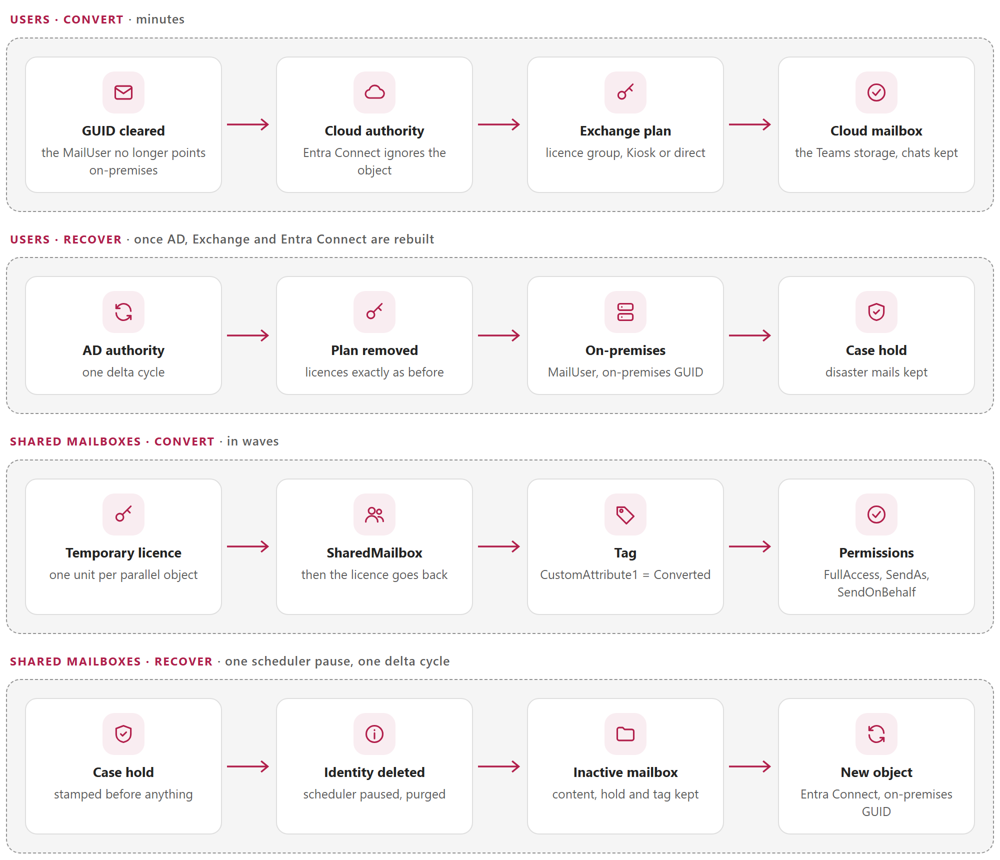

Think of a fire in an office building. Everyone moves to a temporary office the same day. When the building is repaired, everyone moves back. The tool is the moving team. It uses a list of every desk, written **before** the fire. This list is the **snapshot**. After the fire nobody can read the old building, so the snapshot is precious.

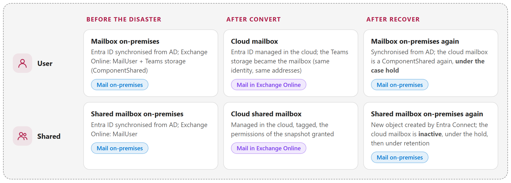

> [!NOTE]
> **What the tool moves.** The tool moves mailboxes: users and shared mailboxes. If you turn it on, it also moves cloud rooms and equipment. It does **not** recreate contacts, distribution groups, mail-enabled security groups, dynamic distribution groups or Microsoft 365 groups. Collect can keep contacts and groups in the snapshot, but only to look at them. The members of a group are used for one thing: to choose the mailboxes of a run with `-Group`. Calendar settings are restored only for the cloud rooms and equipment that you turned on. The calendar of a user is not touched.

> [!CAUTION]
> The old mails are **not copied** by this tool. A user keeps what the cloud already holds, mainly the Teams storage. The mails received in the cloud are **kept** when you go back: they stay under an eDiscovery case hold. A shared mailbox becomes an inactive mailbox under the hold. Nothing is deleted. A cloud room or equipment mailbox is different: see [chapter 6.2 of the administrator guide](PraCloudMailbox-Guide.md#62-unsynchronised-native-resource-lifecycle). Ask before you go back.

### Which tool is mine?

There are two tools. Ask one question: **is your Active Directory still alive?**

| Your answer | Your tool |
|---|---|
| **Yes.** Only the Exchange servers are lost. | **PRA Remote Mailbox.** It is another tool, with its own guide. |
| **No.** Active Directory, Exchange and Entra Connect are all lost. | **PRA Cloud Mailbox.** This guide. |

Both tools can sit on the same server. They do not disturb each other.

### The journey

You prepare **before** the disaster. Then, on the day, you move. Weeks later, you go back.

```steps
Set up once | Put the tool on a server, fill in the settings, install two programs, open the console. Chapter 3.
Collect every day | A scheduled task writes a new snapshot from Exchange. You back it up and keep a copy off-site. Chapter 3.
Try one mailbox | Check, then move one person first. Chapter 4, path 1.
Move everyone | Move a group, an OU, a list, or everything, in waves. Chapter 4, path 2.
Wait, then go back | When your servers are rebuilt, roll the batch back, all at once or in waves. Chapter 5.
Read the report | Every run writes a report. One global report follows the whole batch. Chapter 6.
```

### Two computers, two jobs

| Computer | What it does | Needs |
|---|---|---|
| **Collect computer** | Writes the snapshot every day, before the disaster. | A domain-joined Windows server that reaches an Exchange server. PowerShell 7.5. |
| **Cloud admin server** | Checks, moves and goes back, after the disaster. | A Windows computer of your company that reaches Microsoft 365. It must **not** depend on your Active Directory. PowerShell 7.5. |

The **cloud admin server** is **not** a server in the cloud. It is a machine of your company. It can stand in your server room. The same machine can do both jobs if it is domain-joined and reaches Exchange. After the disaster, only the cloud admin server matters.

### What you will see on the screen

The tool has one window, the **console**. It has **five pages**. You go from left to right. The names are at the top of the window.

| Page | What it is for |
|---|---|
| **Setup** | Is this computer ready? Lights show it. |
| **Task** | What do you want to do? Pick one big card, then which mailboxes. |
| **Verify** | A preview, with **no change at all**. You read it. Then you confirm. |
| **Run** | The tool works. You watch. |
| **Next steps** | What was done, and what to do next. |

### The example in this guide

The pictures and the commands use one example. Replace the names with your own names.

| What | In the example | Replace with |
|---|---|---|
| The company | `contoso.com` | your company name on the Internet |
| The cloud admin server | `SRV-PRA01` | the computer you work on |
| The Exchange server | `SRV-EXCH01.contoso.com` | one Exchange server of your company |
| The tool folder | `D:\PRA\PraCloudMailbox` | the folder where you put the tool |
| Your account | `CONTOSO\pra.operator` | the account you sign in with |
| The test person | `adele.vance@contoso.com` | one real person who agrees to be the test |
| A wave | the group `PRA-Wave1`, the OU `contoso.com/Paris` | your own group or OU |

<!-- icon: checklist -->
## 2. Before you start

Tick every box before you begin. If you cannot tick a box, stop and ask.

- [ ] I have this guide and a quiet hour. A move of many mailboxes can take an hour or more.
- [ ] I know which computer I sit at. Its name is in the box **This computer**, on the right of the **Setup** page.
- [ ] My administrator gave me the rights in the list below.
- [ ] The tool folder is on the computer, and the files are unblocked (see the yellow box at the top).
- [ ] There is a **safe place for the snapshot backups**, **outside** the network that can be lost. See [Protect the snapshot](#protect-the-snapshot).
- [ ] I know the **test person**: one real person who agrees to be moved first.
- [ ] I know who to call if I am stuck. Name and phone number: ____________________

### Ask your administrator for these rights

You do not need to understand this list. Give it to your administrator. The exact table is in the [administrator guide, chapter 4](PraCloudMailbox-Guide.md#4-prerequisites). That guide is the file `PraCloudMailbox-Guide.html`, in the same `docs` folder as this one.

| Where | Ask for | Why the tool needs it |
|---|---|---|
| **The Collect computer** | A domain **user** account in the Exchange role group *View-Only Organization Management*. Not the computer account, not SYSTEM: Exchange refuses them. On a domain controller, the account also needs the right **Log on as a batch job** for the scheduled task. | Collect reads the mailboxes and the shared mailbox permissions. It never changes Exchange. |
| **Microsoft 365, no person present** | An **app registration** with a **certificate**. Four Graph application permissions, plus group permissions. `Exchange.ManageAsApp` and the Exchange Administrator role. eDiscovery Manager in Microsoft Purview. | The tool moves the mailboxes. It places the case hold. |
| **Microsoft 365, an administrator who signs in** | The Entra roles Hybrid Identity Administrator, User Administrator and Exchange Administrator (or Global Administrator). eDiscovery Manager in Purview. | Same work, with a person at the keyboard. |
| **Licences** | A licence group with an Exchange Online plan, free units for the shared mailboxes, an eDiscovery case hold policy, a retention policy. | Each moved mailbox needs a plan. The hold protects the cloud mail. |
| **Entra Connect, after the disaster** | Entra Connect 2.5.76.0 or later on the rebuilt server, and a way to reach it. | Only the rollback needs it. |

> [!NOTE]
> The role names of the interactive sign-in are written in the tool: the Check page tells you which one is missing. Your administrator tests them once, before the real day.

<!-- icon: settings -->
## 3. Set up once

You do this part **one time**. It is best to do it **before** the disaster, as a rehearsal.

### 1 · Get your rights

**Do:** give your administrator the table of chapter 2. Wait until the administrator says: "Done."

**You should see:** nothing yet. You see the effect in step 6, when the lights turn green.

**If not:** do not go on without the rights. The tool stops at the first missing right. It does not harm anything. But it wastes your time.

### 2 · Put the tool on the computer

**Do:**

1. Download `PraCloudMailbox-2.1.0.zip` and its `.sha256` file from the release page of the project. Take the two files named in the **Assets** list. Do **not** take the "Source code" archives: they are not the tool.
2. Check the checksum. Open **PowerShell 7** (Start button, type `PowerShell 7`). Run these two lines in the folder of the download:

```powershell
(Get-FileHash .\PraCloudMailbox-2.1.0.zip -Algorithm SHA256).Hash
Get-Content .\PraCloudMailbox-2.1.0.zip.sha256
```

3. Compare the two values. The text file holds the hash, two spaces, and the file name. The letters can be capital or small. The hash must be the same.
4. Extract the zip. Copy the content of the extracted folder to `D:\PRA\PraCloudMailbox`.
5. Unblock the files (yellow box at the top of this guide).
6. Check the signature of the tool. Run this line in the tool folder:

```powershell
Get-AuthenticodeSignature .\module\Test-PackageIntegrity.ps1 | Format-List Status, SignerCertificate
```

**You should see:** `Status : Valid`. The certificate thumbprint is `0F28E442889F17B5F4D251E8F96E7CC6E2C9C6D6`. The tool checks its own files at every start with the same signature. If one file was changed, it stops before it does anything.

**If not:** if the two hashes differ, or the status is not `Valid`, **stop**. Download the files again from the official page. Do not run a package that fails these checks. Do not turn off the execution policy to clear an error.

### 3 · Install the two programs

**Do:** open **PowerShell 7 as administrator** on the **cloud admin server**. Run these two lines, one after the other:

```powershell
Install-Module Microsoft.Graph.Authentication -MinimumVersion 2.41.1 -Scope AllUsers -Force
Install-Module ExchangeOnlineManagement -MinimumVersion 3.10.1 -Scope AllUsers -Force
```

**You should see:** the modules install. Nothing else to do.

**If not:** if the console later says a module is old or missing, it gives you the exact command. Run it. If an older version still conflicts, close every PowerShell window and open a new one.

### 4 · Fill in the settings file

**Do:** open the settings file with Notepad:

```powershell
notepad D:\PRA\PraCloudMailbox\config\PraCloudMailbox.config.psd1
```

Fill in these lines, between the quotes. Your administrator knows the values. Then save the file.

| Line in the file | What to write | Example |
|---|---|---|
| `Environment` | a short name for this company, **the same on every computer** | `PROD` |
| `Server` (in `Exchange`) | the name of one Exchange server. Only Collect uses it. | `SRV-EXCH01.contoso.com` |
| `TenantId` (in `Cloud`) | the identity number of your Microsoft 365 | `00000000-0000-0000-0000-000000000000` |
| `Organization` (in `Cloud`) | the first name of your Microsoft 365 | `contoso.onmicrosoft.com` |
| `AppId`, `CertificateThumbprint` (in `Cloud`) | the app registration and its certificate. Leave them empty if an administrator signs in. | |
| `GroupId` (in `Licensing.Users`) | the group that gives an Exchange Online plan | the object ID of the group |
| `SkuPartNumber` (in `Licensing.Shared`) | the licence lent to each shared mailbox | `EXCHANGESTANDARD` |
| `HoldPolicy` (in `Retention`) | the name of the eDiscovery case hold policy | `PRA-Recover-Hold` |
| `TargetGroups` (in `Collect`) | the groups to keep with all their members, to move a wave by group | `@('PRA-Wave1')` |
| `TaskName` and `At` (in `Collect.Schedule`) | the name and the time of the daily task. You can leave them as they are. | `PraCloudMailbox Collect`, `02:00` |

**You should see:** the file saved. Nothing else happens.

**If not:** an unknown setting is refused, so a spelling mistake is found at once. If the console later says the settings file is wrong, open it again. Look at the line named in the message.

> [!NOTE]
> One settings file serves every computer. Copy the same file to the Collect computer and to the cloud admin server. In the console, you can change some settings **for one run only**. The file is never written.

### 5 · Collect every day

Collect reads Exchange and writes the **snapshot**: one file, `data\PraCloudMailbox.db`. It reads. It never changes Exchange. You run it **every day**, with a scheduled task, **before** the disaster. One command creates the task.

**Do:** open **PowerShell 7 as administrator** on the Collect computer. Go to the tool folder. Run this command. It asks for the account and its password. Then it checks them and creates a daily task.

```powershell
.\Invoke-PraCloudMailbox.ps1 -Action Schedule -Mode Apply
```

Do you want to look first? Run the same command without `-Mode Apply`. It changes nothing. Add `-At 03:30` to choose the time. The default time is 02:00. In the console, the button **Schedule the daily Collect** does the same. Start the console as administrator.

The account must be a domain **user** account. Put it in the Exchange role group *View-Only Organization Management*. Do not use SYSTEM, a computer account or a managed service account. Exchange refuses them. The command says so in plain words.

Collect needs no Exchange tools. The account needs no mailbox. It needs no administrator rights for Collect itself. Only creating the task needs an administrator window. On a domain controller, the account also needs the right **Log on as a batch job**. The command checks it. Windows keeps the password in the task: it gives the Kerberos ticket. The tool never writes the password to a file.

**You should see:** the line `RESULT: PASS`. Run the task once by hand, as the *Next steps* say. Open **Setup** in the console: the light **Daily Collect** says *Scheduled task … found.* and the time of the last run.

**If not:** the command stops at the step that failed. It says what to do. If the log says *Cannot open the remote session to Exchange*, check three things. The computer is domain-joined. The account is a user of *View-Only Organization Management*. `Exchange.Server` is a server that answers. The words "couldn't be found" mean that the account is not a user: SYSTEM or a computer. The words "isn't assigned to any management roles" mean that the membership is new: wait a few minutes.

**Does a policy create your tasks?** Then create the task yourself, with the same account and the same command:

```powershell
$action = New-ScheduledTaskAction -Execute 'pwsh.exe' -Argument '-NoProfile -NonInteractive -File "D:\PRA\PraCloudMailbox\Invoke-PraCloudMailbox.ps1" -Action Collect -Mode Apply -Force' -WorkingDirectory 'D:\PRA\PraCloudMailbox'
$trigger = New-ScheduledTaskTrigger -Daily -At 2am
$trigger.StartBoundary = (Get-Date -Hour 2 -Minute 0 -Second 0).ToString('s')   # local time, without Z: the task stays at 02:00 when the clock changes
Register-ScheduledTask -TaskName 'PRA Collect' -Action $action -Trigger $trigger -User 'CONTOSO\svc-pra-collect' -Password '<password>'
```

The second line of the block sets the local time of the trigger: without it, PowerShell 7 writes the time in UTC and the task moves by one hour when the clock changes. The task runs **with `pwsh.exe`**, not `powershell.exe`. Do not use SYSTEM: Exchange refuses it. Keep the password in the task.

#### Protect the snapshot

This is the most important part of the preparation. Read it twice.

> [!CAUTION]
> **After the disaster, the snapshot is the only copy of your directory data.** Active Directory, Exchange and Entra Connect are lost. Nothing else knows the list of the mailboxes, their GUIDs and the permissions of the shared mailboxes. If the snapshot is lost or changed, the tool has nothing to work from.

1. **Back it up every day.** Collect keeps a consistent copy of each run in `data\backup`. Back up that folder, and the `data\PraCloudMailbox.db` file.
2. **Keep a copy outside your network.** Put the backup somewhere that the lost domain cannot reach: off-site, offline or immutable storage, with credentials that are **not** in your domain. If attackers hold your domain, they have every disk and every share that your domain reaches. Keep **several generations**, not only the last one.
3. **Protect who can read it.** The snapshot holds names, e-mail addresses, GUIDs and permissions. Give the folder and the backups a **restricted access list**: the administrators of the tool and the backup account only. Never share the folder with **Domain Users**.
4. **Copy the `.sha256` file with it.** Collect writes `PraCloudMailbox.db.sha256` beside the snapshot, and one beside each backup. The tool checks the snapshot against this file **before** it reads it, in Check, Convert and Recover.
5. **If the check says the file changed, restore it from the external backup.** The message says *Nothing was changed.* and *Restore the file from your external backup*. Use `-AcceptUnverifiedSnapshot` **only** when you know why the file changed and you accept it as it is. A snapshot with **no** `.sha256` file gives a warning in a Preview and in a Check. A **Convert or a Recover in Apply mode stops** and changes nothing: copy the `.sha256` file with the snapshot, or add `-AcceptUnverifiedSnapshot` when you know the file is the right one.
6. **A Collect that lost its mailboxes is refused.** Collect refuses to write a snapshot that has no mailbox. It also refuses one that has far fewer than the last good snapshot (`Collect.MaxDropPercent`, 50 by default). It writes nothing and ends with `RESULT: FAIL`. The last good snapshot stays. Find out why Exchange returned fewer mailboxes. Raise the setting only if the drop is expected.
7. **A batch keeps its snapshot.** Convert remembers which snapshot it was made from. Recover and the follow-up of a batch use **that** snapshot, and stop, changing nothing, if it is missing or not the same. Collect never deletes the snapshot of a batch that is not rolled back yet. If the tool says the snapshot of a batch is missing, copy that file from `data\backup` over `data\PraCloudMailbox.db`, with its `.sha256` file.
8. **Back up the journal too.** The journal is `data\PraCloudMailbox-journal.db`. It is written by Convert and Recover themselves, so the checksum does **not** cover it. It is the record of every change and the only input of the rollback. Copy it off-site **during** the operations, not only after.

The cloud admin server needs the snapshot. If Collect does not run on it, copy `data\PraCloudMailbox.db` **and** `data\PraCloudMailbox.db.sha256` there after each Collect. A second scheduled task can do it.

### 6 · Open the console

**Do:** copy this line into the PowerShell window and press **Enter**:

```powershell
pwsh -STA -File D:\PRA\PraCloudMailbox\Invoke-PraCloudMailbox.ps1 -Gui
```

**You should see:** the console opens on the **Setup** page. Look at the **lights**. A light is a small box with a mark. A **green check** means "this is ready". A **red cross** means "this is missing". An **amber** mark is a warning.

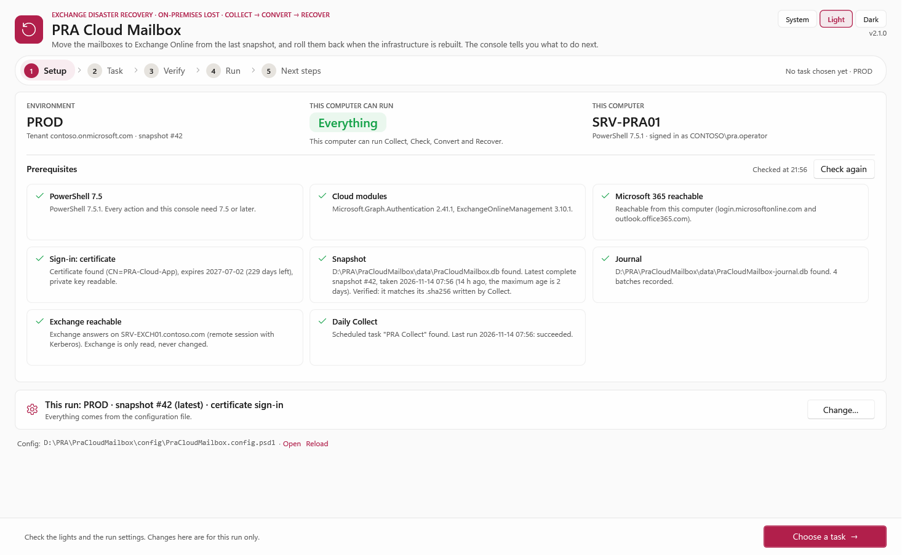

| Light | In plain words |
|---|---|
| **PowerShell 7.5** | The tool and the console need PowerShell 7.5 or later. |
| **Cloud modules** | The two programs of step 3. The text names the versions found. If one is missing, it gives the command to install it. |
| **Microsoft 365 reachable** | Can this computer reach Microsoft 365 through the Internet? The console tries two addresses for a few seconds. If a firewall blocks it, the text says so. |
| **Sign-in: certificate** | The certificate of the app registration: where it is, when it ends, if its private key can be read. Or **Sign-in: interactive**, when an administrator signs in. |
| **Snapshot** | The file, the latest complete snapshot, its age, and if it is **Verified** against its `.sha256` file. |
| **Journal** | The file of the batches. It does not exist before the first Convert. |
| **Exchange reachable** | Can this computer open a remote session to Exchange? Only Collect needs it, only before the disaster. |
| **Daily Collect** | Is there a scheduled task that runs Collect on this computer? |

In the middle of the page, the box **This computer can run** says what this computer can do: **Everything**, **Collect**, **Cloud**, or **Nothing yet**. A computer that cannot run an action greys its card on the next page.

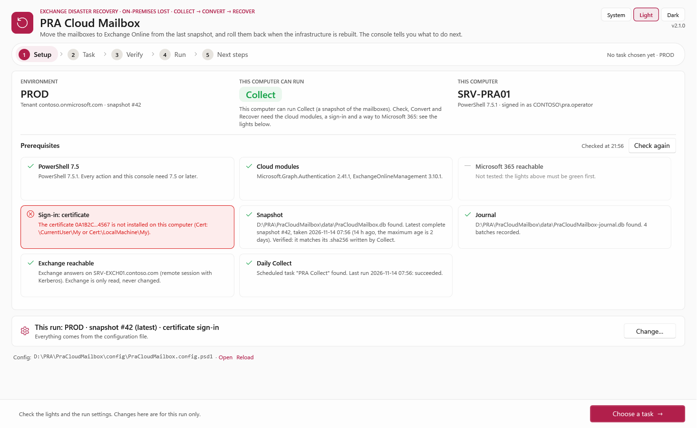

A red light is **not always a problem**. The Collect computer has no cloud programs: its cloud lights stay red. The cloud admin server may not reach Exchange after the disaster: its light **Exchange reachable** may be amber. That is normal. Each computer does its own job.

**If a light is red:** read the text inside it. It says what is missing. Ask your administrator to fix it. Then press **Check again**.

> [!NOTE]
> **The snapshot light.** *Verified* is good. *Not verifiable* is amber: the file has no `.sha256` beside it. **Changed** is red and stops the run. See [Protect the snapshot](#protect-the-snapshot).

#### Settings for this run only

Press **Change…** to open **Settings for this run only (the file is never written)**. You can change the environment, the scope, the snapshot, the sign-in, the tenant, the app, and the number of temporary licences. A changed field is marked **modified**. Press **Reset everything** to go back to the file.

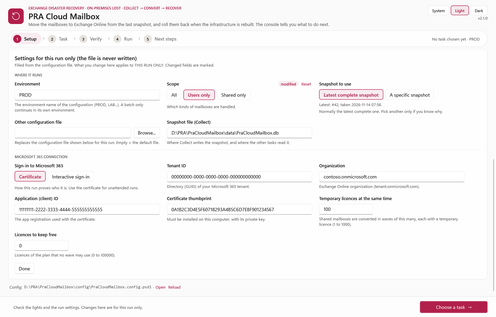

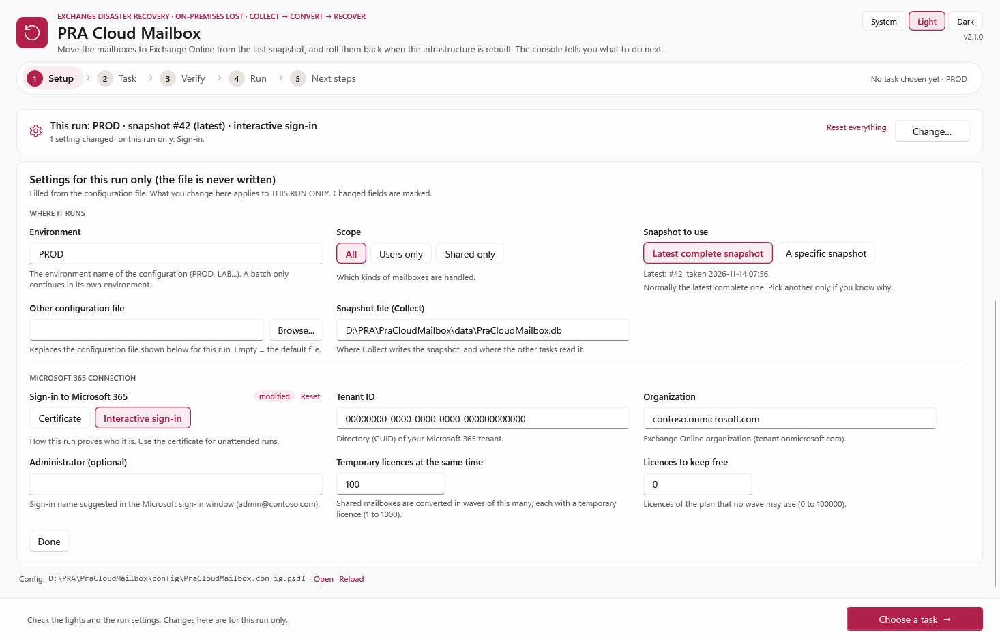

The run uses a copy of your settings. The tool lists every difference in the banner, the log, the summary and the report. The next steps always show your original file.

**Interactive sign-in.** With **Interactive sign-in**, an administrator signs in to Microsoft 365 in a window, instead of the certificate. The tool opens a **Microsoft sign-in window** on its own console. This works only when someone is at the keyboard. It cannot work in a scheduled task. Set `Cloud.SignIn` to `Interactive` in the file to make it the default.

### 7 · Collect once, then check

**In the console.** On a computer that can run Collect: **Choose a task →**, click the card **Collect a snapshot**, **Continue to verification →**, **Preview**, type **COLLECT** (small letters work too), press **Collect the snapshot**.

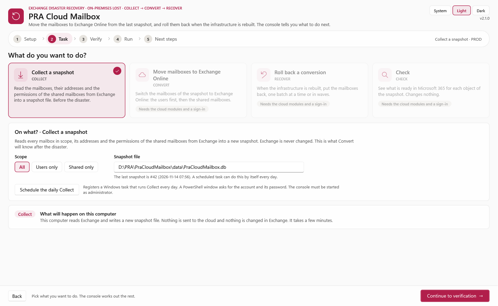

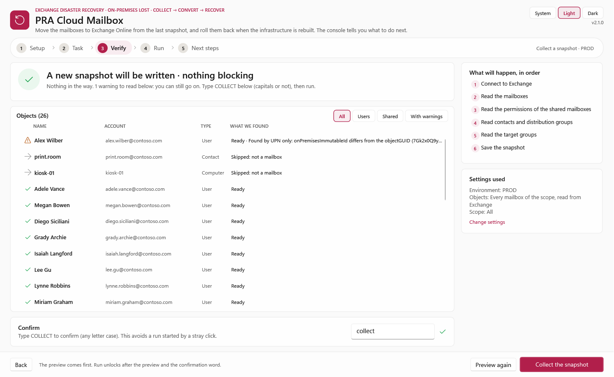

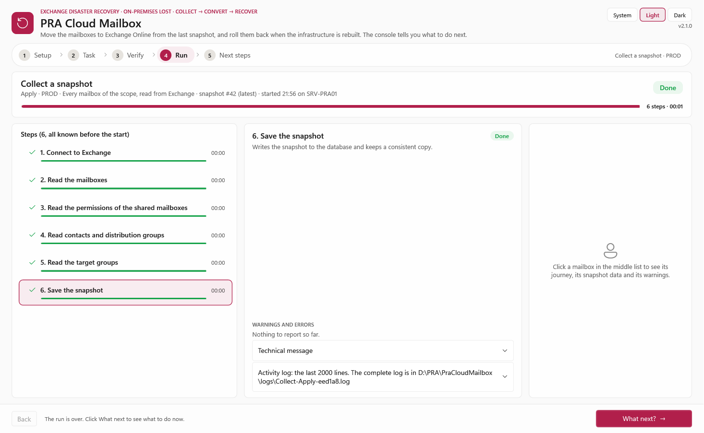

**On the command line.**

```powershell
pwsh -File .\Invoke-PraCloudMailbox.ps1 -Action Collect
pwsh -File .\Invoke-PraCloudMailbox.ps1 -Action Collect -Mode Apply -Force
```

The first line is a **preview**: nothing is written. The second writes the snapshot and its `.sha256` file. `-Force` asks no question: it is the line of the scheduled task. Without `-Force`, **Collect** asks nothing either, except when you collect **one** object (`-Identity`) with `-Mode Apply`.

**You should see:** at the end, the card **The snapshot is written** and the next step *Copy … to the cloud admin server*.

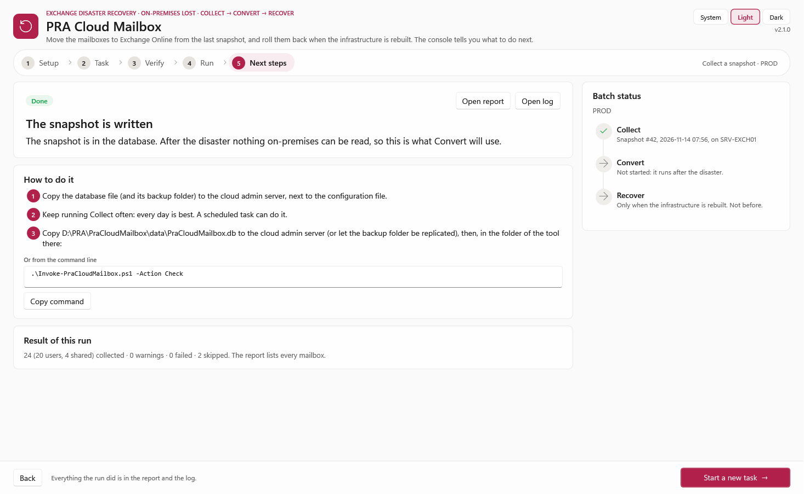

Copy the snapshot **and its `.sha256` file** to the cloud admin server. Then do the first **Check**: see [chapter 6](#6-check-and-read-the-report). Fix every red line until all the objects are ready.

<!-- icon: cloud -->
## 4. A · Move mailboxes to the cloud

Do this only on the day of the disaster, or for a rehearsal. There are two ways. Do them in this order the first time.

| Way | When | Go to |
|---|---|---|
| **Try one mailbox** | **Always first.** One person, to see that everything works. | Path 1 |
| **Move more** | A group, an OU, a list, everything. In waves if you want. | Path 2 |

Every move is a **batch**. A batch has a short **batch ID**, like `1a2b3c4d`. You need it to continue the move or to go back. The ID is on the **Next steps** page, in the report and in the journal.

### Path 1 · Try one mailbox

This is the safest start. One person is moved. Everybody else is left alone.

### 1 · Choose the task

**In the console.** Open the console. Make sure the lights are green. Press **Choose a task →**. Click the card **Move mailboxes to Exchange Online**. It gets a pink frame and a check mark. Two choices appear: **Start a new batch** and **Continue a batch**. Keep **Start a new batch**.

**On the command line.** Nothing to choose: the action is `-Action Convert`.

**You should see:** the **Task** page, with four big cards.

### 2 · Say which person

**In the console.** Under **Which objects?**, click **One mailbox (try one first)**. Type the e-mail address of your test person in the box **Mailbox**. You can also type the sign-in name, the account name or the ID.

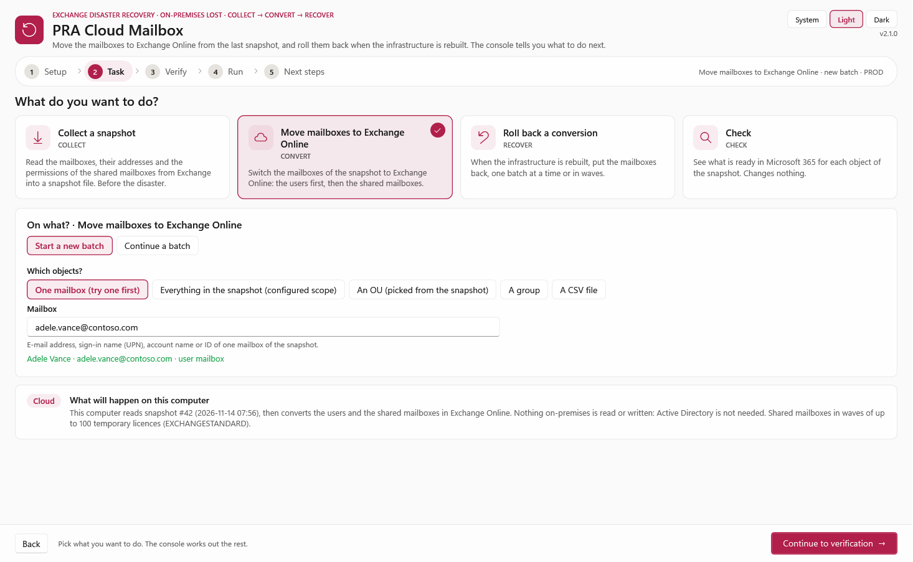

**On the command line.**

```powershell
pwsh -File .\Invoke-PraCloudMailbox.ps1 -Action Convert -Identity adele.vance@contoso.com
```

**You should see:** the card **What will happen on this computer**, at the bottom, with a pink pill **Cloud**. It says that the computer reads the snapshot and moves the person in Exchange Online. Nothing on-premises is read or written.

**If not:** the tool looks for the person in the **snapshot**. If the person is not in it, the run stops with *… is not in …. Nothing was changed.* Check the spelling. Letter case never matters.

### 3 · Preview

**In the console.** Press **Continue to verification →**. On the **Verify** page, press **Preview**. A preview is a trial that **changes nothing**.

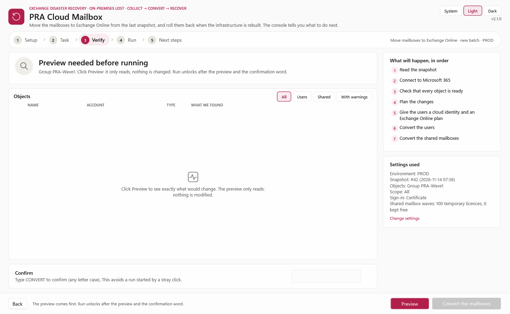

**On the command line.** The command of step 2 **is** the preview. Without `-Mode Apply`, nothing is changed.

**You should see:** a title like **1 mailbox will be converted · nothing blocking**, and one line for the person.

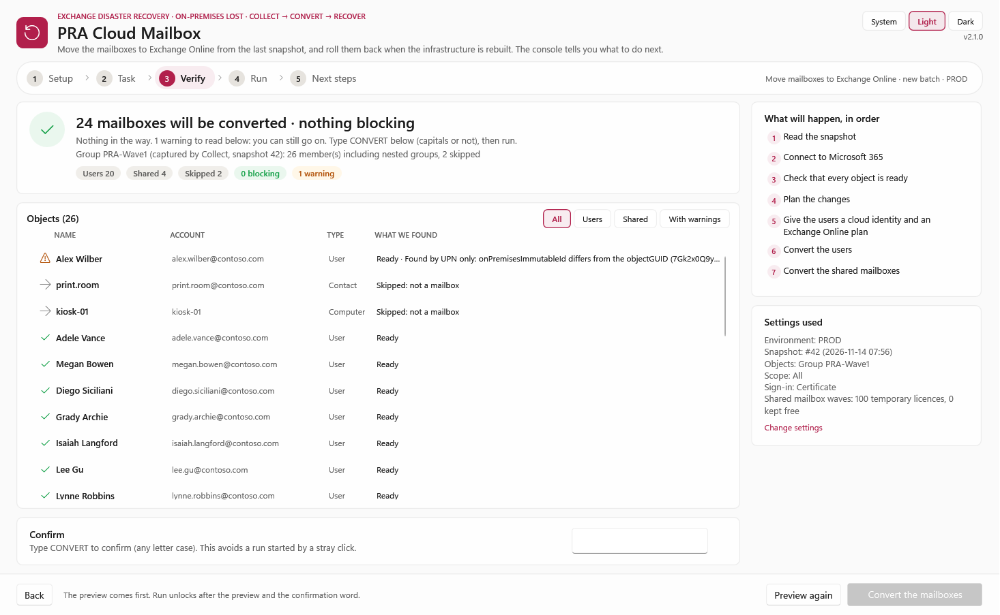

**If not:** a red number such as **1 blocking** means the tool refuses this object. Click the line and read the reason. Do not go on. Stop and ask.

A preview is only good for the files it was made on. Change the settings file, the list of objects, the tool or the snapshot after the preview, and the console refuses the next step. It says *The run is refused: the task, the objects or the settings changed since the preview. Preview again.* Press **Preview** again.

One reason in red deserves a stop: **ENTRA_WRONG_OBJECT**. The tool found an account in Microsoft Entra ID by the sign-in name only, and its mailbox is not the one of the snapshot. It is probably another person's account. The tool changes nothing on it and does not convert the object. Do not force it. Ask your administrator to fix the account or the sign-in name in Entra ID, or leave the object out.

### 4 · Confirm

**In the console.** Read the title one more time. Is it the right number of people? Type the word **CONVERT** in the box. Small or capital letters both work. Then press the red button **Convert the mailboxes**. Any change of task, of objects or of settings cancels the preview: do it again.

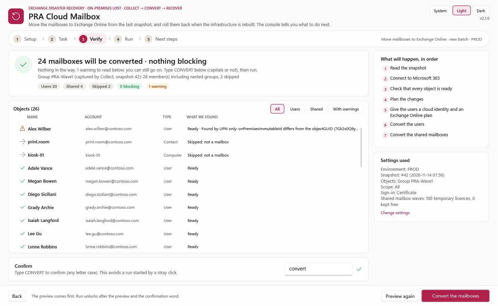

**On the command line.**

```powershell
pwsh -File .\Invoke-PraCloudMailbox.ps1 -Action Convert -Mode Apply -Identity adele.vance@contoso.com
```

The tool shows the plan and asks **one** question: *Convert … object(s) to Exchange Online (…)?* Answer yes. `-Force` skips the question: use it only in a script. The picture shows the same run for every object of a snapshot.

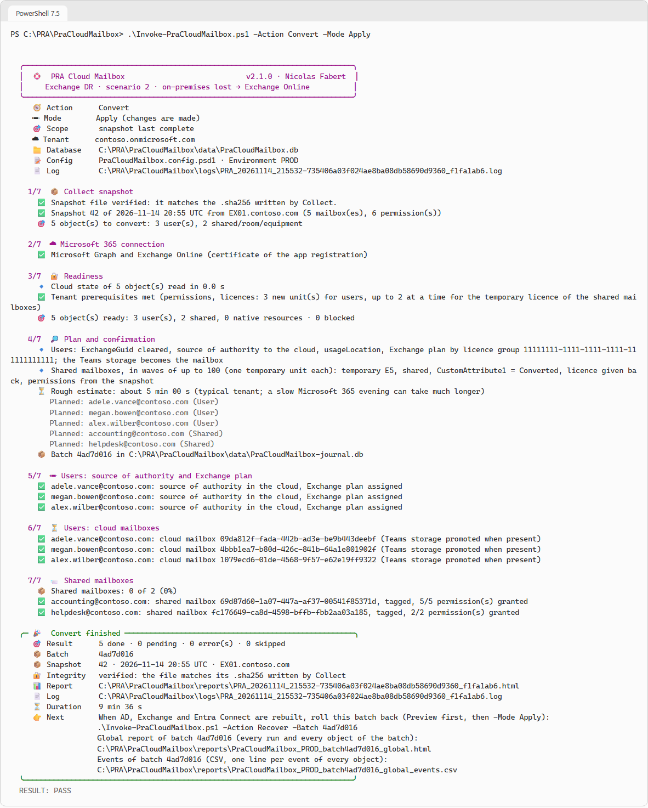

**If not:** the red button stays grey until you did the preview **and** typed the word. Check both.

### 5 · Wait

**Do:** nothing. Watch the list of steps. **Do not close the window.** It cannot be closed during a run. A new black window may open and ask you to sign in to Microsoft: sign in with your own account.

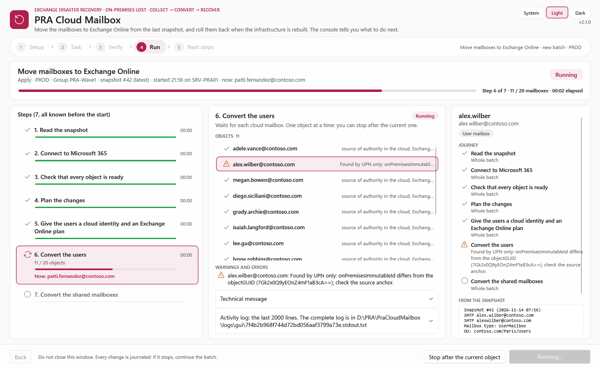

**You should see:** the steps turn green, one after the other. A user gets a mailbox in one or two minutes. At one step the tool **waits** for Exchange Online. This is **normal**.

**To stop:** press **Stop after the current object**. No new object starts. The run ends cleanly, and the next run continues the batch. See [Resume](#resume-a-batch).

### 6 · Look at the end

**Do:** when the title says **Done**, press **What next? →**.

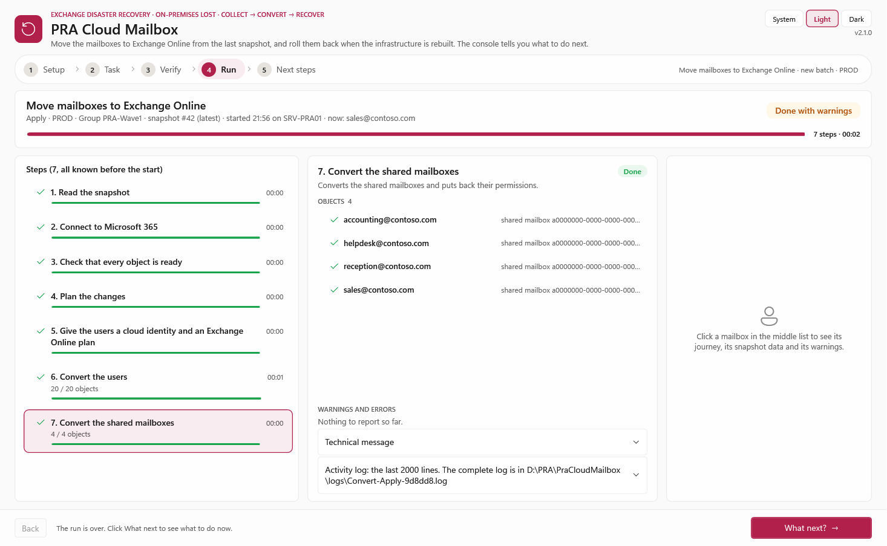

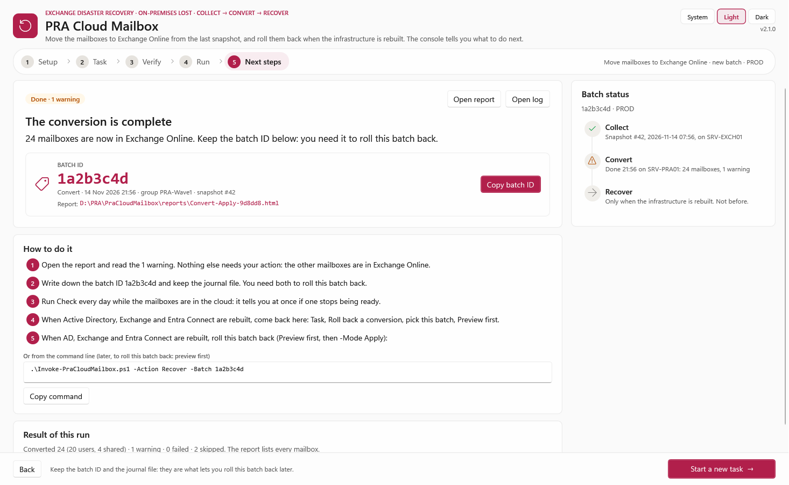

**You should see:** the **Next steps** page. It shows the **batch ID** in a big box, with **Copy batch ID**. Write it down. It also gives the buttons **Open report**, **Open global report** and **Open log**, and the exact command to roll this batch back.

**If not:** if the title says **Part of the conversion remains**, this is **not** an error. Some objects are not finished. Continue the batch: see [Resume](#resume-a-batch).

### 7 · Check with the person

Ask the person to open Outlook. They should see a mailbox and be able to send and receive. Then follow the batch without changing anything:

```powershell
pwsh -File .\Invoke-PraCloudMailbox.ps1 -Action Check -Batch 1a2b3c4d -Expect Provisioned -Once
```

See [chapter 6](#6-check-and-read-the-report). If everything is right, go to Path 2. If not, **stop and ask**. You can undo the test with [chapter 5](#5-b--go-back).

### Path 2 · Move more

Use this path **only after** Path 1 worked. The steps are the same as in Path 1. Only the choice of objects changes. Under **Which objects?**, pick one of these. **One source** at a time: the tool refuses a mix with *Choose one way to say which objects: …*

| Choice in the console | On the command line | What it takes |
|---|---|---|
| **Everything in the snapshot (configured scope)** | no option | every object of the snapshot in the scope of the settings file |
| **An OU (picked from the snapshot)** | `-SearchBase 'contoso.com/Paris'` | the objects of one organizational unit, the sub-units included |
| **A group** | `-Group PRA-Wave1` | the members of one group, the nested groups included |
| **A CSV file** | `-CsvPath .\data\wave1.csv` | the objects listed in a file |
| **One mailbox** | `-Identity adele.vance@contoso.com` | one object |

Two options go with **any** source. `-Scope UsersOnly` or `-Scope SharedOnly` (the console has the same choice in the settings). `-MaxObjects 200` takes the **first** 200 objects: run the same selection again for the next wave.

#### An OU

**In the console.** Click **An OU (picked from the snapshot)**. Press **Pick...** to choose from the OUs of the snapshot, or type the name as a path (`contoso.com/Paris`) or as a distinguished name (`OU=Paris,DC=contoso,DC=com`).

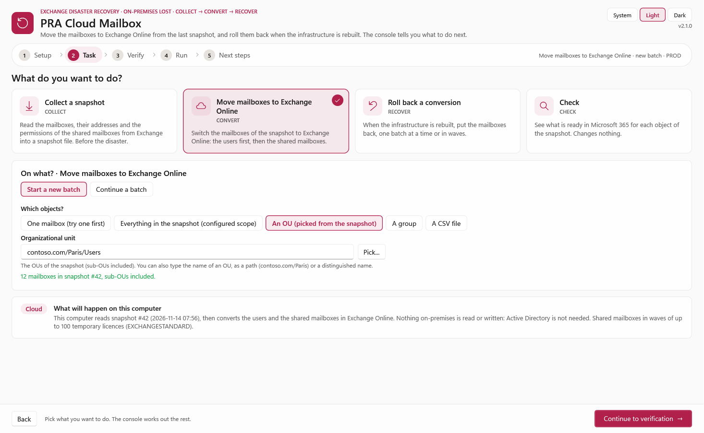

**On the command line.**

```powershell
pwsh -File .\Invoke-PraCloudMailbox.ps1 -Action Convert -SearchBase 'contoso.com/Paris'
```

If the OU holds no object of the snapshot, the run stops: *-SearchBase … gives no object in …. Nothing was changed.*

#### A group

Your administrator named the group in `Collect.TargetGroups` **before** the disaster. Collect then kept the group with **all its members**. After the disaster the tool looks for the group in the snapshot first. If it is not there, the tool looks for a **Microsoft Entra group** with this name.

**In the console.** Click **A group**. Type the name. Press **Check**. The console runs the lookup. It changes nothing.

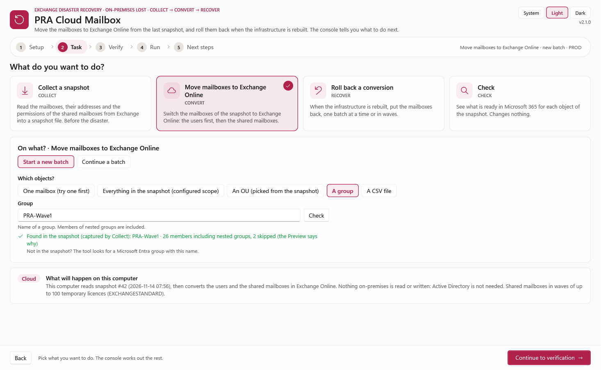

**On the command line.**

```powershell
pwsh -File .\Invoke-PraCloudMailbox.ps1 -Action Check -Group PRA-Wave1 -ResolveOnly
pwsh -File .\Invoke-PraCloudMailbox.ps1 -Action Convert -Group PRA-Wave1
```

**You should see:** a line like *Group … (captured by Collect, snapshot …): … member(s) including nested groups, … skipped*. The words in brackets say where the group comes from: *captured by Collect*, or *Microsoft Entra group, read now*.

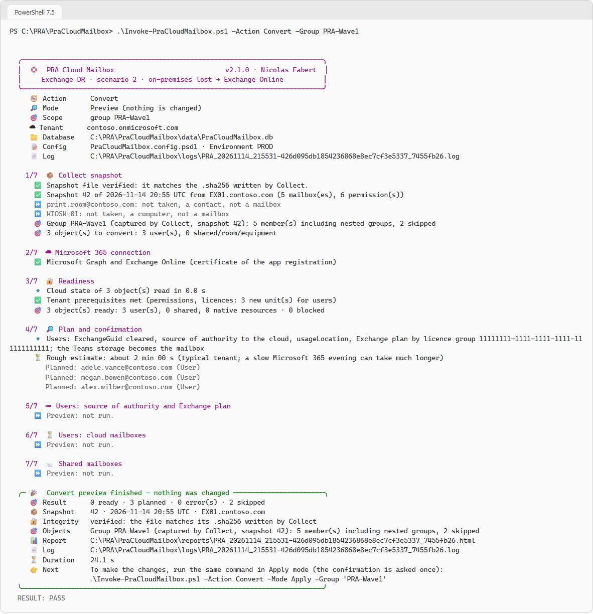

**A skipped member** is a member that is not a mailbox: a computer, a contact, or an object that is not in the snapshot. The run **says why** for each one. It is not an error. The log and the report name them all.

**If not:** if two groups have the same name, the run stops and lists them. Give the distinguished name or the object ID. If no group is found, you see *Group … is not in snapshot … nor in Microsoft Entra.* Check the name.

#### A CSV file

A CSV file is a list in a simple file that Excel can open. It has a column named `Identity` (any letter case). Each line is the e-mail address, the sign-in name, the account name or the ID of one object. A plain list, one identity per line, works too. `#` starts a comment.

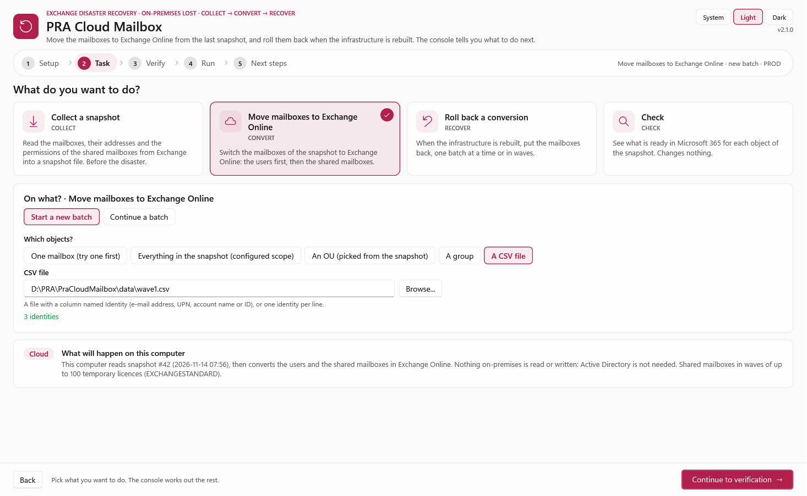

```powershell
pwsh -File .\Invoke-PraCloudMailbox.ps1 -Action Convert -CsvPath .\data\wave1.csv
```

The run is **strict**: it stops, before any change, if an object is listed twice or a line is empty or wrong (*-CsvPath: … cannot be used, nothing was done.* gives the line numbers), or if an object is not in the snapshot. The old name `-IdentityPath` still works.

#### Everything, in waves

Choose **Everything in the snapshot**, or leave out every source option. The tool converts the users first, then the shared mailboxes in **waves**. Each shared mailbox borrows one **temporary licence** while it converts. The wave size is the number of units that are free at the start, minus the units you keep free.

- **`Licensing.Shared.Parallel`** is the largest wave (100 by default).
- **`Licensing.Shared.KeepFree`** is the number of units of that licence that Convert **never uses**. Use it to keep a few units for something else. **0** keeps none.

A shared mailbox that needs **no** new unit is never refused for a missing unit. This is a mailbox that is already shared, or already holds the temporary licence. If a wave finds no free unit, the tool waits **once**, up to 5 minutes, for the units that the previous wave gave back. If none comes, the shared mailboxes that need a unit are marked as failed (*not started: no free unit … nothing was changed on this object*), the others go on, and the batch is **partial**. Free a unit, then continue the batch.

In the console, both numbers are in **Settings for this run only**.

#### Resume a batch

A batch can stop: a stop on request, an error, a timeout. **What is finished is kept. Nothing is done twice.** Continue the batch.

**In the console.** On the **Task** page, click the card **Move mailboxes to Exchange Online**, then **Continue a batch**. The list shows the batches of the journal. Click the one to continue.

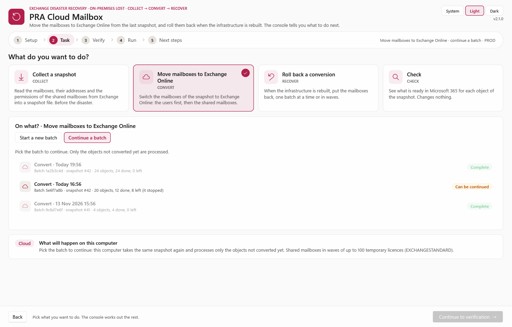

**On the command line.**

```powershell
pwsh -File .\Invoke-PraCloudMailbox.ps1 -Action Convert -Mode Apply -Batch 1a2b3c4d
```

The source options (`-Identity`, `-CsvPath`, `-SearchBase`, `-Group`, `-Scope`, `-MaxObjects`) **narrow** the objects that are resumed. An object that is not in the batch is refused.

**If you press Ctrl+C or close the window,** the run ends with `RESULT: FAIL`, never `PASS`. The Next steps give the command that continues it. The batch becomes **partial**. What was finished is kept.

> [!WARNING]
> **A batch that a rollback has touched is not continued.** If a Recover already rolled back objects of a batch, `Convert -Batch` stops: *Convert batch … cannot be resumed: Recover batch … already rolled back objects of it … Nothing was changed.* An object converted now could never be rolled back. Start a **new** Convert for the objects that are not converted: preview first, then choose them with `-Identity`, `-CsvPath` or `-Group`. The Next steps say the same.

> [!TIP]
> The **Next steps** always give the exact command, with your options. Copy it with **Copy command**.

<!-- icon: refresh -->
## 5. B · Go back

Go back **only** when your administrator says that Active Directory, Exchange and Entra Connect are rebuilt and synchronising. Active Directory must be restored with the **same object GUIDs** as before. Before you go back, read the caution in [chapter 1](#what-this-tool-does).

**Rolling back** means: give the identities back to Active Directory, put the licences back as they were, keep the cloud mail under the hold. Every object goes the way its **current state** allows.

### Path 3 · Roll back a whole batch

### 1 · Pick the batch

**In the console.** On the **Task** page, click the card **Roll back a conversion**. A list of **batches** appears. A batch is one move. Click the line of the batch to undo. The first choice is **Start a rollback**. Keep **Whole batch**.

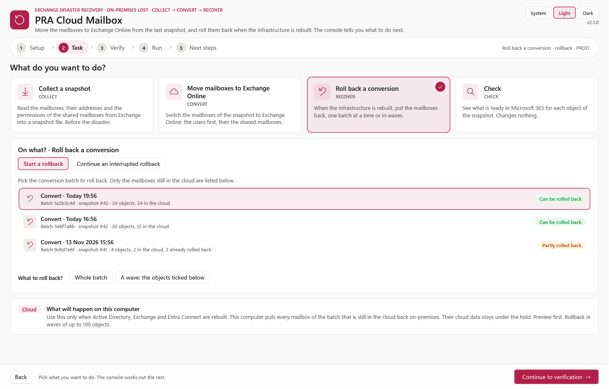

**On the command line.**

```powershell
pwsh -File .\Invoke-PraCloudMailbox.ps1 -Action Recover -Batch 1a2b3c4d
```

**You should see:** the line turns pink. It shows the date, the number of objects, and the status.

**If not:** if the list is empty, the journal is not on this computer. Copy `data\PraCloudMailbox-journal.db` back. If you cannot, stop and ask. The batch ID alone is not enough.

### 2 · Preview and confirm

**In the console.** Press **Continue to verification →**, then **Preview**. Read the title: **… will be rolled back**. Type **RECOVER**. Press **Roll back the mailboxes**.

**On the command line.** The command of step 1 is the preview. Add `-Mode Apply` to make the changes:

```powershell
pwsh -File .\Invoke-PraCloudMailbox.ps1 -Action Recover -Mode Apply -Batch 1a2b3c4d
```

The question is *Roll back … object(s) of Convert batch …?*

The rollback uses the **licence mode of the batch**. If `Licensing.Users.Mode` in the settings file is not the one Convert used, the run stops before any change: *Convert batch … gave the Exchange plan of its users with Licensing.Users.Mode = … and the configuration now says …* Put the old value back in the settings file. Keep the same `GroupId` or `SkuPartNumber`. Then run again.

### 3 · Wait

The tool works in waves. It checks each step before the next. It waits for Entra Connect and for the case hold. This can take a long time. **Do not close the window.** If you stop it, the next run continues.

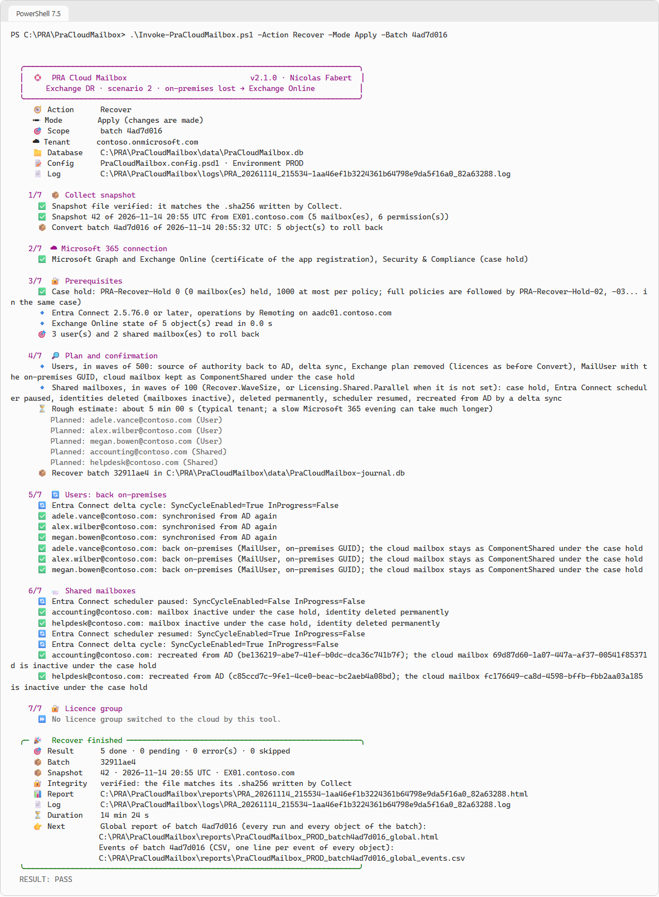

**You should see:** at the end, **The rollback is complete**, or **Part of the rollback remains**. In the second case, run the same command again: *Some objects are not back yet. Fix what is named above, then resume them (nothing is rolled back twice):*

### Path 4 · Roll back in waves

You can roll back a batch **in waves**. Take the objects of one wave first. The others wait. Then run again with the same batch.

**In the console.** Choose **A wave: the objects ticked below**. A grid of the objects of the batch appears. Tick the objects of the wave. Use **Tick all shown** or **Untick all**. The console writes your choice to a CSV file and runs the command with `-CsvPath`.

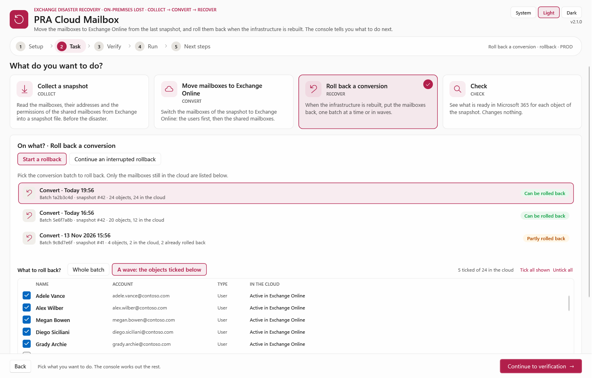

**On the command line.** The same options as in chapter 4 select the wave **inside** the batch:

```powershell
pwsh -File .\Invoke-PraCloudMailbox.ps1 -Action Recover -Mode Apply -Batch 1a2b3c4d -CsvPath .\data\wave1.csv
pwsh -File .\Invoke-PraCloudMailbox.ps1 -Action Recover -Mode Apply -Batch 1a2b3c4d -Group PRA-Wave1
```

A member of the group that is **not in this batch** is skipped, and the run says so. If **all** of them are outside the batch, the run stops and changes nothing.

### Stop, then continue

Press **Stop after the current object** to end a run cleanly. No new object starts. The run finishes its journal and its report. Run the same command later: it continues where it stopped. In the console, click the card **Roll back a conversion**, then **Continue an interrupted rollback**, and pick the batch. If you rolled back a **wave**, the console continues **that wave only**: the objects that were not yet rolled back, never the whole batch. A wave that ended normally is not listed as interrupted.

### After the rollback

| What | How |
|---|---|
| The mails received during the disaster | They stay in the cloud under the case hold. Search them with eDiscovery. |
| Inactive shared mailboxes | After a few days the retention policy holds them. Your administrator then removes their entry from the case hold policy. Never before. |
| The records | Keep `data\PraCloudMailbox-journal.db`, `logs\` and `reports\`. |
| Collect again | Once Exchange is back, start the daily Collect again for the next disaster. |

<!-- icon: search -->
## 6. Check and read the report

### Check before the disaster

**Check** reads Microsoft 365 and tells, for each object of the snapshot, whether Convert can run. It **changes nothing**. Run it after every change of settings, and every week.

**In the console.** Card **Check**, then **Check the snapshot**. Press **Continue to verification →**, then **Run the check**. A check has no preview: it never writes.

**On the command line.**

```powershell
pwsh -File .\Invoke-PraCloudMailbox.ps1 -Action Check
pwsh -File .\Invoke-PraCloudMailbox.ps1 -Action Check -Scope SharedOnly
```

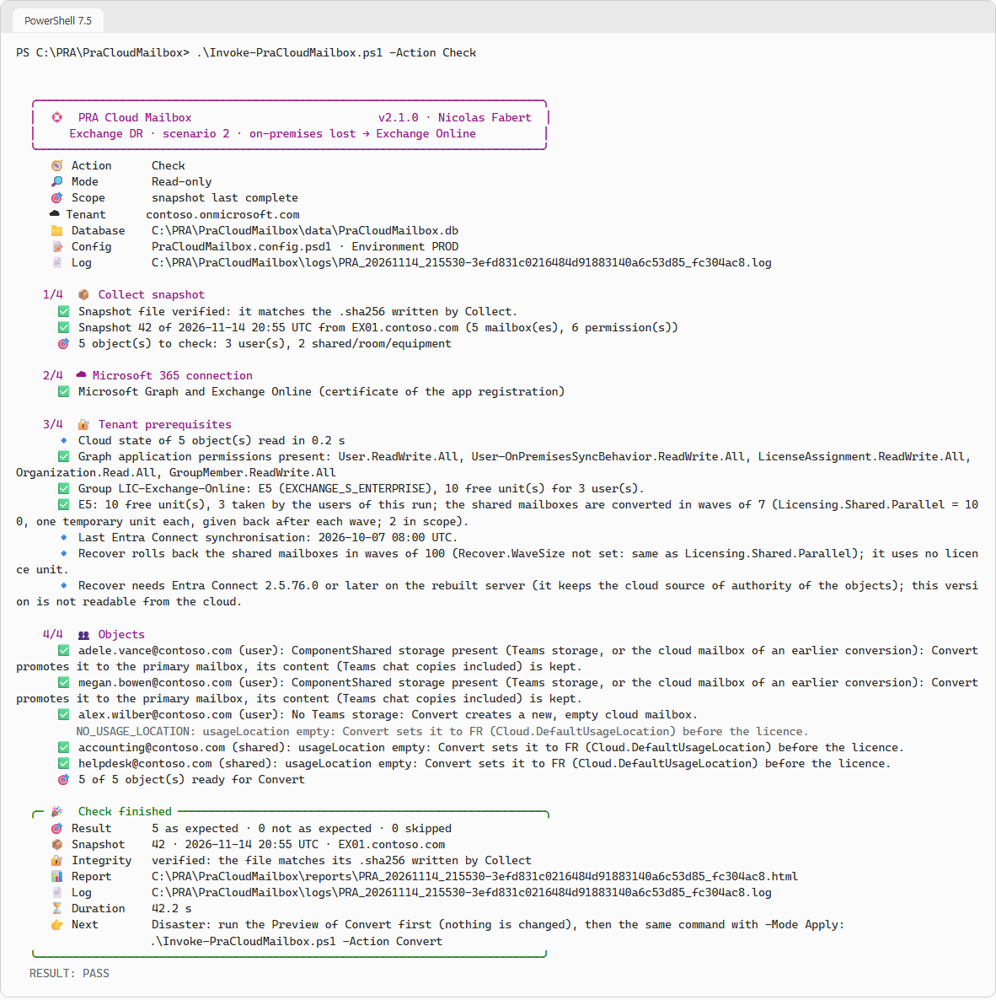

An object with an error is **not ready**: Convert would refuse it, and the exit code is 1. A warning does not change the exit code. The line says why. The usual fixes are in the table of [chapter 7](#7-when-something-goes-wrong).

If the sign-in is **interactive**, Check also compares the **Microsoft Entra roles** of your account with what Convert needs. It tells you which role seems to be missing.

### Follow a batch

After a Convert or a Recover, **follow the batch** to see that every object is in the state it should be in. It reads. It changes nothing.

**In the console.** Card **Check**, then **Follow a batch**. Pick the batch. Choose **What the batch should look like**: **In the cloud**, **Back on-premises** or **Cloud data kept**. Tick **Look once, do not wait** to look one time only.

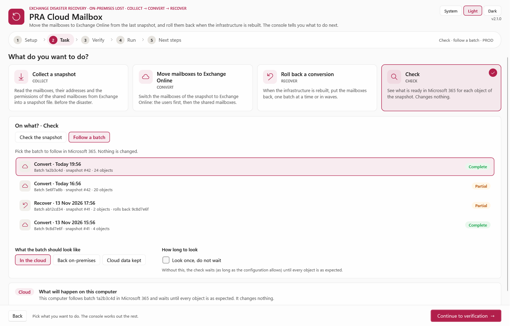

**On the command line.**

```powershell
pwsh -File .\Invoke-PraCloudMailbox.ps1 -Action Check -Batch 1a2b3c4d -Expect Provisioned
pwsh -File .\Invoke-PraCloudMailbox.ps1 -Action Check -Batch 1a2b3c4d -Expect Deprovisioned -Once
pwsh -File .\Invoke-PraCloudMailbox.ps1 -Action Check -Batch 1a2b3c4d -Expect Retained -Once
```

| `-Expect` | In the console | What the tool verifies |
|---|---|---|
| `Provisioned` | **In the cloud** | The default after a Convert. A user has a cloud mailbox with its plan. A shared mailbox is a shared mailbox, tagged, with its permissions. |
| `Deprovisioned` | **Back on-premises** | The default after a Recover. The object is a MailUser with the on-premises GUID, synchronised from Active Directory again. |
| `Retained` | **Cloud data kept** | The cloud data is protected: a case hold on a user, an inactive mailbox for a shared mailbox. |

Without `-Once`, the check **waits**, with the waiting times of the settings, until every object is as expected or the time is over. With `-Once`, it looks one time. If an object is not as expected, the exit code is 1 and the next steps say what to do.

The check follows **every object of the batch**. This includes the ones that Convert never started, for example for lack of a free licence unit. They are listed as *not converted: Convert never started this object, nothing was changed on it*. The tool never says that every object is provisioned while the batch is **not complete**: it ends with exit code 1 and tells you to continue the batch first.

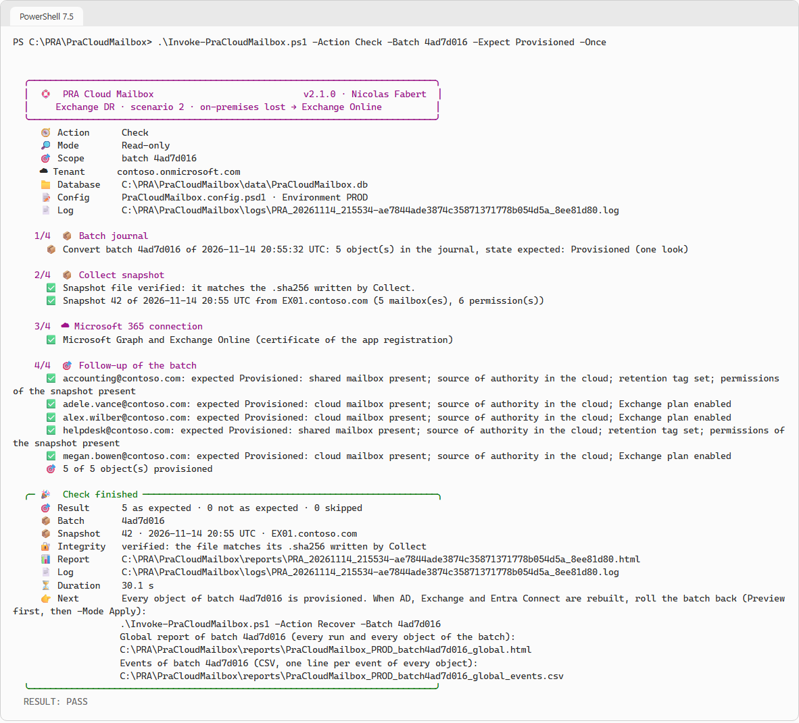

### The reports

Every run writes a log, a transcript, a CSV and an HTML **report**. The report is a web page. It works without Internet in Edge or Chrome. It is the **proof** of what was done.

| File | Content |
|---|---|
| `reports\PRA_<date>_<run>.html` | the report: result, numbers, next step, one row per object |
| `reports\PRA_<date>_<run>.csv` | the same rows, for Excel |
| `reports\PraCloudMailbox_<environment>_batch<id>_global.html` | the **global report** of a batch |
| `reports\PraCloudMailbox_<environment>_batch<id>_global.csv` | the same objects, one line each, for Excel |
| `reports\PraCloudMailbox_<environment>_batch<id>_global_events.csv` | every step of every object, one line each, for Excel |
| `logs\PRA_<date>_<run>.log` | every step with its time. The last line is `RESULT: PASS`, `RESULT: PENDING` (exit code 2), `RESULT: FAIL` or `RESULT: CANCELLED` (you answered no to the confirmation: nothing was written). |
| `logs\PRA_<date>_<run>.transcript.txt` | the PowerShell transcript |

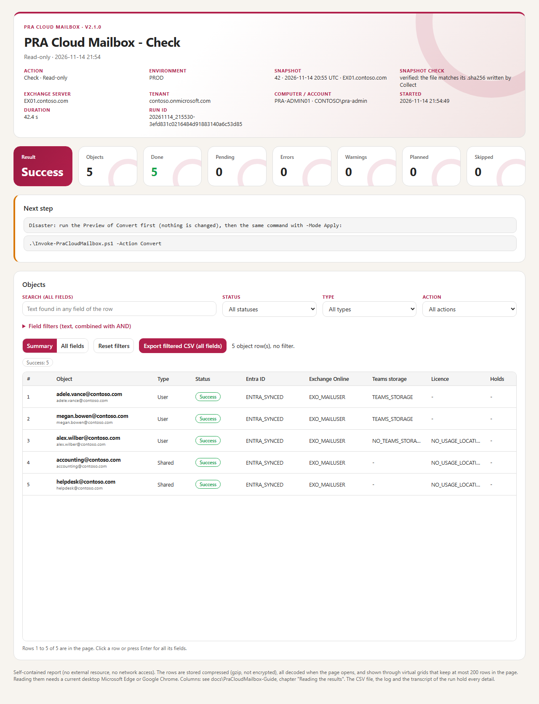

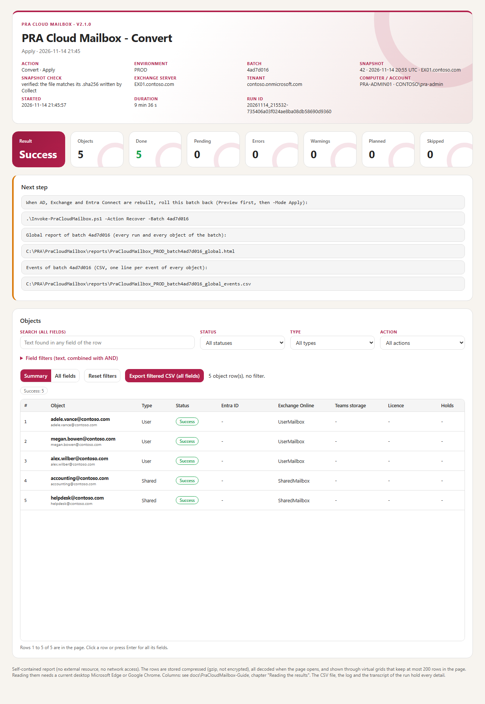

| Part | What it tells you |
|---|---|
| **Result** | **Success** is good. **Pending** means "a part remains". **Failed** means "stopped". |
| **The numbers** | How many objects: done, waiting, wrong, warnings, skipped. |
| **Next step** | The one thing to do now. |
| **The list** | One row per object. Use the search box to find one. |
| **Skipped members** | The members of a group that were not taken, each with its reason. |
| **Run settings changed** | The settings of this run that differ from the file. |

A **warning** is an orange word. It means "done, but read this".

#### The global report

A batch has **one global report**. It follows the batch from end to end: every Convert run, every resume, every follow-up, every Recover wave. Each object has its **journey**: every step, in time order. The tool writes it at the end of every Convert, Recover and `Check -Batch`, and puts its path in the **Next steps**. The **Open global report** button opens it.

The global report has **no limit**. Every object and every step is in it, however many there are. The top of the page is plain text: the totals, the batches and the runs. You can read it even when scripts are blocked. The list of objects below it needs Edge or Chrome. Click an object to read its whole journey. The journey comes in pages of 100 steps. The two CSV files hold the same data for Excel: one line per object, and one line per step.

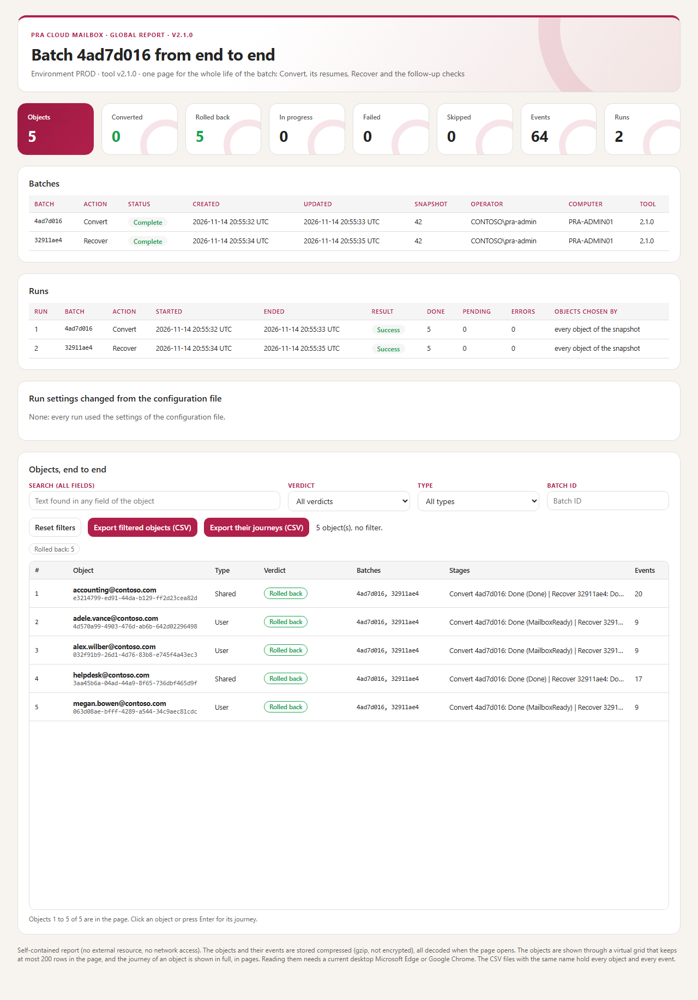

### Exit codes

| Code | Meaning |
|---|---|
| `0` | done |
| `1` | failed, or (Check) an object is not ready, or you answered no to the confirmation (nothing was written) |
| `2` | done, next step required: an object is *Pending*, run the same command again later |

<!-- icon: lifebuoy -->
## 7. When something goes wrong

Find what you **see** in the left column. The middle column says what it **means**. The right column says what to **do**. If you are not sure, **stop and ask**. The messages are the real ones of the tool. A `…` stands for a name or a number that changes.

### A run that stops

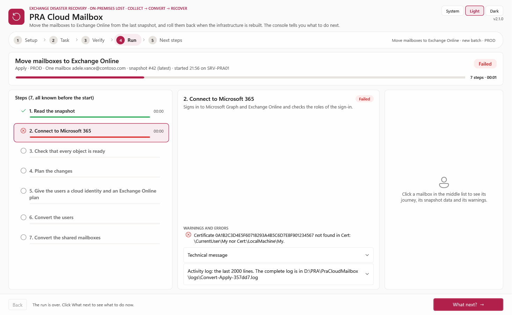

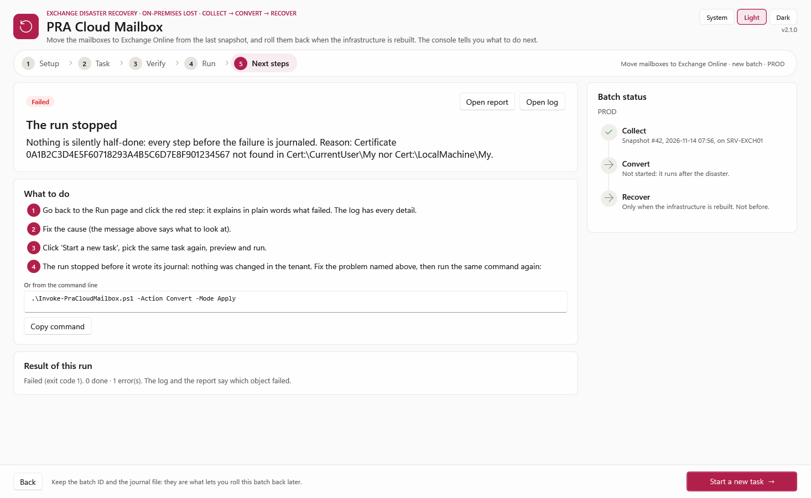

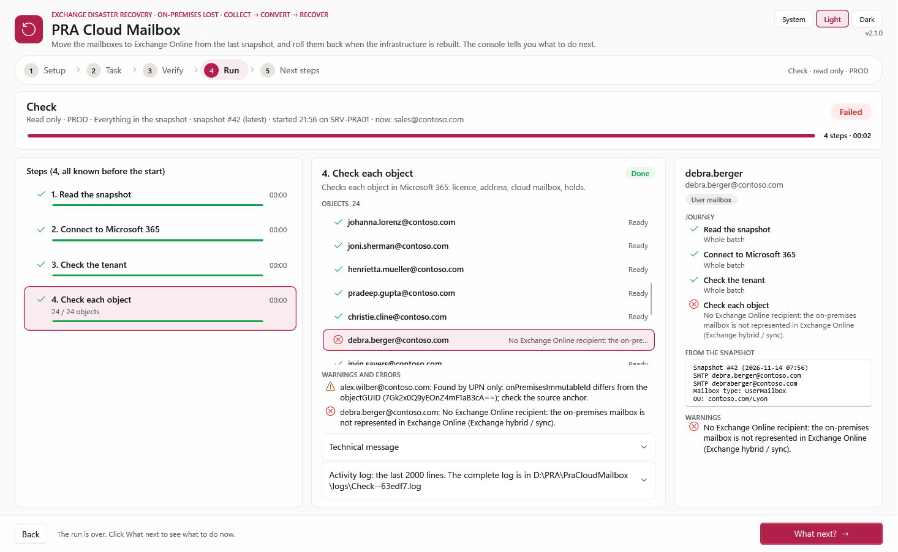

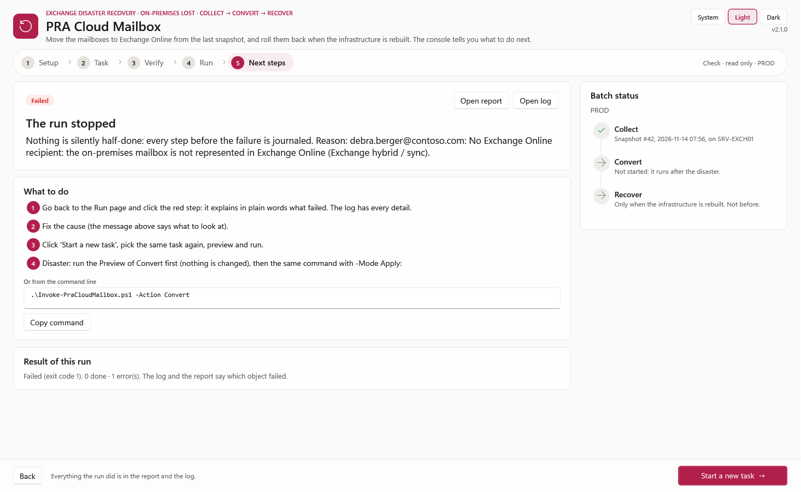

| I see this | It means | Do this |
|---|---|---|
| *-Action is missing: nothing was done.* | You gave no `-Action`. The tool never waits for an answer. | Add `-Action Collect`, `Check`, `Convert` or `Recover`. |
| *PRA Cloud Mailbox runs in PowerShell 7.5 or later (pwsh.exe)* | You used Windows PowerShell 5.1, which is not supported. | Open **PowerShell 7** and run the same command. |
| *The cloud part cannot run on this computer.* with *the tool needs version … or later* | A cloud module is old or missing. **Nothing was changed.** | Run the `Install-Module` command written in the message. Then run again. |
| *Certificate … not found in Cert:\CurrentUser\My nor Cert:\LocalMachine\My.* | The certificate of the app is not on this computer. **Nothing was changed.** | Import the certificate with its private key. Or ask for an interactive sign-in. |
| *Cloud.SignIn = Interactive needs a window where you can sign in* | The sign-in is interactive, but PowerShell was started without a window to answer. | Open PowerShell 7 normally and run again. Or use the certificate. |
| *Tenant prerequisites not met (see above): nothing was changed.* | A permission, a licence group or a free unit is missing. | Run **Check**. Read the lines in red. Ask your administrator. |
| *No complete snapshot in …: run Collect -Mode Apply* | The snapshot file is not on this computer. | Copy `PraCloudMailbox.db` and its `.sha256` file here. |
| *… was changed after its last Collect* … *Nothing was changed.* | The snapshot file does not match its `.sha256` file. | **Restore the file from your external backup.** Use `-AcceptUnverifiedSnapshot` only if you know why and accept it. |
| *… so the tool cannot prove it is the file written by Collect* | The snapshot has no `.sha256` file. A Preview and a Check only warn. A **Convert or a Recover in Apply mode stops**, and nothing is changed. | Copy the `.sha256` file with the snapshot. If you know the file is the right one, add `-AcceptUnverifiedSnapshot`. |
| *Batch … was made from snapshot …, which is not in …* or *… is not the snapshot that batch … was made from* | The snapshot of the batch was deleted or replaced. **Nothing was changed.** | Copy the file of that snapshot from `data\backup` over `data\PraCloudMailbox.db`, with its `.sha256` file. Run the command again. |
| *Collect found no mailbox …* or *… fewer than the last complete snapshot …* | Collect refused to replace the good snapshot with one that lost its mailboxes. | Find out why Exchange returned fewer mailboxes. Ask your administrator before you raise `Collect.MaxDropPercent`. |
| *The Entra ID account with this UPN is probably not this person …* (**ENTRA_WRONG_OBJECT**) | The account was found by sign-in name only, and its mailbox is not the one of the snapshot. **Nothing was changed on it.** | Ask your administrator to fix the account or the sign-in name in Entra ID, or leave the object out. |
| *Convert batch … cannot be resumed: Recover batch … already rolled back objects of it* | A rollback already touched this batch. | Do not continue it. Start a new Convert for the objects that are not converted. |
| *Convert batch … gave the Exchange plan of its users with Licensing.Users.Mode = …* | The licence mode in the settings file is not the one of the batch. **Nothing was changed.** | Put the mode of the batch back in the settings file. Run Recover again. |
| *The run is refused: the task, the objects or the settings changed since the preview* (console) | A file of the run changed after the preview. | Press **Preview** again. |
| `RESULT: FAIL` after Ctrl+C or a closed window | The run was interrupted before its end. The batch is **partial**. | Run the command given in the Next steps. What was finished is kept. |
| *Choose one way to say which objects:* | You gave two of `-Identity`, `-CsvPath`, `-SearchBase`, `-Group`. | Give one. |
| *… is not in …. Nothing was changed.* | An object you named is not in the snapshot or the batch. | Check the name. Letter case does not matter. |
| *… is already converted by Convert batch …: nothing was changed.* | You asked for an object that an earlier batch converted. | Do not convert it twice. Continue that batch with the command in the Next steps. |
| *Convert batch … was already rolled back by Recover batch …* | The batch is already rolled back. | Nothing to do. Use **Check** to see the state of the objects. |
| *Group … is not in snapshot … nor in Microsoft Entra.* | No group has this name. | Check the name, or ask for the group to be added to `Collect.TargetGroups`. |
| *This sign-in cannot read groups in Microsoft Entra ID* | The app or the account has no permission to read groups. | Ask your administrator for `GroupMember.Read.All`, or use a group that Collect kept. |
| *Cancelled by the operator: nothing was changed.* | You answered no to the confirmation. | Run the command again and answer yes. |
| *The run stopped before it wrote its journal: nothing was changed in the tenant.* | The run failed before it changed anything. | Fix the problem named above. Run the same command again. |
| *Cannot open the remote session to Exchange on …* | Collect cannot reach the Exchange server. | Check that the computer is domain-joined, the account may use Exchange PowerShell, and the server answers. |

### Part of the work remains

| I see this | It means | Do this |
|---|---|---|
| **Part of the conversion remains** or *Some objects or lists are not finished. Fix what is named above, then resume them (nothing is converted twice):* | Some objects are not finished. It is **not** an error. | Run the command given after the message. It continues the batch. |
| **Part of the rollback remains** or *Some objects are not back yet. Fix what is named above, then resume them (nothing is rolled back twice):* | Some objects are not back yet. | Run the command given after the message. |
| *no cloud mailbox yet after …: run Convert -Batch … again later* | Exchange Online is still creating the mailbox. | Wait a few minutes. Run the same command with `-Batch`. |
| *not synchronised from AD yet: run Entra Connect, then Recover -Batch again* | Entra Connect has not yet sent the object back. | Run a synchronisation on Entra Connect. Then run again. |
| *Entra Connect did not recreate it … run a full synchronisation on the Entra Connect server* | The tool tried a synchronisation of the object alone and it did not come back. | Run the command of the Next steps on the Entra Connect server and wait for it to end. Then run the Recover command of the Next steps again. |
| *back on-premises; case hold not stamped yet* | The user is back. The hold is still being applied. | Run Recover again later to check it. The hold is never removed from an object that is back. |
| *other hold(s) on the cloud mailbox block the rollback* | Another hold on the user's cloud mailbox stops the switch back. | Remove that hold. Run Recover again. |

### Stop after the current object

The button **Stop after the current object** ends a run cleanly. The result is **Pending**. Nothing is half-done. Continue with the same command.

### The snapshot says Changed

A red light **Snapshot** or the message *… was changed after its last Collect* means: the file is not the one Collect wrote. **Do not go on.** Restore the file and its `.sha256` file from your external backup. If you have no backup, you must decide: ask the owner of the tool. Using `-AcceptUnverifiedSnapshot` is your decision, and it is written in the banner, the log, the summary and the report.

### Module messages

The tool checks the cloud modules before any change. Each message gives the versions found, the minimum, and the **exact `Install-Module` command**. One module per command. If another version of Microsoft Graph is already loaded in the window, close every PowerShell window and start again in a new one.

<!-- icon: book -->
## 8. Picture dictionary

Each page of the console, one by one. The picture shows the page. The table names its parts.

### Setup


| Part | What it is |
|---|---|
| **Environment**, **This computer can run**, **This computer** | The environment name, what this computer can do, its name and the account signed in. |
| **Prerequisites** | The lights. **Check again** looks at them again. |
| **This run** | What applies to this run. **Change…** opens the settings for this run only. |
| **Config** | The settings file. **Open** opens it. **Reload** reads it again. |
| **Choose a task →** | Goes to the Task page. It is grey while a light blocks the way. |

### Task


| Part | What it is |
|---|---|
| **Collect a snapshot** | Reads Exchange into a snapshot. Before the disaster. |
| **Move mailboxes to Exchange Online** | Convert. The users first, then the shared mailboxes. |
| **Roll back a conversion** | Recover. One batch at a time, or in waves. |
| **Check** | Reads Microsoft 365. Changes nothing. |
| **Start a new batch**, **Continue a batch** | A new move, or the rest of a move that stopped. |
| **Which objects?** | One mailbox, everything, an OU, a group, a CSV file. |
| **What will happen on this computer** | A pink pill (**Collect** or **Cloud**) and a sentence. |
| **Continue to verification →** | Goes to the Verify page. |

A card is **grey** when this computer cannot run the task. A pill says why.

### Verify


| Part | What it is |
|---|---|
| The title and the chips | How many objects, how many blocking, how many warnings. |
| **Objects**, **Users**, **Shared**, **With warnings** | Filters of the list. |
| The list | Each object, with its state. Click one to read the detail. |
| **What will happen, in order** | The steps of the run. |
| **Settings used** | The settings of this run. **Change settings** goes back. |
| The box to type the word | **CONVERT**, **RECOVER** or **COLLECT**. Any letter case. |
| **Preview** | Runs the preview. The red button stays grey until you did it. |

### Run


| Part | What it is |
|---|---|
| **Steps** | The steps of the run, each with its time. Click one to see its detail. |
| The middle list | The objects of the step, one by one. |
| The card of an object | Its name, its **journey**, its data from the snapshot, its **warnings**. |
| **Warnings and errors** | Everything to read, in one list. |
| **Technical message**, **Activity log** | For your administrator. |
| **Stop after the current object** | Ends the run cleanly. |

### Next steps


| Part | What it is |
|---|---|
| The title after a move | **The conversion is complete** or **Part of the conversion remains**. |
| The title after a rollback | **The rollback is complete** or **Part of the rollback remains**. |
| The title after Collect or Check | **The snapshot is written**, **The check is finished** or **The check found objects that are not ready**. |
| The title after a failure | **The run stopped**. The text gives the reason. |
| **BATCH ID** and **Copy batch ID** | The key of the batch. Write it down. |
| **How to do it** | The numbered steps. |
| **Or from the command line** and **Copy command** | The exact command, with your options. |
| **Open report**, **Open global report**, **Open log** | The files of the run. |
| **Batch status** | Collect, Convert, Recover: where the batch stands. |
| **Start a new task →** | Goes back to the Task page. |

### The theme

The buttons **System**, **Light** and **Dark** at the top right change the colours. **System** follows Windows.

<!-- icon: book -->
## 9. Glossary

| Word | What it means |
|---|---|
| **Snapshot** | The file written by Collect: the mailboxes, their GUIDs and addresses, the permissions of the shared mailboxes. After the disaster it is the **only copy**. |
| **`.sha256` file** | A small text file beside the snapshot. It holds the checksum of the snapshot. The tool compares it before it reads the snapshot. |
| **Journal** | The file `data\PraCloudMailbox-journal.db`. It records every change of Convert and Recover. It is the only input of the rollback. |
| **Batch** | One move of many objects, with its journal. It has a short **batch ID**, like `1a2b3c4d`. |
| **Wave** | A part of a batch or of the objects: one group, one OU, one list, or the first N objects. |
| **Convert** | The task that gives each object a mailbox in Exchange Online. The card says **Move mailboxes to Exchange Online**. |
| **Recover** | The task that goes back. The card says **Roll back a conversion**. |
| **Check** | A read-only look at Microsoft 365. With a batch, it follows the batch. |
| **Preview** | A trial. It shows what would happen. It changes **nothing**. |
| **Apply** | The real run. It changes things. The tool asks you to confirm first. |
| **Case hold** | A protection of the eDiscovery case. It keeps the cloud mail of the users and of the shared mailboxes. |
| **Inactive mailbox** | A shared mailbox kept in the cloud, under the hold, after its identity is deleted. Its content is kept. |
| **Cloud admin server** | A Windows machine of your company that reaches Microsoft 365 and does **not** depend on your Active Directory. It is **not** a server in the cloud. |
| **Run-only settings** | The settings you change in the console for one run. The file is never written. |
| **Temporary licence** | The licence a shared mailbox borrows while it converts. It is given back after each wave. |
| **KeepFree** | The units of the licence that Convert never uses. |
| **Entra Connect** | The bridge from Active Directory to the cloud. After the disaster it is rebuilt. |
| **Certificate** | A digital key that lets the app sign in with nobody present. It has an end date. |
| **OU** | A folder inside Active Directory. |
| **CSV** | A list in a simple file that Excel can open. |
| **Exit code** | The number a run returns: 0 done, 1 failed, 2 done with a next step. |
